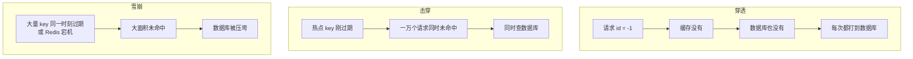
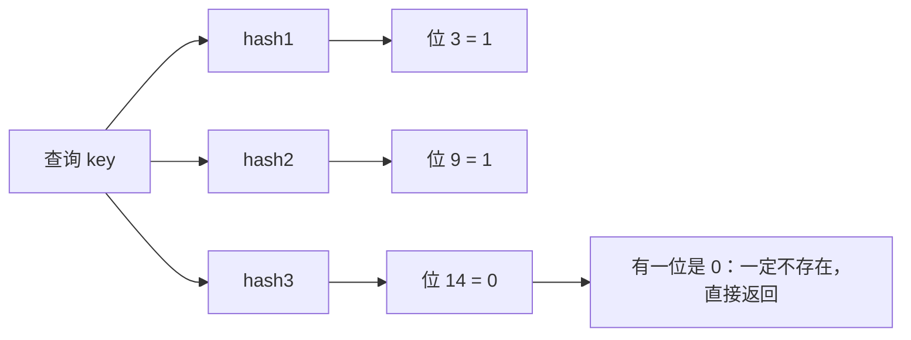

# 缓存穿透、击穿、雪崩

> 频率：★★★ · 近两年出现在：字节（含布隆过滤器专问）、美团、腾讯、阿里、SHEIN、招银等 · 参考：[小林coding](https://xiaolincoding.com/redis/cluster/cache_problem.html)

## 一句话答案

- **穿透**：查**不存在**的数据，缓存和数据库都没有，请求全打到数据库。用布隆过滤器或缓存空值。
- **击穿**：**一个热点 key** 过期的瞬间，大量请求同时回源。用互斥锁（singleflight）或逻辑过期。
- **雪崩**：**大量 key 同时过期**，或者 Redis 宕机。用随机过期时间、多级缓存、熔断限流、高可用集群。

## 图解

## 展开（1–2 分钟能讲完）

| 问题 | 原因 | 解决办法 |
|---|---|---|
| 穿透 | 恶意请求或业务 bug 查不存在的数据 | ① **缓存空值**，设较短的过期时间；② **布隆过滤器**挡在缓存前面，判断「一定不存在」就直接返回；③ 参数校验（id 不能为负数） |
| 击穿 | 热点 key 过期 | ① **互斥锁**：只有拿到锁的请求去查库并重建缓存，其他请求等待或重试（Go 的 singleflight 也是这个思路）；② **逻辑过期**：缓存不设 TTL，value 里存过期时间，发现过期就异步重建，期间先返回旧值；③ 热点数据永不过期 |
| 雪崩 | 同时过期 / Redis 宕机 | ① 过期时间加**随机偏移**；② Redis 主从 + 哨兵或 Cluster 保证高可用；③ 本地缓存 + Redis **多级缓存**；④ **熔断、降级、限流**保护数据库；⑤ 提前预热 |

**布隆过滤器的原理**：一个很长的位数组 + k 个哈希函数。加入元素时把 k 个位置置 1；查询时 k 个位置都是 1 才「可能存在」，有一个是 0 就「一定不存在」。所以它**有误判（把不存在说成存在），但不会漏判**。

## 追问链

- **布隆过滤器的误判率由什么决定？** 位数组长度 m、元素个数 n、哈希函数个数 k。m 越大误判越低；k 的最优值约为 (m/n)·ln2。Guava 和 Redisson 都可以直接指定预期元素数和误判率。
- **布隆过滤器能删除元素吗？** 不能，一个位可能被多个元素共用。要删除用**计数布隆过滤器**（每个位换成计数器），或者定期重建。
- **新增数据时布隆过滤器怎么同步？** 写数据库的同时写布隆过滤器；如果先写库再写过滤器失败，会把存在的数据误判为不存在，所以要重试或定期全量重建。
- **互斥锁方案里，没拿到锁的请求怎么办？** 短暂休眠后重试读缓存，或者直接返回旧值 / 默认值。注意锁要有过期时间，防止重建失败导致一直拿不到。
- **缓存空值有什么问题？** 恶意请求用大量不同的不存在 key，会把缓存塞满空值。所以空值的过期时间要短，并配合布隆过滤器和限流。

## 我的项目里

TODO：项目里有没有做缓存预热、随机过期时间、空值缓存？热点数据是什么？
