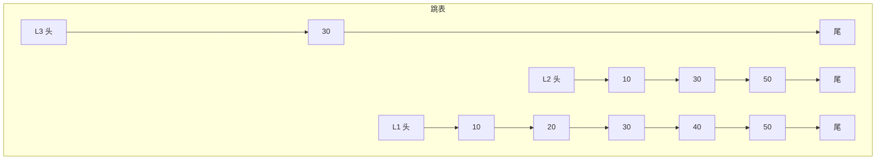

# 数据类型与底层结构（跳表、listpack）

> 频率：★★★ · 近两年出现在：字节（ZSet 跳表、Stream）、腾讯（数据类型与跳表）、美团（ZSet、Bitmap）、阿里（跳表）、腾讯云智（Redis 底层结构）等 · 参考：[小林coding](https://xiaolincoding.com/redis/data_struct/command.html)

## 一句话答案

五种基本类型：String（SDS）、List（quicklist）、Hash（listpack / 哈希表）、Set（整数集合 / 哈希表）、ZSet（listpack / 跳表 + 哈希表）。另有 Bitmap、HyperLogLog、Geo、Stream。

## 展开（1–2 分钟能讲完）

每种类型都是「元素少时用紧凑结构省内存，元素多了换成查找快的结构」。以下是 Redis 7 的情况：

| 类型 | 小数据时 | 大数据时 | 典型场景 |
|---|---|---|---|
| String | int / embstr（≤ 44 字节） | raw（SDS） | 缓存对象、计数器、分布式锁 |
| List | quicklist（由多个 listpack 组成的双向链表） | 同左 | 消息队列（简单场景）、最新列表 |
| Hash | listpack（≤ 128 个字段且每个值 ≤ 64 字节） | 哈希表 | 对象的多个字段、购物车 |
| Set | intset（全是整数且 ≤ 512 个）或 listpack | 哈希表 | 共同好友、去重、抽奖 |
| ZSet | listpack（≤ 128 个且每个 ≤ 64 字节） | 跳表 + 哈希表 | 排行榜、延迟队列 |

阈值都可以配置（如 `hash-max-listpack-entries`）。7.0 之前紧凑结构叫 ziplist，7.0 起换成 listpack，解决了 ziplist 的「连锁更新」问题。

**特殊类型**：Bitmap（签到、在线状态，1 亿用户约 12 MB）、HyperLogLog（UV 统计，12 KB 估算上亿基数，误差约 0.81%）、Geo（附近的人）、Stream（带消费组的消息队列）。

## 图解

**ZSet 为什么同时用跳表和哈希表？** 哈希表按成员 O(1) 查分数（`ZSCORE`）；跳表按分数有序，支持 O(log n) 的插入和范围查询（`ZRANGE`）。

查找 40：从最高层开始，能往右就往右，超过目标就下降一层。每个结点的层数随机决定（每层以 1/4 的概率继续升高，最多 32 层），平均查找 O(log n)。

## 追问链

- **ZSet 为什么用跳表不用红黑树？**
  - 范围查询简单：找到起点后沿最底层链表往后走就行。红黑树要中序遍历。
  - 实现简单，好调试。
  - 改变层数概率就能平衡内存和速度。
- **SDS 比 C 字符串好在哪？**
  - 记录了长度，`STRLEN` 是 O(1)。
  - 二进制安全，可以存 `\0`。
  - 预分配空间，追加时减少内存重分配。
  - 不会缓冲区溢出。
- **哈希表扩容会卡住 Redis 吗？** 不会，用的是**渐进式 rehash**：同时保留新旧两张表，每次增删改查顺带迁移一个桶，空闲时也会迁移一部分。
- **排行榜、点赞、签到分别用什么？** 排行榜用 ZSet；点赞用 Set（谁点了）加 String 计数；签到用 Bitmap；UV 用 HyperLogLog。同分怎么排见[排行榜设计](../11-distributed/leaderboard)。
- **List 能当消息队列吗？** 简单场景可以（`LPUSH` + `BRPOP`），但没有确认机制，消费者拿走后宕机消息就丢了。要可靠就用 Stream（有消费组和 ACK），或者正经的 MQ。

## 我的项目里

TODO：项目里用了哪些 Redis 类型？为什么选它？
