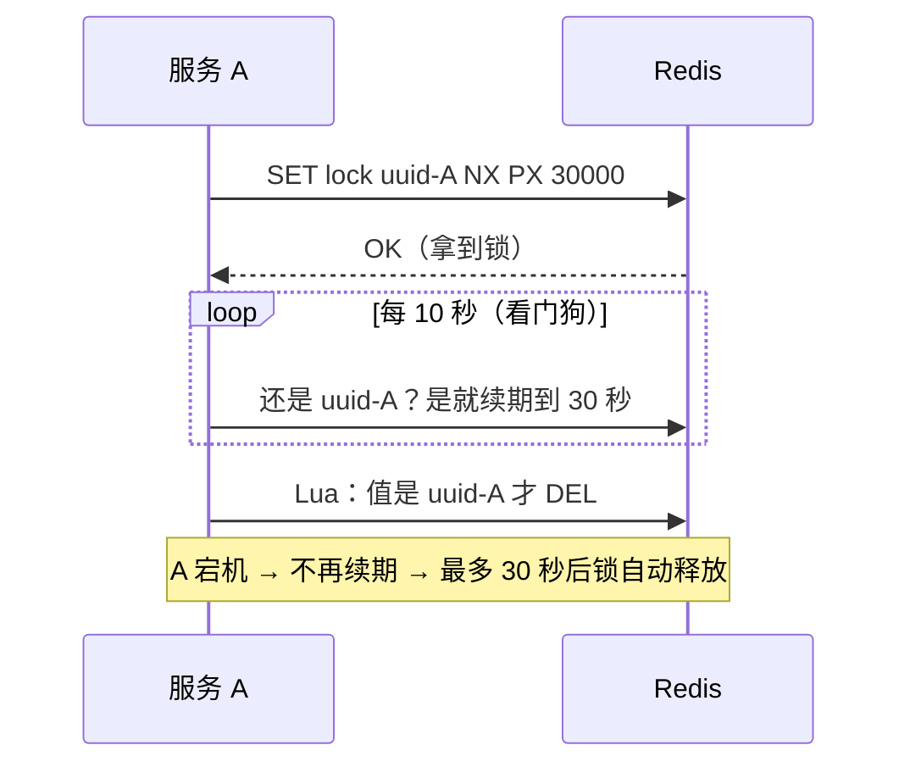

# 分布式锁：SETNX、Lua、Redisson 看门狗、RedLock

> 频率：★★★ · 近两年出现在：字节（含 RedLock 专问）、美团、腾讯、阿里、小米、顺丰、快手、浩鲸等 · 参考：[小林coding](https://xiaolincoding.com/redis/base/redis_interview.html)、[JavaGuide](https://javaguide.cn/distributed-system/distributed-lock-implementations.html)

## 一句话答案

加锁用 `SET key 唯一值 NX PX 过期时间`（一条命令，原子）；解锁用 Lua 脚本**先比较值再删除**，防止删掉别人的锁。Redisson 的看门狗每 10 秒给锁续期。主从切换时锁可能丢失，RedLock 向多数独立节点加锁来缓解，但仍有争议。

## 展开（1–2 分钟能讲完）

单机的 `synchronized` 和 `ReentrantLock` 只能锁住一个 JVM 里的线程，多台机器同时扣库存时，就需要一把所有机器都能看到的锁。

一把合格的分布式锁要满足四点，Redis 的做法一一对应：

| 要求 | 做法 | 不这样做的后果 |
|---|---|---|
| 互斥 | `SET ... NX`：key 不存在才能设置成功 | — |
| 不死锁 | 同一条命令里带过期时间 `PX 30000` | 持锁的机器宕机，锁永远不释放。分两条命令（SETNX + EXPIRE）也不行，中间宕机一样死锁 |
| 只能自己解锁 | value 存唯一值（UUID + 线程 id），解锁时比较 | A 的锁过期后被 B 拿到，A 执行完把 B 的锁删了 |
| 解锁原子 | 用 Lua 脚本把「比较 + 删除」合成一步 | 比较完、删除前锁刚好过期并被别人拿走，又删错了 |

```lua
-- 解锁：值相等才删除
if redis.call("get", KEYS[1]) == ARGV[1] then
    return redis.call("del", KEYS[1])
else
    return 0
end
```

## 图解

**锁过期了业务还没执行完怎么办？** Redisson 的看门狗：不指定过期时间时，默认锁 30 秒，后台每 10 秒（过期时间的 1/3）检查一次，线程还持有锁就续到 30 秒。持锁的机器宕机后，看门狗也跟着停止，锁最多 30 秒后自动释放。



**主从切换时锁丢失**：


RedLock 的做法：向 N 个（通常 5 个）**互相独立**的 Redis 主节点依次加锁，超过半数成功且总耗时小于锁的有效期，才算加锁成功。争议在于它依赖各节点的时钟基本同步，而且遇到长时间 GC 停顿时仍然可能有两个客户端同时持锁（Martin Kleppmann 的批评）。要求绝对正确时，可以加 **fencing token**（每次加锁拿到递增的版本号，存储端拒绝旧版本的写入），或者改用 ZooKeeper、etcd。

## 追问链

- **可重入怎么实现？** Redisson 用 Hash 结构存锁：field 是「UUID:线程 id」，value 是重入次数。加锁时同一线程计数加一，解锁时减一，减到 0 才删除。
- **为什么不能只用 SETNX？** SETNX 本身不能带过期时间，再单独 EXPIRE 不是原子操作。
- **拿不到锁怎么办？** 直接返回失败（适合防重复提交），或者自旋重试 / 订阅锁释放的消息再重试（Redisson 用发布订阅，避免空转）。
- **和 ZooKeeper 锁比？** ZooKeeper 用临时顺序结点：客户端断开时结点自动删除，不需要过期时间；每个客户端只监听前一个结点，没有惊群。它是 CP 系统，更可靠，但性能比 Redis 低。
- **用了分布式锁还会超卖吗？** 锁的粒度、过期时间设置不当都可能出问题。库存扣减通常还要在数据库层用 `where stock > 0` 或乐观锁兜底，见[秒杀系统](../11-distributed/seckill)。

## 我的项目里

TODO：项目里有没有用分布式锁？锁的是什么资源？过期时间怎么定的？
