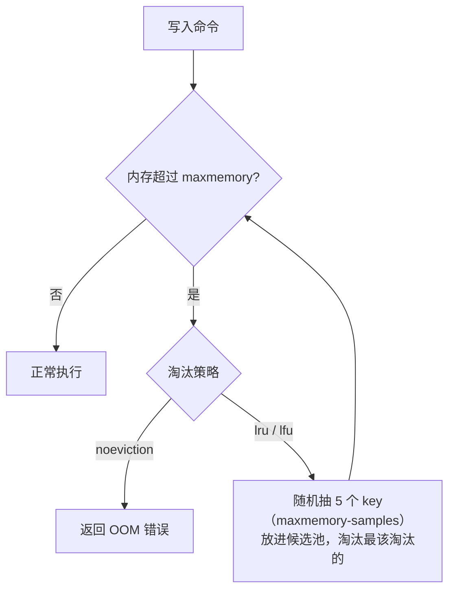

# 过期删除与内存淘汰

> 频率：★★★ · 近两年出现在：字节（淘汰与持久化）、快手（过期删除）、去哪儿、浩鲸、超聚变、美团（LFU、过期淘汰）等 · 参考：[小林coding](https://xiaolincoding.com/redis/module/strategy.html)

## 一句话答案

过期删除：惰性删除（访问时检查）+ 定期删除（每秒多次抽样检查）。内存满了按 `maxmemory-policy` 淘汰，常用 `allkeys-lru`；Redis 的 LRU 是随机抽样的近似算法，4.0 起还有 LFU。

## 展开（1–2 分钟能讲完）

这是两件不同的事：**过期删除**处理设置了 TTL 且已经到期的 key；**内存淘汰**是内存达到 `maxmemory` 时，按策略删掉一些 key（哪怕没过期）。

**过期删除 = 惰性 + 定期**

- **惰性删除**：访问 key 时检查是否过期，过期就删除并返回空。省 CPU，但没人访问的过期 key 会一直占内存。
- **定期删除**：默认每秒 10 次（`hz 10`），每次随机抽 20 个带过期时间的 key，删掉过期的；如果过期比例超过 25% 就再抽一轮，每次最多执行 25 毫秒。
- 两者结合，在 CPU 和内存之间取平衡。仍然漏掉的过期 key，最后靠内存淘汰兜底。

**内存淘汰的 8 种策略**

| 范围 | 策略 |
|---|---|
| 不淘汰 | `noeviction`（默认）：写入直接报错 |
| 所有 key | `allkeys-lru`、`allkeys-lfu`、`allkeys-random` |
| 只在设置了过期时间的 key 里 | `volatile-lru`、`volatile-lfu`、`volatile-random`、`volatile-ttl`（剩余时间最短的先删） |

纯缓存场景一般选 `allkeys-lru`；访问频率差异明显时选 `allkeys-lfu`。

## 图解

**近似 LRU**：每个 key 只记录最后访问时间（24 位），淘汰时随机抽样 5 个，放进一个大小为 16 的候选池，淘汰池里最久没访问的。不维护全局链表，省内存；抽样数调到 10 时已经很接近真正的 LRU。

**LFU**：同样用这 24 位，高 16 位存上次衰减的时间（分钟），低 8 位存一个**对数增长**的访问计数（访问越多越难再加一），并且计数会随时间衰减，避免过去的热点一直占着。

## 追问链

- **LRU 和 LFU 的区别？** LRU 看「最近有没有用」，一次全量扫描就可能把真正的热点挤掉；LFU 看「用得多不多」，更能保住长期热点。
- **Redis 的 LRU 和手写 LRU 有什么区别？** 手写的是哈希表 + 双向链表的精确 LRU，见[算法库 146](https://github.com/bingqin2/algo-notes/blob/main/docs/13-design/lc146.md)。Redis 用抽样近似，省掉了每个 key 两个指针的内存。
- **主从下过期 key 怎么处理？** 从节点不会主动删除过期 key，由主节点删除后同步一条 `DEL` 给从节点。3.2 起从节点读到过期 key 时会返回空，不会返回过期数据。
- **为什么大量 key 同时过期会导致卡顿？** 定期删除时过期比例一直超过 25%，会连续循环直到 25 毫秒上限，主线程被占用。所以过期时间要加随机值，见[缓存雪崩](./cache-problems)。

## 我的项目里

TODO：项目里 `maxmemory-policy` 设的是什么？为什么？
