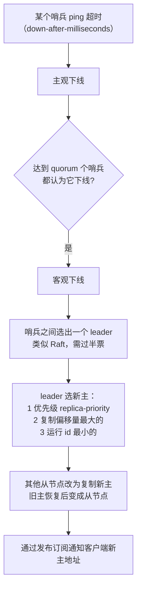
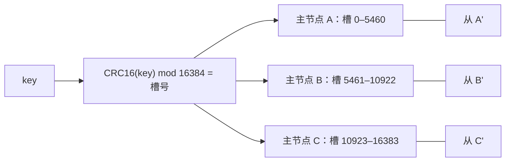

# 高可用：主从复制、哨兵、Cluster

> 频率：★★★ · 近两年出现在：字节（Redis 主从复制、Cluster）、腾讯（Cluster 故障转移、心跳误判）、腾讯音乐（主从切换）、美团（一主多从）、阿里、顺丰（哨兵）、百度（Redis 高可用）等 · 参考：[小林coding](https://xiaolincoding.com/redis/cluster/master_slave_replication.html)

## 一句话答案

主从复制：首次全量（RDB）+ 之后增量（复制积压缓冲区）。哨兵监控主节点，主观下线 → 客观下线 → 选新主 → 通知客户端。Cluster 把数据分到 16384 个哈希槽，多主多从，客户端遇到 MOVED 重定向。

## 展开（1–2 分钟能讲完）

三者是递进关系：

| 方案 | 解决什么 | 还缺什么 |
|---|---|---|
| 主从复制 | 数据有备份，读可以分摊到从节点 | 主节点挂了要人工切换 |
| 哨兵 | 自动故障转移 | 写入和容量仍受单个主节点限制 |
| Cluster | 数据分片，写和容量都能水平扩展；自带故障转移 | 跨槽的多 key 操作受限 |

**主从复制**

1. 从节点发 `PSYNC 复制 id 偏移量`。第一次连接时复制 id 不认识，主节点回 `FULLRESYNC`。
2. **全量同步**：主节点 `BGSAVE` 生成 RDB 发给从节点，期间的新写命令先存进复制缓冲区，RDB 发完再发这些命令。
3. **命令传播**：之后主节点每执行一条写命令，就异步发给从节点。
4. **断线重连后增量同步**：主节点有一个环形的**复制积压缓冲区**（`repl-backlog-size`，默认 1 MB）。从节点的偏移量还在缓冲区范围内就只补差的部分，否则重新全量同步。

**哨兵**：多个哨兵（至少 3 个）互相通信，定期 ping 主节点。

## 图解

**Cluster 的分片**：

客户端缓存「槽 → 节点」的映射。请求发错节点时，节点回 `MOVED 槽号 正确地址`，客户端更新映射后重发；槽正在迁移时回 `ASK`，只临时重定向这一次。

## 追问链

- **为什么是 16384 个槽？** 节点之间用 gossip 交换心跳，消息里带着一个表示「我负责哪些槽」的位图：16384 位是 2 KB，65536 位就要 8 KB，太大。而且 Redis 作者建议集群不超过 1000 个主节点，16384 个槽够用。
- **脑裂怎么处理？** 网络分区时旧主还在接收写入，新主选出后旧主降级，这期间写入的数据会丢。配置 `min-replicas-to-write 1` 和 `min-replicas-max-lag 10`：旧主连不上足够的从节点时就拒绝写入，减少丢失。
- **主从复制是异步的，会丢数据吗？** 会。主节点写完就返回，还没同步到从节点时宕机，这部分数据就丢了。这也是[分布式锁](./distributed-lock)在主从切换时可能失效的原因。可以用 `WAIT` 命令等待指定数量的从节点确认，但会变慢。
- **Cluster 不支持哪些操作？** 涉及多个 key 的命令（`MGET`、事务、Lua）要求 key 在同一个槽。可以用 hash tag：`{user:1}:cart` 和 `{user:1}:order` 只按花括号里的部分计算槽。
- **心跳误判怎么办？** 一个节点 ping 超时只算主观下线，要多数节点（Cluster 里是多数主节点）都认为它下线才会故障转移。超时时间不能设太短，否则网络抖动就会触发切换。
- **从节点能保证读到最新数据吗？** 不能，有复制延迟。要求强一致的读要走主节点。

## 我的项目里

TODO：项目里 Redis 是单机、哨兵还是 Cluster？有没有遇到过主从切换？
