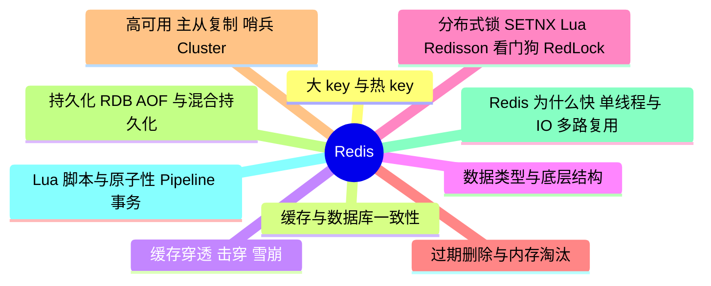

# Redis

> 进度：3 / 10 条已写完。本页由 `tools/gen_index.py` 生成，改条目后重新运行即可。

## 知识地图

## 条目（按频率排序）

频率按 2025–2026 年后端面经里出现的次数估计：★★★ 几乎每场都可能问，★★ 经常问，★ 偶尔问。

| 知识点 | 频率 | 状态 | 一句话答案 |
|---|---|---|---|
| [大 key 与热 key](./big-hot-key) | ★★★ | · | 大 key（单个 value 过大或集合元素过多）会导致阻塞、网络拥塞、迁移慢，用 --bigkeys 或 memory usage 发现，拆分后用 unlink 异步删除。热 key 访问集中在一个分片，用本地缓存、key 加随机后缀分散、读写分离。 |
| [缓存与数据库一致性](./cache-consistency) | ★★★ | ✅ | 常用方案是 Cache Aside：读时先读缓存，没有再读库并写回缓存；写时先更新数据库，再删除缓存。删除失败用消息队列重试，或订阅 binlog（Canal）异步删除；要求更强时用延迟双删。 |
| [缓存穿透、击穿、雪崩](./cache-problems) | ★★★ | ✅ | 穿透：查不存在的数据，请求全打到数据库，用布隆过滤器或缓存空值。击穿：热点 key 过期瞬间大量请求回源，用互斥锁（singleflight）或逻辑过期。雪崩：大量 key 同时过期或 Redis 宕机，用随机过期时间、多级缓存、熔断限流、高可用集群。 |
| [数据类型与底层结构（跳表、listpack）](./data-structures) | ★★★ | · | 五种基本类型：String（SDS）、List（quicklist）、Hash（listpack / 哈希表）、Set（整数集合 / 哈希表）、ZSet（listpack / 跳表 + 哈希表）。另有 Bitmap、HyperLogLog、Geo、Stream。 |
| [分布式锁：SETNX、Lua、Redisson 看门狗、RedLock](./distributed-lock) | ★★★ | ✅ | 加锁用 SET key 唯一值 NX PX 过期时间（原子）；解锁用 Lua 脚本先比较值再删除，防止删掉别人的锁。Redisson 的看门狗每 10 秒给锁续期。主从切换时锁可能丢失，RedLock 向多数独立节点加锁来缓解，但仍有争议。 |
| [过期删除与内存淘汰](./expiration-eviction) | ★★★ | · | 过期删除：惰性删除（访问时检查）+ 定期删除（每秒抽样检查）。内存满了按 maxmemory-policy 淘汰，常用 allkeys-lru；LRU 是近似算法（随机抽样），4.0 起还有 LFU。 |
| [高可用：主从复制、哨兵、Cluster](./ha-cluster) | ★★★ | · | 主从复制：首次全量（RDB）+ 之后增量（复制积压缓冲区）。哨兵监控主节点，主观下线 → 客观下线 → 选新主 → 通知客户端。Cluster 把数据分到 16384 个哈希槽，多主多从，客户端遇到 MOVED 重定向。 |
| [持久化：RDB、AOF 与混合持久化](./persistence) | ★★★ | · | RDB 定时 fork 子进程生成快照，恢复快但可能丢最近的数据；AOF 记录每条写命令，appendfsync everysec 最多丢 1 秒，文件大要重写；4.0 起混合持久化：AOF 重写时前半部分写 RDB 格式。 |
| [Redis 为什么快：单线程与 IO 多路复用](./why-fast) | ★★★ | · | 数据在内存里；核心命令执行是单线程，没有锁和上下文切换开销；用 epoll 做 IO 多路复用，一个线程处理大量连接；数据结构针对场景优化。Redis 6.0 起网络读写可以多线程，命令执行仍是单线程。 |
| [Lua 脚本与原子性、Pipeline、事务](./lua-atomic) | ★★☆ | · | Lua 脚本在 Redis 里整段执行，期间不会插入其他命令，可以把「判断 + 修改」做成原子操作（扣库存、限流、解锁）。Pipeline 只是批量发送减少网络往返，不保证原子；MULTI 事务不支持回滚。 |
