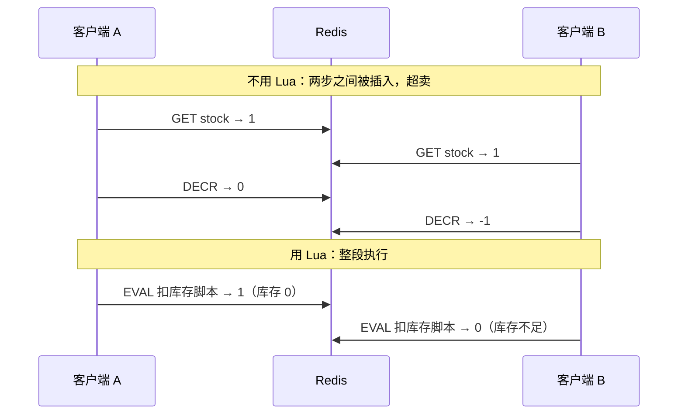

# Lua 脚本与原子性、Pipeline、事务

> 频率：★★ · 近两年出现在：字节（Lua 原子性、秒杀 Lua、Redis Lua 锁）、腾讯（Redis Lua、Redis + Lua 限流）、美团（Lua 并发）等 · 参考：[JavaGuide](https://javaguide.cn/database/redis/redis-questions-02.html)

## 一句话答案

Lua 脚本在 Redis 里整段执行，期间不会插入其他命令，可以把「判断 + 修改」做成原子操作（扣库存、限流、解锁）。Pipeline 只是批量发送以减少网络往返，不保证原子；MULTI 事务不支持回滚。

## 展开（1–2 分钟能讲完）

单条 Redis 命令本来就是原子的。问题出在**多条命令之间**：先 `GET stock` 判断大于 0，再 `DECR stock`，两步之间别的客户端也可能读到同一个库存，造成超卖。

三种把多条命令放在一起的方式：

| | Lua 脚本 | MULTI / EXEC 事务 | Pipeline |
|---|---|---|---|
| 原子执行（中间不插入别的命令） | ✅ | ✅ | ❌ |
| 能根据中间结果做判断 | ✅ | ❌（命令先排队，EXEC 时才执行） | ❌ |
| 出错能回滚 | ❌ | ❌ | ❌ |
| 主要用途 | 判断 + 修改的原子操作 | 一组命令一起执行，配合 WATCH 做乐观锁 | 减少网络往返，提高吞吐 |

**扣库存的 Lua 脚本**：

```lua
-- KEYS[1] = 库存 key，ARGV[1] = 购买数量
local stock = tonumber(redis.call('GET', KEYS[1]) or '0')
if stock < tonumber(ARGV[1]) then
    return 0          -- 库存不足
end
redis.call('DECRBY', KEYS[1], ARGV[1])
return 1
```

用 `EVAL` 执行；为了减少传输，可以先 `SCRIPT LOAD` 拿到 SHA，之后用 `EVALSHA` 执行。

## 图解



## 追问链

- **Lua 脚本出错会回滚吗？** 不会。脚本执行到一半报错，前面已经执行的写命令不会撤销。所以脚本里要先做完所有检查，再写入。
- **脚本执行太久会怎样？** 它会阻塞所有其他客户端。超过 `busy-reply-threshold`（旧版叫 `lua-time-limit`，默认 5 秒）后，其他客户端会收到 BUSY 错误。脚本还没写入时可以 `SCRIPT KILL`；已经写入了就只能 `SHUTDOWN NOSAVE`。所以脚本里不要有循环大量 key 的操作。
- **MULTI 事务的错误处理？** 命令语法错误（入队时就能发现）会导致整个事务不执行；运行时错误（比如对 String 用了 `LPUSH`）只有那一条失败，其他照常执行。
- **WATCH 是怎么做乐观锁的？** `WATCH key` 之后，如果这个 key 在 `EXEC` 之前被别人修改了，`EXEC` 返回空，事务不执行，客户端重试。
- **Cluster 下用 Lua 有什么限制？** 脚本里所有 key 必须在同一个槽，可以用 hash tag `{}`，见[高可用](./ha-cluster)。
- **Redis 7 的 Functions 是什么？** 把 Lua 函数作为库注册到 Redis 里，会被持久化和复制，不用每个客户端自己管理脚本。

## 我的项目里

TODO：项目里有没有用 Lua 脚本？做的是什么原子操作？
