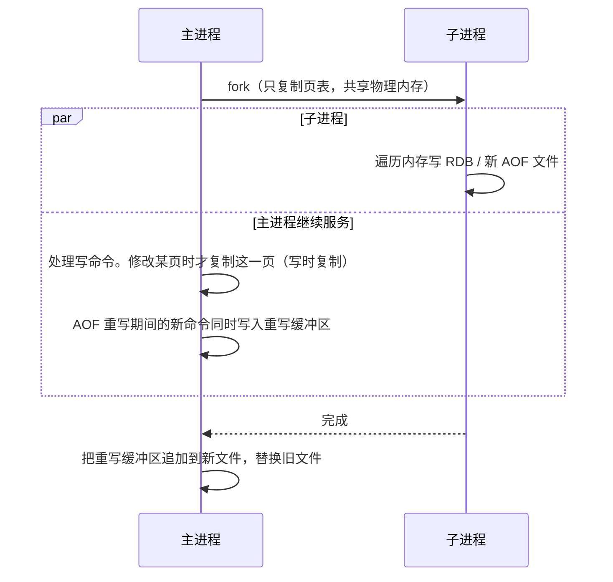

# 持久化：RDB、AOF 与混合持久化

> 频率：★★★ · 近两年出现在：字节（Redis 持久化、集群持久化）、腾讯音乐（持久化与集群）、潍柴（异常停机不丢数据）、快手等 · 参考：[小林coding](https://xiaolincoding.com/redis/storage/aof.html)

## 一句话答案

RDB 定时 fork 子进程生成快照，恢复快但可能丢最近的数据；AOF 记录每条写命令，`appendfsync everysec` 最多丢 1 秒，文件大了要重写；4.0 起支持混合持久化：AOF 重写时前半部分写成 RDB 格式。

## 展开（1–2 分钟能讲完）

| | RDB | AOF |
|---|---|---|
| 记录什么 | 某一时刻的内存快照（二进制） | 每条写命令（文本协议） |
| 怎么触发 | `save` 配置的条件（如 3600 秒内至少 1 次修改），或手动 `BGSAVE` | 每条写命令追加到缓冲区，按 `appendfsync` 刷盘 |
| 丢多少数据 | 上次快照之后的全部修改 | `always`：几乎不丢但慢；`everysec`（默认）：最多丢 1 秒；`no`：交给操作系统 |
| 文件大小 | 小，压缩过 | 大，需要定期重写 |
| 恢复速度 | 快，直接加载 | 慢，要重放命令 |

**混合持久化**（`aof-use-rdb-preamble yes`，5.0 起默认开启）：AOF 重写时，先把当前内存以 RDB 格式写在文件开头，之后的增量命令以 AOF 格式追加。恢复时先加载 RDB 部分，再重放少量命令，兼顾速度和完整性。

生产环境一般是**两个都开**：AOF（混合）保证数据尽量不丢，RDB 用来做定期备份。

## 图解

**BGSAVE 和 AOF 重写都依赖 fork + 写时复制：**

Redis 7 起 AOF 拆成多个文件：一个基础文件加若干增量文件，由清单文件管理，重写时不用再维护重写缓冲区。

## 追问链

- **fork 会阻塞吗？** fork 本身要复制页表，内存越大越慢（每 GB 大约十几毫秒），这段时间主线程是阻塞的。所以单实例内存不要太大（一般建议不超过 10 GB 左右）。
- **写时复制有什么风险？** 快照期间写入很多时，大量页被复制，内存可能接近翻倍。要预留内存，并关闭透明大页（THP），否则每次复制 2 MB 的大页。
- **异常停机怎么尽量不丢数据？** 开 AOF + `everysec`，最多丢 1 秒；再加主从复制。要求一条都不丢的数据，不应该只存在 Redis 里。
- **AOF 文件损坏怎么办？** 用 `redis-check-aof --fix` 修复，它会截掉末尾不完整的命令。
- **AOF 为什么是先执行命令再写日志？** 不用在写日志前检查语法，也不会阻塞当前命令；代价是执行完、写日志前宕机会丢这一条。

## 我的项目里

TODO：项目里 Redis 开了哪种持久化？数据丢了能从哪里恢复？
