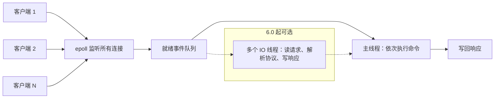

# Redis 为什么快：单线程与 IO 多路复用

> 频率：★★★ · 近两年出现在：字节（Redis 单线程与集群）、顺丰（Redis 为什么快）、美团、思格等 · 参考：[小林coding](https://xiaolincoding.com/redis/base/redis_interview.html)

## 一句话答案

数据在内存里；核心命令执行是单线程，没有锁和上下文切换开销；用 epoll 做 IO 多路复用，一个线程处理大量连接；数据结构针对场景优化。Redis 6.0 起网络读写可以多线程，命令执行仍是单线程。

## 展开（1–2 分钟能讲完）

单机 Redis 能到每秒 10 万级的读写，原因有四个：

1. **纯内存操作**：瓶颈不在 CPU，而在内存和网络。
2. **单线程执行命令**：不需要加锁，没有线程切换和竞争，每条命令天然原子。
3. **IO 多路复用**：一个线程通过 epoll 同时监听成千上万个连接，哪个连接有数据就处理哪个，不会因为某个连接阻塞而停下来。
4. **高效的数据结构**：SDS、listpack、跳表、渐进式 rehash 的哈希表，都针对速度和内存做了优化。

「单线程」要说准确：**执行命令的主线程是单线程**。Redis 还有后台线程处理关闭文件、AOF 刷盘、异步释放内存（`UNLINK`、`lazyfree`）。6.0 起可以开启 `io-threads`，让多个线程并行做网络读写和协议解析，但命令仍然由主线程依次执行。

## 图解

## 追问链

- **为什么不用多线程执行命令？** 瓶颈主要在网络和内存，多线程带来的锁开销和复杂度不划算；单线程还让事务、Lua 脚本的原子性变得简单。
- **6.0 为什么引入多线程？** 网络 IO 在高并发下成了瓶颈（读写 socket、解析协议），用多线程分担这部分，命令执行仍然串行，所以不影响原子性。
- **单线程怎么利用多核？** 一台机器上部署多个实例，或者用 Cluster 分片。
- **什么操作会阻塞 Redis？** `KEYS *`、对大集合做 `HGETALL`/`SMEMBERS`、用 `DEL` 删除大 key、AOF 设成 `always` 刷盘、fork 大内存实例生成 RDB。解决办法分别是 `SCAN`、分批读取、`UNLINK`、`everysec`、控制实例内存大小。见[大 key 与热 key](./big-hot-key)。
- **epoll 为什么比 select 快？** 见[IO 多路复用](../10-os/io-multiplexing)。

## 我的项目里

TODO：项目里 Redis 的 QPS 大概多少？有没有遇到过慢命令？
