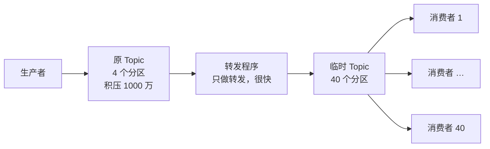

# 消息堆积

> 频率：★★☆ · 近两年出现在：字节（Kafka 可靠性、offset、Rebalance、消息积压）、阿里（Kafka 投递与幂等、重复消费、并发消费丢消息、Kafka 与延迟队列）、美团（消息不丢、消息去重、死信、RabbitMQ 选型） · 参考：[JavaGuide](https://javaguide.cn/high-performance/message-queue/message-queue.html)

## 一句话答案

先判断原因：是生产突增，还是消费变慢（下游接口慢、DB 慢、消费者挂了、某条消息一直重试卡住）。应急：先**扩容消费者**，但消费者数超过分区数没用，所以要么增加分区，要么临时写一个程序把积压的消息**转发到一个分区更多的新 Topic**，再用大量消费者处理；同时可以降级非核心逻辑。长期：消费端批量处理、异步化、优化慢 SQL，监控消费延迟（lag）并告警。

## 展开（1–2 分钟能讲完）

**排查顺序**：

1. 看 lag 是所有分区都在涨，还是个别分区涨：个别分区说明分区键**热点**或者那个消费者实例有问题。
2. 看消费者日志：有没有大量异常、重试；消费者是否在频繁 Rebalance（Rebalance 期间整个组停止消费）。
3. 看消费逻辑的耗时：依赖的 DB、Redis、外部接口有没有变慢。

**提速手段**：

- 扩容消费者实例（≤ 分区数）。
- 消费者内部**多线程处理**：拉取线程把消息分发给线程池，注意 offset 要在处理完成后再提交，否则会丢消息；需要顺序的按 key 哈希到固定线程（见[顺序消息](./ordering)）。
- **批量**：一次拉多条（`max.poll.records`），批量写 DB。
- 把失败的消息转到**重试 Topic / 死信队列**，不要在原地无限重试堵住后面的消息。
- 降级：暂时跳过非核心的处理（比如统计），只保留主流程，事后补。

**临时扩分区的做法**：Kafka 分区只能加不能减，而且加分区后 key 的映射会变（顺序可能被打乱）。更稳妥的应急是：写一个转发程序，消费原 Topic，原样写入一个有 10 倍分区的临时 Topic，然后部署 10 倍的消费者去消费临时 Topic。

## 图解

## 追问链

- **死信队列？** 消息重试多次仍然失败，就放进死信队列，不再阻塞正常消息，之后人工或定时任务处理。RabbitMQ 原生支持：消息被拒绝且不重新入队、TTL 过期、队列满了，都会进入配置的死信交换机（DLX）。RocketMQ 默认重试 16 次后进入 `%DLQ%消费组名`。Kafka 没有内置，要自己实现：失败后发到 `xxx-retry` / `xxx-dlq` Topic（Spring Kafka 的 `DeadLetterPublishingRecoverer`）。
- **延迟队列怎么实现？**
  - RabbitMQ：消息 TTL + 死信队列（消息在一个没有消费者的队列里过期后进入死信队列被消费）；注意队列里前面的消息没过期时后面的也出不去，要么每种延迟时间一个队列，要么用延迟插件 `rabbitmq_delayed_message_exchange`。
  - RocketMQ：4.x 有 18 个固定的延迟级别（1s 到 2h）；5.x 支持任意时间的定时消息（时间轮实现）。
  - Kafka：不支持，可以按延迟级别建多个 Topic，由一个服务拉取后检查时间，到期再投递。
  - 不用 MQ：Redis ZSet（score 是到期时间，定时 `ZRANGEBYSCORE` 取到期的）、Redisson 的 `RDelayedQueue`、时间轮、DB 定时扫表。
  - 典型场景：订单 30 分钟未支付自动取消。
- **消息过期丢失了怎么补？** RabbitMQ 设了 TTL 的消息积压过期会被丢弃（没配死信时）。补救：从生产端的记录（业务表、消息发送记录表）里查出这段时间应该发的消息，重新发送；所以重要消息发送前要先落库（[本地消息表](../11-distributed/distributed-transaction)），消费端要做好[幂等](./idempotency)，重发才安全。Kafka 的消息按保留时间（默认 7 天）删除，积压超过保留时间也会丢，要监控 lag。
- **怎么提前发现积压？** 监控每个消费组的 lag（Kafka 的 `kafka-consumer-groups.sh --describe`、Burrow、Prometheus 的 kafka-exporter），lag 持续增长就告警；同时监控消费耗时和失败率。

## 我的项目里

TODO：项目的 MQ 有没有积压过？lag 有监控吗？消费失败的消息去了哪里？
