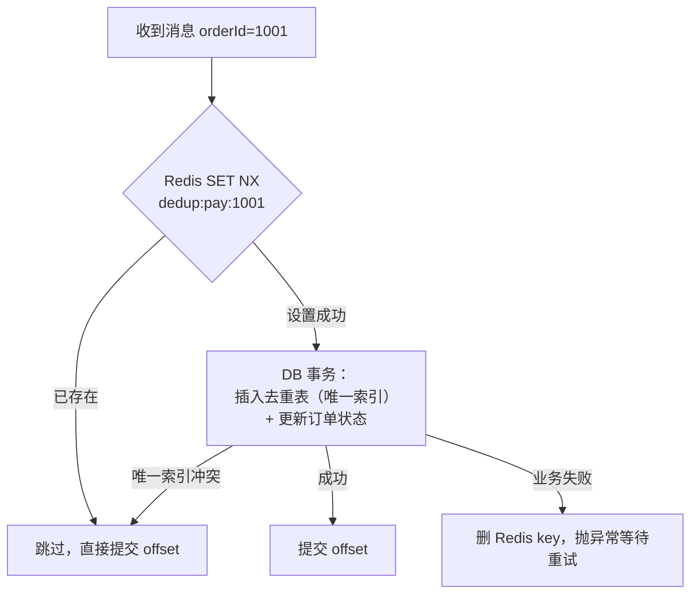

# 重复消费与幂等

> 频率：★★★ · 近两年出现在：字节（恰好一次、幂等消费、充值幂等）、阿里（Kafka 投递与幂等、重复消费、并发消费丢消息、Kafka 与延迟队列）、腾讯（Kafka 投递与重复消费、至少一次语义）、美团（消息不丢、消息去重、死信、RabbitMQ 选型） · 参考：[JavaGuide](https://javaguide.cn/high-performance/message-queue/message-queue.html)

## 一句话答案

MQ 一般只保证**至少一次**投递：生产者超时重发、消费者处理完还没提交 offset 就挂了、Rebalance，都会导致同一条消息被消费多次。所以消费端必须**幂等**：用业务唯一键（订单号）或消息 id 去重——数据库唯一索引、Redis `SET NX`、去重表，或者让操作本身天然幂等（状态机条件更新、`UPDATE ... SET status = 'PAID' WHERE id = ? AND status = 'UNPAID'`）。

## 展开（1–2 分钟能讲完）

**为什么会重复**：

- 生产端：发送后没收到 ack（网络超时），重试，实际上 Broker 已经存了。
- 消费端：处理成功了，提交 offset 之前进程崩溃或者发生 Rebalance，新的消费者从上次提交的位置重新消费。

**幂等的几种做法**（按可靠性从高到低）：

| 做法 | 说明 |
|---|---|
| 数据库唯一索引 | 插入去重表或业务表（订单号唯一），重复插入报 `DuplicateKeyException` 就跳过。和业务写在**同一个事务**里最可靠 |
| 状态机 + 条件更新 | `UPDATE order SET status='PAID' WHERE id=? AND status='UNPAID'`，影响行数为 0 说明已经处理过 |
| 乐观锁 | 带版本号更新 |
| Redis `SET key NX EX` | 快，但 Redis 和 DB 不在一个事务里：设了 key、业务失败了，要删 key；业务成功、设 key 前崩溃了，又会重复。适合作为第一层快速过滤 |

**去重的 key 用什么**：优先用**业务唯一标识**（订单号 + 操作类型），而不是 MQ 的消息 id：因为生产者重发时可能生成新的消息 id。

## 图解

## 追问链

- **Kafka 生产者幂等和事务？** `enable.idempotence=true`（3.0 起默认开启）：每个生产者有一个 PID，每条消息带分区内递增的序列号，Broker 对同一个 PID + 分区发现序列号重复就丢弃。只能保证**单个生产者会话、单个分区**内不重复。**事务**（`transactional.id`）能保证跨分区的多条消息原子写入，并且在「消费 → 处理 → 生产」场景里把消费的 offset 提交也放进同一个事务，配合消费者 `isolation.level=read_committed`，实现 Kafka 内部的 exactly-once。但只要处理过程有外部副作用（写 DB、调接口），还是要靠业务幂等。
- **支付回调重复怎么处理？** 支付平台会多次回调（没收到成功响应就重试），必须幂等：以支付平台的交易号或我方订单号为键；先查订单状态，已支付就直接返回成功；更新用条件更新 `WHERE status = 'UNPAID'`；同时校验金额和签名。处理成功后要按支付平台要求返回成功标识，否则它会一直重试。
- **去重记录保存多久？** 至少覆盖可能重复的时间窗口：MQ 的最大重试时间、支付平台的回调重试周期（通常几十个小时）。Redis 的去重 key 设一个比这个长的过期时间（比如 3 天）；数据库去重表可以长期保存或按月归档清理。业务表的唯一索引本身就是永久的。
- **至少一次、至多一次、恰好一次？** 见[消息不丢失](./reliability)。工程上的「恰好一次」= 至少一次投递 + 消费端幂等。

## 我的项目里

TODO：项目里消费端是怎么做幂等的？用的是什么作为去重键？
