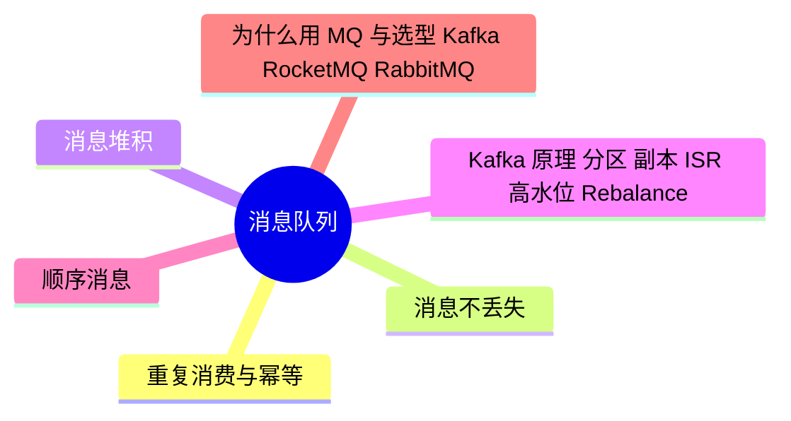

# 消息队列

> 进度：0 / 6 条已写完。本页由 `tools/gen_index.py` 生成，改条目后重新运行即可。

## 知识地图

## 条目（按频率排序）

频率按 2025–2026 年后端面经里出现的次数估计：★★★ 几乎每场都可能问，★★ 经常问，★ 偶尔问。

| 知识点 | 频率 | 状态 | 一句话答案 |
|---|---|---|---|
| [重复消费与幂等](./idempotency) | ★★★ | · | MQ 只保证至少一次，重复不可避免，所以消费端要幂等：唯一业务 id + 数据库唯一索引、去重表、Redis SETNX 记录已处理、状态机（只允许从特定状态流转）。 |
| [消息不丢失](./reliability) | ★★★ | · | 三个环节都要保证：生产端用同步发送 + 确认（Kafka acks=all）+ 失败重试；Broker 端多副本（min.insync.replicas ≥ 2）+ 刷盘；消费端业务处理完再手动提交 offset。 |
| [消息堆积](./backlog) | ★★☆ | · | 先扩容消费者（不能超过分区数），或者临时把消息转发到更多分区的新 topic 再加机器消费；同时排查消费慢的原因（下游慢、单条处理耗时）。 |
| [Kafka 原理：分区、副本、ISR、高水位、Rebalance](./kafka-internals) | ★★☆ | · | Topic 分为多个分区，每个分区有 leader 和 follower 副本；和 leader 保持同步的副本集合叫 ISR；高水位（HW）是所有 ISR 都确认的位置，消费者只能读到 HW 之前。消费者组成员变化会触发 Rebalance，期间停止消费。 |
| [顺序消息](./ordering) | ★★☆ | · | Kafka 只保证分区内有序：把需要有序的消息用同一个分区键（如订单 id）发到同一分区，消费端单线程或按 key 分发到内存队列处理。 |
| [为什么用 MQ 与选型：Kafka、RocketMQ、RabbitMQ](./selection) | ★★☆ | · | 作用是异步、解耦、削峰。Kafka 吞吐量最高，适合日志和大数据；RocketMQ 功能全（事务消息、延迟消息），适合业务；RabbitMQ 延迟低、路由灵活（交换机类型），吞吐量较低。 |
