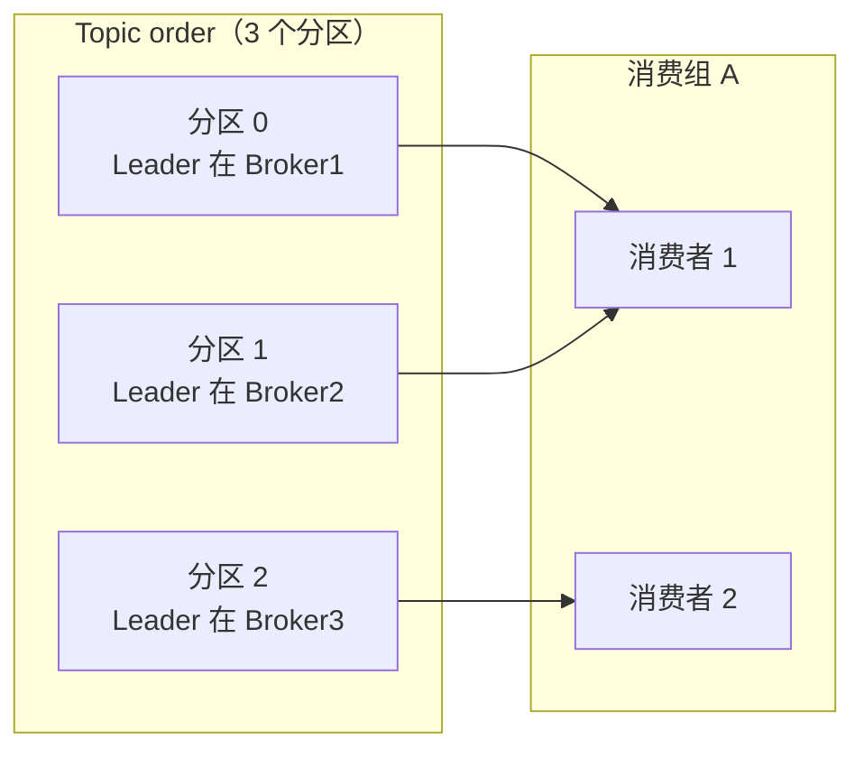

# Kafka 原理：分区、副本、ISR、高水位、Rebalance

> 频率：★★☆ · 近两年出现在：字节（Kafka 可靠性、offset、Rebalance、消息积压） · 参考：[JavaGuide](https://javaguide.cn/high-performance/message-queue/kafka-questions-01.html)

## 一句话答案

Topic 分成多个**分区**（Partition），分区是并行和顺序的单位，每个分区是一个只追加的日志；每个分区有多个**副本**，一个 Leader 负责读写，Follower 从 Leader 拉取同步。和 Leader 保持同步的副本集合叫 **ISR**。**高水位**（HW）是 ISR 里所有副本都已经同步到的位置，消费者只能读到 HW 之前的消息。**Rebalance** 是消费组里消费者增减或订阅变化时，重新分配分区给消费者的过程，期间整个组暂停消费。

## 展开（1–2 分钟能讲完）

**存储**：每个分区是一个目录，由多个 **segment** 组成（`.log` 数据文件 + `.index` 稀疏偏移量索引 + `.timeindex` 时间索引）。查找某个 offset：先二分找到 segment，再在稀疏索引里二分找到最近的位置，然后顺序扫描。过期数据按 segment 整个删除。

**副本同步**：

- Follower 主动向 Leader 拉取。
- 落后太多（超过 `replica.lag.time.max.ms`，默认 30 秒没跟上）就被踢出 ISR，追上了再加回来。
- **LEO**（Log End Offset）：每个副本下一条要写的位置。**HW** = ISR 中所有副本 LEO 的最小值。
- Leader 挂了，从 ISR 里选新 Leader（`unclean.leader.election.enable=false` 时不会选 ISR 之外的副本，保证不丢数据但可能暂时不可用）。

**消费组**：一个分区同一时间只能被组内一个消费者消费；一个消费者可以消费多个分区。所以**消费者数 > 分区数时，多出来的消费者是空闲的**。不同的消费组互不影响，各自从头到尾消费一遍（发布订阅）。

## 图解



```text
Leader:     [0 1 2 3 4 5 6 7]   LEO=8
Follower1:  [0 1 2 3 4 5]       LEO=6
Follower2:  [0 1 2 3 4 5 6]     LEO=7
                         ↑ HW=6，消费者只能读到 offset 5
```

## 追问链

- **Kafka 为什么快？**
  - **顺序写磁盘**：只追加，顺序写的速度接近内存随机写。
  - **页缓存**：读写都走操作系统的 Page Cache，刚写入的消息通常直接从内存读走；JVM 堆不存消息，没有 GC 压力。
  - **零拷贝**：消费时用 `sendfile` 把数据从页缓存直接发到网卡，不经过用户态（见[零拷贝](../10-os/zero-copy)）。
  - **批量 + 压缩**：生产者攒批发送（`batch.size`、`linger.ms`），整批压缩，Broker 原样存储，消费者解压。
  - **分区并行**：分区分布在多个 Broker 上，水平扩展。
- **怎么减少 Rebalance？** Rebalance 的触发原因：消费者加入或离开（包括被**误判**为离开）、分区数变化、订阅变化。误判最常见：
  - 心跳超时：`session.timeout.ms`（默认 45 秒）内没收到心跳。调大它，并让 `heartbeat.interval.ms` 约为它的 1/3。
  - 处理太慢：两次 `poll` 之间超过 `max.poll.interval.ms`（默认 5 分钟）就被认为挂了。减少 `max.poll.records` 或者加快处理。
  - 用**静态成员**（`group.instance.id`），滚动重启时不触发 Rebalance；用**增量协作式 Rebalance**（`CooperativeStickyAssignor`），只迁移需要变动的分区，其他分区不停止消费。
- **offset 存在哪？** 0.9 之前存在 ZooKeeper，之后存在 Kafka 内部的 `__consumer_offsets` Topic（50 个分区，按消费组哈希），用日志压缩只保留每个 key 最新的值。提交方式：自动提交（`enable.auto.commit`，每 5 秒，可能丢或重复）；手动同步 `commitSync` / 异步 `commitAsync`，一般在处理完一批后手动提交。
- **ZooKeeper 和 KRaft？** Kafka 早期靠 ZooKeeper 存元数据和选 Controller；2.8 引入 KRaft（Kafka 自己用 Raft 管理元数据），3.3 生产可用，4.0 起彻底移除 ZooKeeper。好处是少一个组件，支持的分区数更多，故障恢复更快。

## 我的项目里

TODO：项目里的 Topic 有几个分区、几个副本？消费者有几个实例？offset 是自动还是手动提交？
