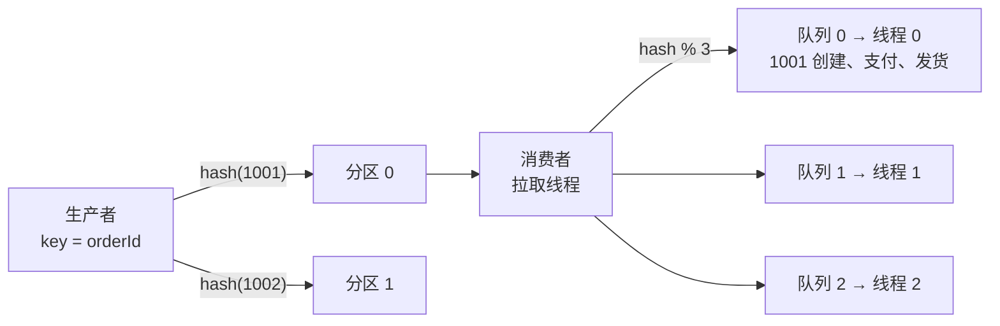

# 顺序消息

> 频率：★★☆ · 近两年出现在：美团（Kafka 顺序消费、分区键、MQ 乱序） · 参考：[JavaGuide](https://javaguide.cn/high-performance/message-queue/kafka-questions-01.html)

## 一句话答案

Kafka / RocketMQ 只保证**分区（队列）内有序**，不保证全局有序。需要顺序的消息（同一个订单的「创建 → 支付 → 发货」）要发到**同一个分区**：用订单号作为消息 key，按 key 哈希选分区。消费端一个分区只由一个消费者**单线程**顺序处理；需要多线程时，按 key 哈希分到固定的线程（内存队列），保证同一个 key 的消息由同一个线程处理。

## 展开（1–2 分钟能讲完）

**全局有序 vs 局部有序**：全局有序只能用 1 个分区 + 1 个消费者，没有并发，吞吐很低，几乎不用。业务上通常只需要**同一个实体的消息有序**（局部有序）。

**生产端会不会打乱顺序**：

- 同步发送一条一条发，最可靠。
- 异步发送 + 重试时：第 1 批失败重试，第 2 批先成功，就乱序了。Kafka 开启幂等（`enable.idempotence=true`）后，Broker 用序列号保证同一分区内顺序，可以保持 `max.in.flight.requests.per.connection ≤ 5`；不开幂等时要设为 1。
- 换分区：分区数变化后，同一个 key 会哈希到新分区，变化前后的消息可能乱序。

**消费端多线程的做法**：

```text
拉取线程 → 按 hash(orderId) % N 放进 N 个内存队列 → N 个工作线程各自顺序处理
```

注意 offset 的提交：要等这批消息都处理完再提交，否则崩溃后会丢消息。

## 图解



## 追问链

- **消费端多线程怎么保证顺序？** 上面的 key 哈希到固定线程的方法。RocketMQ 有现成的 `MessageListenerOrderly`：消费时锁住队列，单个队列串行消费。
- **重试会不会打乱顺序？** 会。一条消息消费失败，如果把它扔到重试队列、继续消费后面的，后面的就比它先处理了。顺序消费的场景下，失败时应该**原地重试**（阻塞这个分区或这个 key，RocketMQ 顺序消费失败会挂起当前队列一段时间后重试），重试多次仍失败再进死信并告警，同时要考虑是否跳过后续同 key 的消息。另一个思路是让消费端**容忍乱序**：消息里带版本号或状态，按状态机判断（已发货的订单收到「支付」消息直接忽略），或者用版本号丢弃旧消息。
- **binlog 同步的顺序问题？** 用 Canal / Debezium 把 MySQL binlog 发到 Kafka，同步到 ES 或缓存。同一行数据的变更必须有序，否则旧值会覆盖新值。做法：按**主键**（库名 + 表名 + 主键）做分区 key；消费端更新时比较 binlog 位点或更新时间，只用更新的数据覆盖旧的。Canal 默认只发到一个分区（保证全局有序但慢），可以配置按主键哈希分区。
- **分区数加了以后顺序怎么办？** 加分区的那一刻，同一个 key 可能前后在两个分区。可以选业务低峰期加分区，加之前暂停生产、等消费完；或者消费端用版本号兜底。

## 我的项目里

TODO：项目里有没有需要顺序处理的消息？分区 key 用的是什么？
