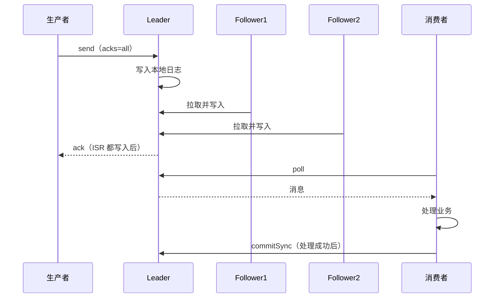

# 消息不丢失

> 频率：★★★ · 近两年出现在：字节（Kafka 可靠性、offset、Rebalance、消息积压）、阿里（Kafka 投递与幂等、重复消费、并发消费丢消息、Kafka 与延迟队列）、腾讯（Kafka 投递与重复消费、至少一次语义）、美团（消息不丢、消息去重、死信、RabbitMQ 选型） · 参考：[JavaGuide](https://javaguide.cn/high-performance/message-queue/kafka-questions-01.html)

## 一句话答案

分三段保证：**生产端**用同步发送或带回调的异步发送，失败重试，Kafka 设 `acks=all`；**Broker 端**多副本，`replication.factor ≥ 3`、`min.insync.replicas ≥ 2`、`unclean.leader.election.enable=false`；**消费端**关闭自动提交 offset，业务处理成功后再手动提交。代价是可能重复，所以消费端要[幂等](./idempotency)。

## 展开（1–2 分钟能讲完）

**每一段可能丢在哪、怎么防**：

| 环节 | 怎么丢 | 怎么防 |
|---|---|---|
| 生产者 → Broker | 发送失败没处理（`send()` 是异步的，不看回调就不知道失败）；`acks=0/1` 时 Leader 收到后还没同步就挂了 | 回调里处理失败、`retries` 调大；`acks=all`；重要消息先落库（本地消息表），发送失败可以补发 |
| Broker 存储 | 写入页缓存还没刷盘就宕机；Leader 挂了，选了一个没同步完的副本当 Leader | 多副本（不依赖单机刷盘）；`min.insync.replicas=2` 保证至少写到 2 个副本才算成功；禁止 unclean 选举 |
| Broker → 消费者 | 自动提交 offset：消息拉到了、offset 提交了，业务还没处理完就崩溃 | `enable.auto.commit=false`，处理成功后手动提交 |

**`min.insync.replicas` 要配合 `acks=all`**：`acks=all` 是等 ISR 里所有副本都写入，但如果 ISR 只剩 Leader 自己，「所有」就只有 1 个。设 `min.insync.replicas=2` 后，ISR 不足 2 个时生产者会收到错误（`NotEnoughReplicas`），而不是假装写成功。常见配置：3 副本 + `min.insync.replicas=2`，允许挂一台。

## 图解

## 追问链

- **Kafka acks 的三个取值？** `0`：发出去就算成功，不等任何确认，最快、可能丢；`1`：Leader 写入本地日志就确认，Leader 在同步前挂了会丢；`all`（`-1`）：ISR 里所有副本都写入才确认，最可靠，延迟最高。Kafka 3.0 起默认 `acks=all` 并开启幂等。
- **RabbitMQ 的 confirm 和持久化？** 生产端：开启 **publisher confirm**，Broker 收到并（对持久化消息）写盘后回 ack；还有 **return** 机制：消息到了交换机但路由不到任何队列时退回给生产者（要设 `mandatory=true`）。Broker 端：交换机、队列声明为 durable，消息设 `deliveryMode=2`（持久化），集群用**仲裁队列**（Quorum Queue，基于 Raft）多副本。消费端：关闭自动 ack，处理成功后 `basicAck`，失败 `basicNack` 并决定是否重新入队。
- **至少一次、至多一次、恰好一次？** 至多一次（at most once）：先提交 offset 再处理，可能丢、不会重复；至少一次（at least once）：先处理再提交，不会丢、可能重复，**最常用**；恰好一次（exactly once）：不丢也不重。Kafka 的事务能在「Kafka 读 → Kafka 写」的流处理里做到；涉及外部系统时，工程上靠「至少一次 + 幂等」实现效果上的恰好一次。
- **消费端多线程处理会丢消息吗？** 会：拉取线程把消息交给线程池后就提交了 offset，线程池里的任务还没执行完进程就挂了。要等这一批都处理完再提交，或者自己维护每个分区已完成的连续 offset，只提交到连续完成的位置。
- **刷盘策略要不要同步？** Kafka 默认不主动 fsync，靠多副本保证可靠，刷盘交给操作系统。RocketMQ 可以配置同步刷盘（`SYNC_FLUSH`）+ 同步复制，最可靠但性能下降明显，金融场景才用。

## 我的项目里

TODO：项目里的生产者 acks 设的是多少？消费者是自动提交还是手动提交？有没有消息发送失败的补偿？
