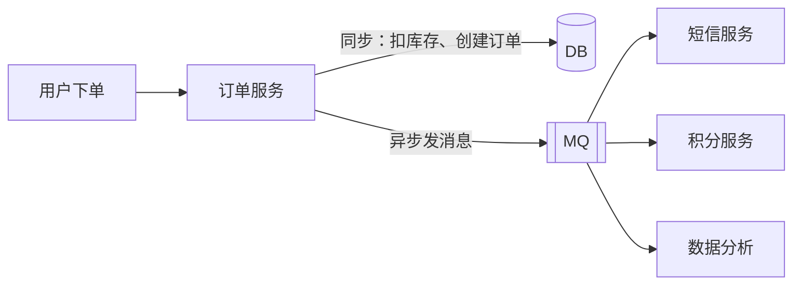

# 为什么用 MQ 与选型：Kafka、RocketMQ、RabbitMQ

> 频率：★★☆ · 近两年出现在：美团（消息不丢、消息去重、死信、RabbitMQ 选型） · 参考：[JavaGuide](https://javaguide.cn/high-performance/message-queue/message-queue.html)

## 一句话答案

用 MQ 是为了**异步**（下单后发短信、加积分不阻塞主流程）、**解耦**（上游只管发消息，不关心有几个下游）、**削峰**（秒杀流量先进队列，下游按能力消费）。选型：**Kafka** 吞吐最高，适合日志、埋点、流处理、大数据管道；**RocketMQ** 功能全（事务消息、延迟消息、顺序消息、消息轨迹），适合电商、交易类业务；**RabbitMQ** 路由灵活、延迟低（微秒级）、管理界面好，适合业务量中等、路由规则复杂的场景。

## 展开（1–2 分钟能讲完）

| | Kafka | RocketMQ | RabbitMQ |
|---|---|---|---|
| 吞吐 | 最高，百万级/秒 | 十万级/秒 | 万级/秒 |
| 延迟 | 毫秒级 | 毫秒级 | 微秒级 |
| 模型 | 分区日志，消费者拉取 | 队列，拉取（长轮询） | 交换机 + 队列，推送 |
| 消息回溯 | 支持（按 offset、时间） | 支持（按时间） | 消费后删除，不支持 |
| 事务消息 | Kafka 事务（不是同一回事） | 半消息 + 回查，用于分布式事务 | 不支持 |
| 延迟消息 | 不支持 | 支持（5.x 任意时间） | 插件或 TTL + 死信 |
| 顺序消息 | 分区内有序 | 队列内有序，有顺序消费 API | 单队列单消费者 |
| 语言 | Scala/Java | Java | Erlang |
| 适合 | 日志、埋点、流处理 | 电商交易 | 中小规模业务、复杂路由 |

**RocketMQ 的事务消息**：先发一个对消费者不可见的「半消息」→ 执行本地事务 → 根据结果提交（消费者可见）或回滚（删除）；如果 Broker 迟迟没收到结果，会**回查**生产者的本地事务状态。用来保证「本地事务」和「发消息」要么都成功要么都失败。

## 图解

## 追问链

- **RabbitMQ 的四种交换机？** **Direct**：routing key 完全匹配；**Topic**：routing key 按模式匹配（`*` 匹配一个单词，`#` 匹配零个或多个），如 `order.*.paid`；**Fanout**：广播给所有绑定的队列，忽略 routing key；**Headers**：按消息头属性匹配，很少用。
- **引入 MQ 带来的问题？** 系统可用性降低（MQ 挂了影响全链路，要高可用部署）；复杂度增加：要处理[消息丢失](./reliability)、[重复消费](./idempotency)、[顺序](./ordering)、[积压](./backlog)；一致性问题：主流程成功了，下游消费失败，要有补偿和对账；排查变难：链路变长，要有消息轨迹和 traceId 透传。
- **项目里为什么选这个 MQ？** 结合场景回答：数据量和吞吐要求、需不需要事务消息/延迟消息、团队熟悉程度、公司已有的基础设施和运维能力。比如：「埋点和日志量大、需要对接 Flink，选 Kafka；订单状态变更需要事务消息和延迟取消，选 RocketMQ」。
- **Redis 能做消息队列吗？** 可以：`List`（LPUSH + BRPOP，没有 ack，消费者崩溃会丢）、`Pub/Sub`（不持久化，消费者不在线就丢）、**Stream**（5.0+，有消费组、ack、pending 列表，比较完善）。适合轻量场景；对可靠性要求高、量大还是用专业 MQ。
- **Pulsar 是什么？** 计算存储分离：Broker 无状态，消息存在 BookKeeper 里，扩容快，支持多租户和跨地域复制。

## 我的项目里

TODO：项目里用的是哪个 MQ？主要用在哪些场景（异步、解耦、削峰）？为什么选它？
