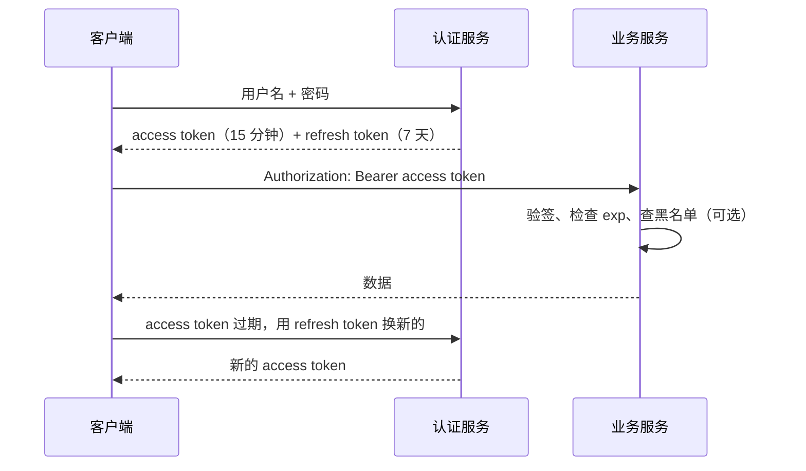

# Cookie、Session、Token 与 JWT

> 频率：★★☆ · 参考：[JavaGuide](https://javaguide.cn/system-design/security/basis-of-authority-certification.html)

## 一句话答案

HTTP 无状态，要靠凭证识别用户。**Session**：登录后服务端存会话数据，给浏览器一个 sessionId（放在 Cookie 里），每次请求带上；服务端有状态，集群要共享 Session（存 Redis）。**Token / JWT**：服务端签发一个令牌，客户端每次放在 `Authorization` 头里带上。JWT 自带用户信息和签名，服务端只验签、不用查存储（无状态），代价是**签发后无法主动失效**。

## 展开（1–2 分钟能讲完）

**Cookie 和 Session 的关系**：Cookie 是浏览器的存储机制，每次请求同域名时自动带上；Session 是服务端的会话。Cookie 只是 sessionId 的载体。

**JWT 的结构**：`Header.Payload.Signature`，前两段是 Base64URL 编码的 JSON（**不是加密**，任何人都能解码，所以不能放敏感信息），第三段是用密钥对前两段算的签名（HS256 用共享密钥，RS256 用私钥签、公钥验）。服务端验签通过、没过期（`exp`）就认为可信。

| | Session | JWT |
|---|---|---|
| 状态 | 服务端存储 | 无状态，信息在令牌里 |
| 扩展 | 集群要共享（Redis） | 天然支持，任何服务有密钥/公钥就能验 |
| 失效 | 删除服务端记录即可 | 到期前一直有效，要额外机制 |
| 跨域 / 移动端 | Cookie 受同源策略限制，App 不方便 | 放请求头，跨域和 App 都方便 |
| 大小 | sessionId 很短 | 带了信息，比较长，每次请求都传 |

## 图解

## 追问链

- **JWT 怎么退出登录、续期？** 退出：服务端维护**黑名单**（Redis 存被注销的 token 的 jti，过期时间等于 token 剩余有效期），每次请求检查；或者给每个用户存一个版本号，token 里带版本，改密码或退出时版本 +1。这样就不完全无状态了，但只查一次 Redis 很便宜。续期：**双 token**：access token 短期（15 分钟），refresh token 长期（7 天，存服务端，可撤销）；access 过期后用 refresh 换新的；refresh 每次用完也可以轮换（旧的作废），发现旧的被重复使用说明被盗。
- **单点登录（SSO）？** 一处登录，多个系统通用。典型 CAS 流程：访问系统 A 未登录 → 跳转认证中心 → 登录后认证中心在**自己的域名**下设 Cookie（全局会话），带一个一次性的 ticket 跳回 A → A 拿 ticket 去认证中心校验，建立 A 的局部会话。访问系统 B 时跳到认证中心，发现已有全局会话，直接发 ticket 回 B，无需再输密码。同一个顶级域名下也可以直接共享 Cookie。OAuth2 / OIDC 是另一套标准，第三方登录（微信登录）用 OAuth2 的授权码模式。
- **CSRF 和 XSS？** **CSRF**（跨站请求伪造）：用户登录了 bank.com，访问恶意网站，恶意网站发一个指向 bank.com 的请求，浏览器自动带上 bank.com 的 Cookie。防御：Cookie 设 `SameSite=Lax/Strict`；校验 CSRF Token；校验 `Origin` / `Referer`；用请求头传 token 而不是 Cookie（JWT 放 Authorization 头天然防 CSRF）。**XSS**（跨站脚本）：攻击者把脚本注入页面（评论里写 `<script>`），在用户浏览器里执行，窃取 Cookie 或 token。防御：输出时转义、CSP 策略、Cookie 设 `HttpOnly`（JS 读不到）。所以 token 存 localStorage 怕 XSS，存 Cookie 怕 CSRF，各有取舍。
- **密码怎么存？** 不能明文、不能只用 MD5。用加盐的慢哈希：BCrypt、Argon2（Spring Security 默认 BCrypt）。

## 我的项目里

TODO：项目的登录是 Session 还是 JWT？token 存在客户端哪里？怎么处理过期和退出？
