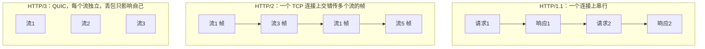

# HTTP 1.1 / 2 / 3、长短连接、状态码

> 频率：★★☆ · 近两年出现在：字节（TCP 四次挥手、HTTP 演进、SSE 与 WebSocket）、腾讯（QUIC、KCP、HTTP 长短连接、HTTPS） · 参考：[小林coding](https://xiaolincoding.com/network/2_http/http_interview.html)

## 一句话答案

**HTTP/1.1**：默认长连接（keep-alive），但一个连接上的请求要排队（队头阻塞），浏览器只好对同一域名开 6 个左右的连接。**HTTP/2**：二进制分帧、**多路复用**（一个 TCP 连接上并发多个流）、HPACK 头部压缩、服务器推送；但 TCP 层丢包时所有流都要等（TCP 队头阻塞）。**HTTP/3**：基于 **QUIC**（UDP 上实现可靠传输），流之间互不阻塞，握手更快（1-RTT，恢复连接 0-RTT），连接迁移（换网络不断）。

## 展开（1–2 分钟能讲完）

| | HTTP/1.0 | HTTP/1.1 | HTTP/2 | HTTP/3 |
|---|---|---|---|---|
| 连接 | 短连接，每个请求一个 TCP | 长连接 | 一个连接多路复用 | QUIC（UDP） |
| 格式 | 文本 | 文本 | 二进制帧 | 二进制帧 |
| 队头阻塞 | 有 | 有（管线化基本没人用） | HTTP 层解决，TCP 层仍有 | 解决 |
| 头部 | 不压缩 | 不压缩 | HPACK | QPACK |

**长连接和短连接**：短连接每次请求都要三次握手和四次挥手（HTTPS 还要 TLS 握手），开销大。长连接复用 TCP 连接，`Connection: keep-alive`，服务端设空闲超时（Nginx `keepalive_timeout` 默认 75 秒）。服务之间的调用用 HTTP 客户端的**连接池**复用连接。

## 图解

## 追问链

- **常见状态码？**
  - `301` 永久重定向（浏览器和搜索引擎会缓存新地址）、`302` 临时重定向；`307`/`308` 是对应的不允许改请求方法的版本。
  - `304` Not Modified：协商缓存命中，资源没变，用本地缓存。
  - `400` 请求参数错误、`401` 未认证（没登录或 token 无效）、`403` 已认证但**没有权限**、`404`、`405` 方法不允许、`429` 请求太多（被限流）。
  - `500` 服务器内部错误；`502` Bad Gateway：网关（Nginx）连上游失败或上游返回了无效响应，比如上游进程挂了、连接被重置；`503` 服务不可用（过载、维护）；`504` Gateway Timeout：网关等上游**超时**。
- **GET 和 POST？** 语义上 GET 获取资源，应该是**安全**（不修改数据）且**幂等**的，可以被缓存、收藏；POST 提交数据，不幂等。参数位置：GET 一般放 URL（浏览器和服务器对 URL 长度有限制，不是协议限制），POST 放请求体。安全性上 POST 的参数不在 URL 里、不会出现在浏览器历史和服务器访问日志中，但都是明文，真正安全要靠 HTTPS。「GET 发一个包、POST 发两个包」是部分浏览器的实现细节，不是规范。
- **HTTP 缓存（强缓存、协商缓存）？** **强缓存**：响应头 `Cache-Control: max-age=3600`（或老的 `Expires`），过期前浏览器直接用本地缓存，不发请求（状态显示 200 from cache）。**协商缓存**：强缓存过期后，浏览器带上 `If-None-Match: <ETag>` 或 `If-Modified-Since: <时间>` 问服务器，资源没变返回 304，不带响应体。ETag 优先，更精确（修改时间只精确到秒，内容不变但时间变了也会失效）。静态资源常用「文件名带哈希 + 长时间强缓存」。
- **HTTP/2 为什么还是有队头阻塞？** 所有流共用一个 TCP 连接，TCP 保证字节有序，一个包丢了，后面所有流的数据都要等它重传。QUIC 在 UDP 上为每个流单独做可靠传输，才彻底解决。
- **QUIC 为什么基于 UDP？** TCP 在操作系统内核里，升级极慢，中间设备（防火墙、NAT）也只认识老的 TCP 行为；在 UDP 上用户态实现，可以快速迭代。

## 我的项目里

TODO：项目里服务间调用用的什么 HTTP 客户端？有没有配置连接池和超时？Nginx 返回过 502/504 吗？
