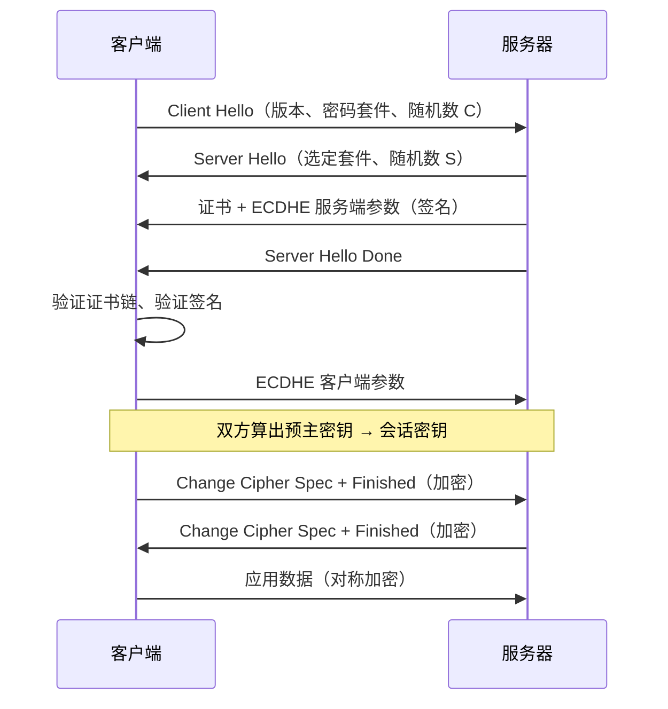

# HTTPS 与 TLS 握手、中间人攻击

> 频率：★★★ · 近两年出现在：阿里（HTTPS、浏览器请求全过程、操作系统内存）、腾讯（QUIC、KCP、HTTP 长短连接、HTTPS） · 参考：[小林coding](https://xiaolincoding.com/network/2_http/https_rsa.html)

## 一句话答案

HTTPS = HTTP + TLS。TLS 握手用**非对称加密**（或 ECDHE 密钥交换）安全地协商出一个**对称密钥**，之后的数据都用对称加密传输；用**数字证书**证明服务器的公钥确实属于这个域名，防止中间人攻击；用 MAC/AEAD 保证数据不被篡改。

## 展开（1–2 分钟能讲完）

**TLS 1.2 握手（ECDHE）**：

1. Client Hello：支持的 TLS 版本、密码套件列表、客户端随机数。
2. Server Hello：选定的密码套件、服务端随机数；发送**证书**；发送 ECDHE 的服务端公钥参数（用证书私钥签名）。
3. 客户端验证证书，验证签名，生成自己的 ECDHE 参数发给服务端。
4. 双方用 ECDHE 算出同一个预主密钥，再结合两个随机数生成会话密钥。
5. 双方发送 Finished（用会话密钥加密的握手摘要），验证握手没被篡改。之后传应用数据。

一共 **2 个 RTT**。**TLS 1.3** 简化成 **1 个 RTT**：客户端在 Client Hello 里直接带上密钥交换参数（猜服务端会选的曲线），删掉了 RSA 密钥交换和不安全的算法；会话恢复时可以 **0-RTT**（有重放风险）。

**RSA 密钥交换 vs ECDHE**：RSA 方式是客户端用服务器公钥加密预主密钥发过去，一旦服务器私钥泄露，**以前录下来的所有流量都能解密**（没有前向安全性）；ECDHE 每次握手生成临时密钥，私钥泄露也解不开历史流量。TLS 1.3 只保留了 (EC)DHE。

## 图解

## 追问链

- **为什么不全程用非对称加密？** 非对称加密（RSA、ECC）比对称加密（AES）慢几百到上千倍，而且 RSA 能加密的数据长度受密钥长度限制。所以只在握手时用它安全地交换密钥，大量数据用 AES-GCM 这类对称加密。现代 CPU 还有 AES-NI 指令加速。
- **证书怎么验证？** 证书里有域名、公钥、有效期、颁发者，以及颁发者（CA）用**它的私钥**对证书内容哈希值做的签名。浏览器用 CA 的公钥验证签名：解出哈希值，和自己算的哈希比较。CA 的公钥从哪来？中间 CA 的证书由根 CA 签名，**根证书预装在操作系统和浏览器里**，层层向上验证直到信任的根，这叫证书链。还要检查：域名匹配、在有效期内、没有被吊销（CRL / OCSP）。
- **中间人攻击怎么防？** 中间人截获连接，冒充服务器给客户端发自己的证书。但它没有目标域名的合法证书（CA 不会给它签），浏览器验证会失败并警告。只要用户不点「继续访问」、客户端不信任来路不明的根证书，中间人就无法解密。App 还可以做**证书锁定**（certificate pinning），只认特定的证书或公钥。
- **抓包工具为什么能看到 HTTPS 内容？** Charles、Fiddler 本身就是中间人：它们要求你在设备上**安装并信任它们的自签根证书**，然后为每个访问的域名现场签发假证书。因为你信任了它的根，浏览器验证通过。所以「信任一个根证书」是很危险的操作。证书锁定的 App 无法这样抓包。
- **HTTPS 一定安全吗？** 保证的是传输过程的机密性和完整性，不保证服务器本身可信，也防不了本机被植入根证书、XSS、钓鱼网站（钓鱼网站也可以申请合法证书）。

## 我的项目里

TODO：项目的 HTTPS 在哪一层终止（Nginx / 负载均衡 / 应用本身）？证书是怎么申请和续期的（比如 Let's Encrypt）？
