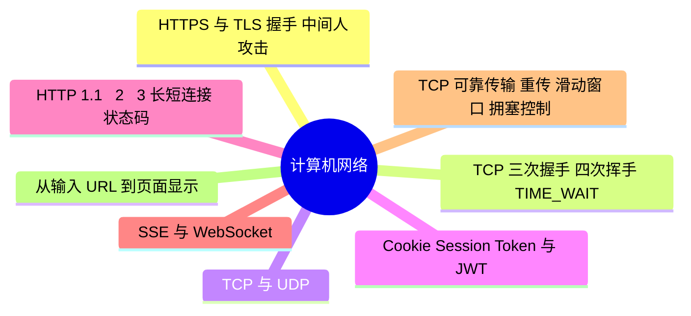

# 计算机网络

> 进度：8 / 8 条已写完。本页由 `tools/gen_index.py` 生成，改条目后重新运行即可。

## 知识地图

## 条目（按频率排序）

频率按 2025–2026 年后端面经里出现的次数估计：★★★ 几乎每场都可能问，★★ 经常问，★ 偶尔问。

| 知识点 | 频率 | 状态 | 一句话答案 |
|---|---|---|---|
| [HTTPS 与 TLS 握手、中间人攻击](./https) | ★★★ | ✅ | TLS 握手用非对称加密（或 ECDHE 密钥交换）协商出对称密钥，之后用对称加密传输；证书由 CA 签名，客户端验证证书链防止中间人。 |
| [TCP 三次握手、四次挥手、TIME_WAIT](./tcp-handshake) | ★★★ | ✅ | 三次握手同步双方初始序列号，并防止历史连接；四次挥手是因为 TCP 全双工，两个方向分别关闭。主动关闭方进入 TIME_WAIT 等 2MSL，保证最后的 ACK 能重传、旧连接的报文在网络里消失。 |
| [TCP 与 UDP](./tcp-udp) | ★★★ | ✅ | TCP 面向连接、可靠、有序、有流量控制和拥塞控制；UDP 无连接、不可靠、开销小、延迟低。直播、游戏、DNS 用 UDP 或基于 UDP 的协议（QUIC、KCP）。 |
| [Cookie、Session、Token 与 JWT](./auth) | ★★☆ | ✅ | Session 存服务端、靠 Cookie 里的 session id 关联，集群下要共享 Session（Redis）；JWT 把信息签名后放在客户端，服务端无状态，缺点是不能主动失效。 |
| [HTTP 1.1 / 2 / 3、长短连接、状态码](./http) | ★★☆ | ✅ | 1.1 默认长连接但有队头阻塞；2 用二进制分帧和多路复用、头部压缩；3 基于 QUIC（UDP），解决 TCP 层队头阻塞、连接迁移。 |
| [SSE 与 WebSocket（大模型流式输出）](./sse-websocket) | ★★☆ | ✅ | SSE 基于 HTTP，服务端单向推送，自动重连，适合大模型的流式输出；WebSocket 是全双工长连接，适合聊天、协同编辑。 |
| [TCP 可靠传输：重传、滑动窗口、拥塞控制](./tcp-reliability) | ★★☆ | ✅ | 靠序列号 + 确认 + 超时重传/快速重传保证可靠；滑动窗口做流量控制；拥塞控制分慢启动、拥塞避免、快速重传、快速恢复。 |
| [从输入 URL 到页面显示](./url-to-page) | ★★☆ | ✅ | DNS 解析 → 建立 TCP 连接（HTTPS 还有 TLS 握手）→ 发送 HTTP 请求 → 服务器经负载均衡、网关到应用处理 → 返回响应 → 浏览器解析渲染。 |
