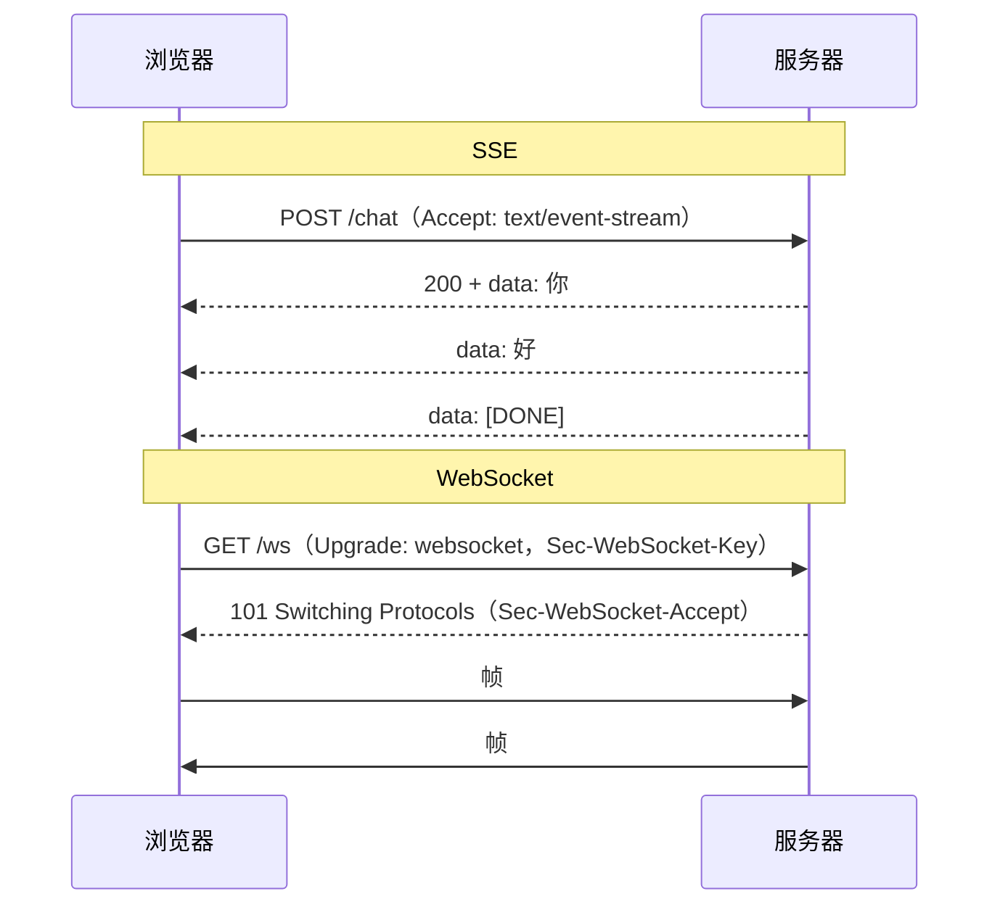

# SSE 与 WebSocket（大模型流式输出）

> 频率：★★☆ · 近两年出现在：字节（TCP 四次挥手、HTTP 演进、SSE 与 WebSocket）、腾讯（WebSocket 认证）、美团（SSE 与跨语言通信、HTTP 流式接口） · 参考：[小林coding](https://xiaolincoding.com/network/2_http/http_websocket.html)

## 一句话答案

**SSE**（Server-Sent Events）是普通的 HTTP 响应，`Content-Type: text/event-stream`，服务器保持连接不断开，一条一条推 `data: ...\n\n`；**单向**（服务器 → 客户端），纯文本，浏览器自带断线重连。**WebSocket** 先用 HTTP 发一个 `Upgrade` 请求，握手后升级成独立的**全双工**协议，双方随时互发文本或二进制帧。大模型对话大多用 SSE：只需要服务器流式返回，SSE 更简单、兼容现有的 HTTP 基础设施。

## 展开（1–2 分钟能讲完）

| | SSE | WebSocket | 轮询 / 长轮询 |
|---|---|---|---|
| 方向 | 服务器 → 客户端 | 双向 | 客户端拉 |
| 协议 | HTTP | 独立协议（ws://、wss://） | HTTP |
| 数据 | UTF-8 文本 | 文本 + 二进制 | 任意 |
| 断线重连 | 浏览器自动，带 `Last-Event-ID` | 自己实现 | 不涉及 |
| 网关、鉴权 | 和普通 HTTP 一样 | 要专门支持 Upgrade | 一样 |
| 适合 | LLM 流式输出、通知、进度 | 聊天、协同编辑、游戏、实时语音 | 简单低频场景 |

**SSE 格式**：

```text
event: message
id: 42
data: {"delta": "你好"}

data: [DONE]

```

每个事件以空行结束；`id` 用于重连时告诉服务器从哪继续；`retry:` 设置重连间隔。

**SSE 的注意点**：HTTP/1.1 下浏览器对同一域名最多 6 个连接，开多个 SSE 标签页会占满（HTTP/2 下没有这个问题）；Nginx 要关闭响应缓冲（`proxy_buffering off` 或响应头 `X-Accel-Buffering: no`），否则会攒满一块才发出去，流式效果就没了；原生 `EventSource` 只支持 GET、不能加自定义头，所以 LLM 应用一般用 `fetch` + `ReadableStream` 自己解析 SSE 格式（可以 POST、带 Authorization）。

## 图解



## 追问链

- **为什么大模型对话多用 SSE？** 交互模式就是「用户发一个问题（普通 POST），模型一个 token 一个 token 地返回」，只需要服务器单向推送。SSE 就是 HTTP，现有的网关、负载均衡、鉴权、日志、CDN 都直接可用，实现也简单；OpenAI、Anthropic 的 API 都用 SSE 返回流式结果。需要用户在生成过程中频繁双向交互（实时语音、打断）时才用 WebSocket。
- **WebSocket 握手过程和鉴权？** 客户端发 HTTP GET，带 `Connection: Upgrade`、`Upgrade: websocket`、`Sec-WebSocket-Key`（随机 Base64）、`Sec-WebSocket-Version: 13`。服务端返回 `101`，`Sec-WebSocket-Accept` = Base64(SHA1(Key + 固定 GUID))，证明它理解 WebSocket 协议。鉴权：浏览器的 WebSocket API **不能自定义请求头**，所以常用的做法是：握手 URL 带一个**短期一次性 ticket**（先用普通 HTTP 接口拿 ticket，避免长期 token 出现在 URL 和日志里）；或者用 Cookie（同域时自动带，注意校验 `Origin` 防跨站）；或者连接建立后第一条消息发 token，服务端在规定时间内没收到认证消息就断开。
- **长连接断线重连和消息补发？** 客户端：检测断开（心跳超时、onclose）后**指数退避**重连，加随机抖动，避免服务重启后所有客户端同时涌入。消息补发：每条消息带递增的序号或 id，客户端记下收到的最后一个，重连后告诉服务端（SSE 自带 `Last-Event-ID`），服务端从缓存（Redis Stream、消息表）里补发之后的消息；客户端按 id 去重。LLM 场景下，生成任务要和连接**解耦**：生成结果写进缓存，连接断了只是停止推送，重连后从断点继续读，而不是重新生成。
- **WebSocket 集群怎么推送？** 连接在某一台机器上，要推给某个用户，需要知道他连在哪台：用 Redis 记录 用户 → 机器，或者用 Redis Pub/Sub、MQ 广播给所有机器，由持有连接的那台推送。

## 我的项目里

TODO：项目里的流式输出是怎么实现的（SSE / WebSocket）？网关有没有遇到缓冲导致不流式的问题？断线后怎么处理？
