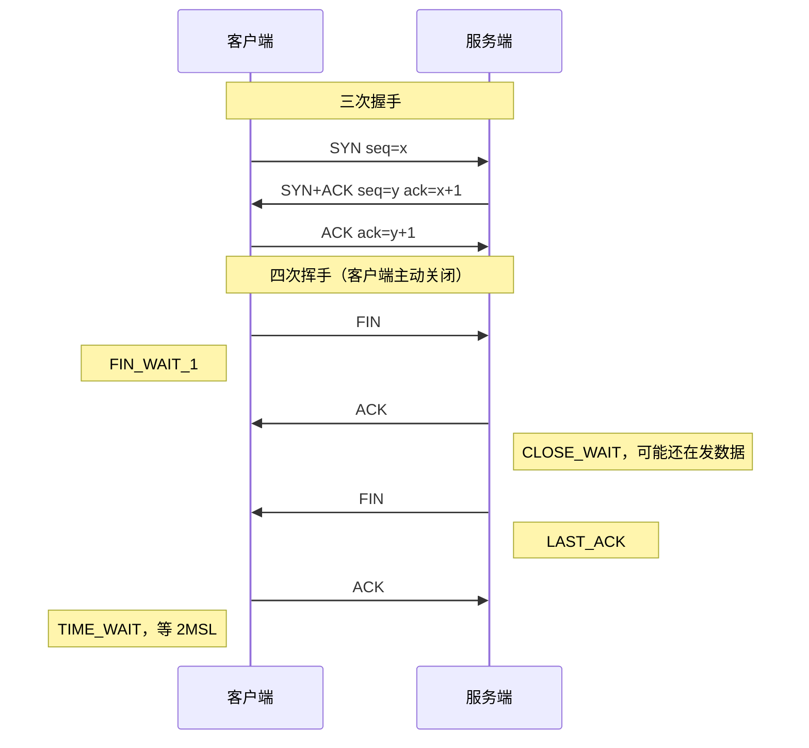

# TCP 三次握手、四次挥手、TIME_WAIT

> 频率：★★★ · 近两年出现在：字节（TCP 四次挥手、HTTP 演进、SSE 与 WebSocket）、腾讯（TCP 三次握手四次挥手、TIME_WAIT、对端断电感知、粘包）、美团（epoll 触发模式、TCP 拥塞控制、TCP 半连接全连接队列、零拷贝） · 参考：[小林coding](https://xiaolincoding.com/network/3_tcp/tcp_interview.html)

## 一句话答案

**三次握手**：客户端发 SYN → 服务端回 SYN+ACK → 客户端回 ACK。目的是双方确认对方的发送和接收能力都正常，并同步各自的初始序列号。**四次挥手**：因为 TCP 是全双工的，每个方向要单独关闭：主动方发 FIN → 被动方回 ACK（此时被动方可能还有数据要发）→ 被动方发 FIN → 主动方回 ACK，然后主动方进入 **TIME_WAIT**，等待 2MSL 再彻底关闭。

## 展开（1–2 分钟能讲完）

**状态变化**：

- 握手：客户端 `CLOSED → SYN_SENT → ESTABLISHED`；服务端 `LISTEN → SYN_RCVD → ESTABLISHED`。
- 挥手：主动方 `FIN_WAIT_1 → FIN_WAIT_2 → TIME_WAIT → CLOSED`；被动方 `CLOSE_WAIT → LAST_ACK → CLOSED`。

**为什么要 TIME_WAIT，为什么是 2MSL**（MSL 是报文最大生存时间，Linux 上 TIME_WAIT 固定 60 秒）：

1. 保证最后一个 ACK 能到达：如果它丢了，被动方会重发 FIN，主动方还在 TIME_WAIT 就能再回 ACK。一来一回最多 2MSL。
2. 让这个连接在网络中残留的旧报文都消失，避免被之后**相同四元组**的新连接误收。

**挥手为什么是四次而不是三次**：被动方收到 FIN 时，可能还有数据没发完，所以先回 ACK，等数据发完再发自己的 FIN。如果被动方没有数据要发，并且开启了延迟确认，ACK 和 FIN 可以合并，就变成三次。

## 图解

## 追问链

- **为什么不是两次握手？** 主要原因是**防止历史连接**：客户端发了一个 SYN 因网络滞留，超时后又发了新的 SYN。旧 SYN 后到达服务端，两次握手的话服务端就直接建立连接、分配资源，而客户端根本不要这个连接。三次握手时，客户端收到 SYN+ACK 发现确认号对不上（是旧连接的），会回 RST 终止。另外，两次握手只能让客户端确认服务端的序列号同步了，服务端无法确认客户端收到了自己的初始序列号。
- **TIME_WAIT 过多怎么办？** TIME_WAIT 出现在**主动关闭**的一方。短连接、大量主动关闭的客户端（比如作为客户端调下游的服务）容易堆积，占用本地端口（客户端端口约 2.8 万个），导致无法新建连接。处理：
  - 根本办法：用**长连接**和连接池，减少建连和关闭。
  - `net.ipv4.tcp_tw_reuse=1`：作为客户端发起新连接时，可以复用处于 TIME_WAIT 的端口（依赖时间戳，比较安全）。
  - 调大本地端口范围 `ip_local_port_range`。
  - 不要用 `tcp_tw_recycle`（NAT 环境下会丢包，4.12 内核已删除）；`SO_LINGER` 设 0 直接发 RST 跳过 TIME_WAIT，不推荐。
  - 反过来，服务端如果有大量 **CLOSE_WAIT**，说明应用代码收到对方的 FIN 后**没有调用 close**（连接泄漏），要查代码。
- **半连接队列和全连接队列、SYN 洪泛？** 服务端收到 SYN 后，把连接放进**半连接队列**（SYN 队列），回 SYN+ACK；收到第三次的 ACK 后，移到**全连接队列**（accept 队列），等应用调用 `accept()` 取走。全连接队列长度是 `min(backlog, somaxconn)`，满了默认丢弃 ACK（`tcp_abort_on_overflow=0`），客户端以为连接成功了，发数据才发现不行。**SYN 洪泛**：攻击者伪造大量源 IP 发 SYN，不回第三次 ACK，占满半连接队列。防御：开启 **SYN Cookie**（`tcp_syncookies=1`，队列满时不保存状态，把信息编码到 SYN+ACK 的序列号里，收到 ACK 时校验）；增大半连接队列；减少 SYN+ACK 重传次数；上游清洗流量。
- **对端突然断电怎么感知？** 断电时对方来不及发 FIN 或 RST，本端以为连接还在。如果本端在发数据，会触发**超时重传**，重传若干次（`tcp_retries2`，约十几分钟）后放弃。如果本端也不发数据，只能靠：TCP **keepalive**（默认空闲 2 小时才开始探测，探测 9 次、每次间隔 75 秒，太慢，一般要调小或者在 socket 上单独设置）；**应用层心跳**（更常用，几十秒一次，超时没收到就判定断开，WebSocket、RPC 框架、Netty 的 `IdleStateHandler` 都这样做）。进程崩溃（而不是断电）时操作系统会替进程发 FIN，可以正常感知。

## 我的项目里

TODO：线上机器有没有看过 `ss -s` 或 `netstat` 的连接状态统计？有没有 TIME_WAIT 或 CLOSE_WAIT 过多的情况？
