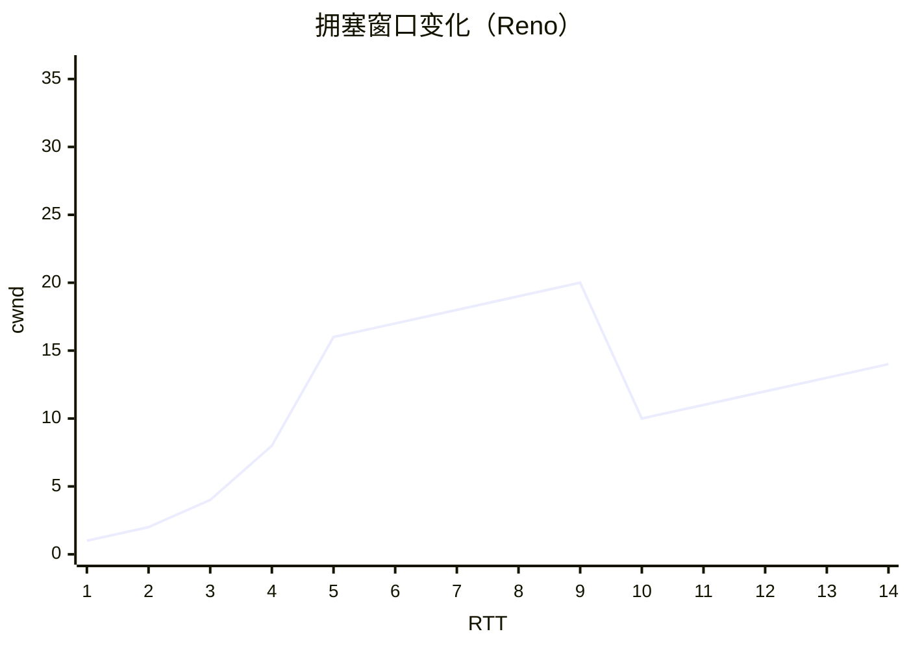

# TCP 可靠传输：重传、滑动窗口、拥塞控制

> 频率：★★☆ · 近两年出现在：美团（epoll 触发模式、TCP 拥塞控制、TCP 半连接全连接队列、零拷贝） · 参考：[小林coding](https://xiaolincoding.com/network/3_tcp/tcp_feature.html)

## 一句话答案

TCP 靠**序列号 + 确认应答**知道哪些数据到了，靠**超时重传和快速重传**补发丢失的数据，靠**滑动窗口**一次发多个包、不必每个都等确认，靠**流量控制**（接收方通告窗口 rwnd）防止发得太快把接收方淹没，靠**拥塞控制**（拥塞窗口 cwnd：慢启动、拥塞避免、快重传、快恢复）防止把网络塞满。发送窗口 = min(rwnd, cwnd)。

## 展开（1–2 分钟能讲完）

**重传**：

- **超时重传**：发出后启动计时器，超时（RTO，根据测量的 RTT 动态计算）没收到 ACK 就重传，每次超时 RTO 翻倍。
- **快速重传**：收到 **3 个重复的 ACK**（比如一直确认 1001，说明 1001 之后的某个包丢了、后面的包到了），不等超时立刻重传。
- **SACK**（选择性确认）：ACK 里告诉发送方已经收到了哪些区间，发送方只重传真正缺的部分。

**拥塞控制的四个阶段**：

1. **慢启动**：cwnd 从一个较小的值（Linux 默认 10 个 MSS）开始，每收到一个 ACK 加 1，相当于每个 RTT 翻倍，指数增长。
2. **拥塞避免**：cwnd 到达慢启动阈值 ssthresh 后，每个 RTT 只加 1，线性增长。
3. **发生超时**：认为拥塞严重，ssthresh = cwnd / 2，cwnd 重置为初始值，重新慢启动。
4. **收到 3 个重复 ACK（快重传 + 快恢复）**：认为只是轻微拥塞（后面的包还能到），ssthresh = cwnd / 2，cwnd = ssthresh（+3），直接进入拥塞避免。

这是经典的 Reno。Linux 默认用 **CUBIC**（窗口增长是时间的三次函数，高带宽长延迟网络下恢复更快）；Google 的 **BBR** 不以丢包作为拥塞信号，而是测量带宽和最小 RTT 来控制发送速率，在有随机丢包的网络（无线）下效果好得多。

## 图解

前 5 个 RTT 慢启动指数增长，到 ssthresh = 16 后线性增长；第 10 个 RTT 收到 3 个重复 ACK，cwnd 减半到 10，继续线性增长（快恢复）。

## 追问链

- **流量控制和拥塞控制的区别？** 流量控制是**点对点**的：接收方的缓冲区有限，通过 ACK 里的窗口字段告诉发送方「我还能收多少」。拥塞控制是**全局**的：考虑整个网络的承载能力，发送方根据丢包和延迟自己估计 cwnd。一个保护接收方，一个保护网络。接收窗口为 0 时，发送方停发并定时发**窗口探测**报文，防止双方因为窗口更新的包丢了而死锁。
- **Nagle 算法和延迟确认？** **Nagle**：有未被确认的数据时，小包先攒着，等收到 ACK 或者攒满一个 MSS 再发，减少大量小包（比如 telnet 每个字符一个包）。**延迟确认**：接收方收到数据后不立刻回 ACK，等一会（Linux 最多约 40 ms），看能不能和要发的数据一起捎带回去。两者同时开启会互相等待：发送方等 ACK 才发下一个小包，接收方等数据才回 ACK，产生约 40 ms 的延迟。对延迟敏感的应用（RPC、游戏、Redis 客户端）一般设置 `TCP_NODELAY` 关闭 Nagle。
- **滑动窗口怎么工作？** 发送窗口里分成「已发送未确认」和「可以发送但还没发」两部分，收到 ACK 后窗口左边界右移，可以继续发新的数据。接收窗口同理，按序到达的数据交给应用后右移。
- **序列号为什么是随机的初始值？** 防止旧连接的报文被新连接误收（序列号范围对不上），也防止攻击者猜出序列号伪造报文。

## 我的项目里

TODO：有没有遇到过因为 Nagle 和延迟确认导致的 40 ms 延迟？服务器的拥塞控制算法是什么（`sysctl net.ipv4.tcp_congestion_control`）？
