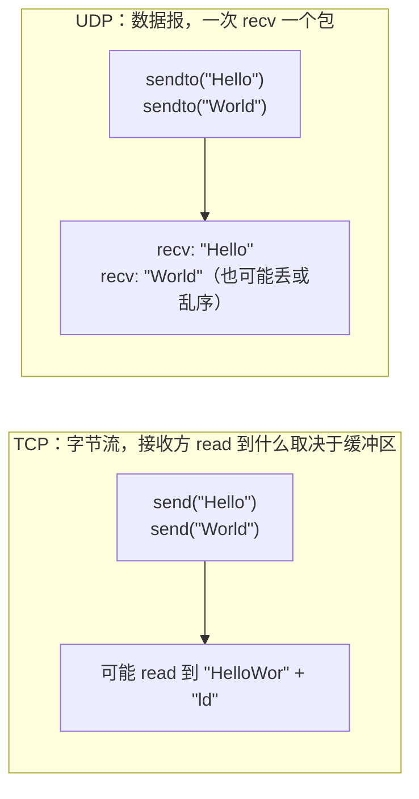

# TCP 与 UDP

> 频率：★★★ · 近两年出现在：腾讯（TCP 三次握手四次挥手、TIME_WAIT、对端断电感知、粘包） · 参考：[小林coding](https://xiaolincoding.com/network/3_tcp/tcp_interview.html)

## 一句话答案

TCP 面向连接、可靠（确认、重传、排序、去重）、有流量控制和拥塞控制、**字节流**（没有消息边界）、只能一对一，头部至少 20 字节。UDP 无连接、不可靠、没有拥塞控制、**保留消息边界**（发一个包就收一个包）、支持一对多（广播、组播），头部只有 8 字节。TCP 适合文件传输、网页、RPC 这种要求不丢不乱的场景；UDP 适合音视频、游戏、DNS 这种实时性比完整性重要的场景，以及 QUIC 这类在应用层自己实现可靠性的协议。

## 展开（1–2 分钟能讲完）

| | TCP | UDP |
|---|---|---|
| 连接 | 三次握手建立连接 | 无连接，直接发 |
| 可靠性 | 确认、重传、按序交付 | 不保证到达、不保证顺序 |
| 传输单位 | 字节流，没有边界 | 数据报，有边界 |
| 拥塞控制 | 有 | 没有（应用自己控制） |
| 通信方式 | 一对一 | 一对一、一对多、多对多 |
| 头部 | 20–60 字节 | 8 字节 |
| 典型应用 | HTTP/1、HTTP/2、MySQL、SSH | DNS、视频会议（RTP）、游戏、QUIC/HTTP/3 |

**DNS 为什么用 UDP**：一次查询就是一问一答，数据很小，用 UDP 省去握手，快。响应超过 512 字节（或 EDNS 的上限）时改用 TCP；区域传输（主从 DNS 同步）用 TCP。

## 图解

## 追问链

- **UDP 怎么实现可靠传输？** 在应用层把 TCP 的机制按需实现一遍：每个包加**序列号**；接收方回 **ACK**（可以批量确认、带 SACK）；发送方**超时重传**；接收方按序列号**重排、去重**；加**流量控制和拥塞控制**。现成的方案：**QUIC**（HTTP/3 的基础）、**KCP**（游戏常用，用更多带宽换更低延迟：RTO 不翻倍、更激进的快速重传、可以关闭拥塞控制）。好处是在用户态实现，可以按业务定制（比如音视频可以「过期的包就不重传了」），也能避免 TCP 的队头阻塞。
- **TCP 粘包拆包怎么处理？** TCP 是字节流，没有消息边界：发送方的两次 send 可能被合成一个包（Nagle），一次 send 的大数据也可能被拆成多个段，接收方一次 read 读到的可能是半条或一条半消息。这其实不是 TCP 的问题，而是**应用层要自己定义消息边界**：
  - **固定长度**：每条消息固定 N 字节，浪费空间。
  - **分隔符**：比如每条消息以 `\n` 结束（Redis 协议、HTTP 头用 `\r\n`），消息内容里出现分隔符要转义。
  - **长度字段**（最常用）：消息头里写明消息体长度，先读固定长度的头，再读指定长度的体。Netty 的 `LengthFieldBasedFrameDecoder` 就是这个。HTTP 用 `Content-Length` 或 chunked 编码。
- **能用 TCP 客户端直接给 HTTP 服务器发请求吗？** 能。HTTP/1.1 就是 TCP 上的文本协议，用 `telnet` 或 `nc` 连上 80 端口，手动输入 `GET / HTTP/1.1`、`Host: example.com`、空行，就能收到响应。HTTPS 要先完成 TLS 握手（`openssl s_client`）。HTTP/2 是二进制帧，手敲不行。
- **一个 TCP 连接最多能发多少请求？** 理论上没有上限，取决于服务器的空闲超时和最大请求数配置（Nginx `keepalive_requests` 默认 1000）。
- **TCP 和 UDP 可以用同一个端口吗？** 可以，端口是按协议区分的，内核根据 IP 头里的协议字段分别交给 TCP 或 UDP 模块。

## 我的项目里

TODO：项目里有没有自己定义过 TCP 上的消息格式（比如 RPC、IM），是怎么处理粘包的？
