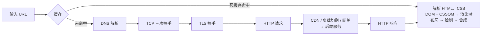

# 从输入 URL 到页面显示

> 频率：★★☆ · 近两年出现在：阿里（HTTPS、浏览器请求全过程、操作系统内存）、腾讯（原码反码补码、键盘输入到屏幕显示） · 参考：[小林coding](https://xiaolincoding.com/network/1_base/what_happen_url.html)

## 一句话答案

解析 URL → 查缓存 → **DNS** 解析出 IP → 建立 **TCP** 连接（三次握手）→ **TLS** 握手（HTTPS）→ 发送 **HTTP** 请求 → 经过 CDN、负载均衡、网关到达后端服务处理 → 返回响应 → 浏览器**解析渲染**：HTML 构建 DOM 树、CSS 构建 CSSOM、合成渲染树 → 布局 → 绘制 → 合成显示；遇到 JS、图片等资源再发请求。

## 展开（1–2 分钟能讲完）

**网络部分**按层说：

- 应用层：DNS 查询、HTTP 请求。
- 传输层：TCP 分段，加端口号。
- 网络层：IP 包，加源和目标 IP，路由器逐跳转发。
- 链路层：ARP 查下一跳的 MAC 地址，加以太网帧头；经过交换机、路由器。

**服务端部分**（后端岗可以多说）：DNS 可能返回 CDN 节点的 IP，静态资源直接由 CDN 返回；动态请求到负载均衡（LVS 四层 / Nginx 七层）→ 网关（鉴权、限流、路由）→ 业务服务 → 缓存 / 数据库 → 返回。

**渲染部分**：

1. 解析 HTML 构建 **DOM**；遇到 `<script>`（没有 async/defer）会阻塞解析，先下载并执行 JS。
2. 解析 CSS 构建 **CSSOM**（CSS 会阻塞渲染）。
3. DOM + CSSOM → **渲染树**（不含 `display:none` 的元素）。
4. **布局**（Layout / Reflow）：计算每个元素的位置和大小。
5. **绘制**（Paint）：生成绘制指令，分层。
6. **合成**（Composite）：GPU 合成各层，显示到屏幕。

## 图解

## 追问链

- **DNS 解析过程？** 浏览器缓存 → 操作系统缓存（和 `hosts` 文件）→ 本地 DNS 服务器（运营商或公司的，通常是**递归查询**：它负责问到底）→ 本地 DNS 服务器依次**迭代查询**：根域名服务器（告诉它 `.com` 的服务器地址）→ 顶级域名服务器（告诉它 `example.com` 的权威服务器地址）→ 权威域名服务器（返回 IP）。结果按 TTL 缓存。一般用 UDP 53 端口。
- **每一层可以怎么优化？**
  - DNS：`dns-prefetch` 预解析；减少域名数量。
  - 连接：HTTP 长连接、HTTP/2 多路复用、`preconnect`；TLS 1.3 减少 RTT、会话复用；HTTP/3 0-RTT。
  - 传输：CDN 就近访问；Gzip / Brotli 压缩；图片用 WebP / AVIF，按需懒加载。
  - 缓存：静态资源长时间强缓存 + 文件名带哈希；接口加服务端缓存。
  - 后端：接口合并、缓存、异步、数据库优化。
  - 渲染：CSS 放头部、JS 放底部或加 `defer`/`async`；减少重排（批量修改 DOM、用 `transform` 做动画）；服务端渲染（SSR）减少首屏白屏时间。
- **键盘输入到屏幕显示的过程？** 按下按键 → 键盘控制器产生扫描码，触发**硬件中断** → CPU 暂停当前任务，执行键盘的中断处理程序（驱动），把扫描码转成键码放进输入缓冲区 → 操作系统把输入事件交给当前**前台窗口**的进程（图形系统的事件队列；终端程序则通过 tty 读取）→ 应用程序读到字符，更新自己的数据，调用图形接口重新绘制 → 显卡把新的帧写进显存 → 显示器按刷新率从显存读取并显示。关键点是**中断机制**、**内核态和用户态的切换**、**事件分发**。
- **重排和重绘的区别？** 重排（回流）是元素几何属性变化，要重新计算布局，开销大；重绘是颜色等外观变化，不影响布局。重排一定会重绘，重绘不一定重排。`transform`、`opacity` 只触发合成，最便宜。

## 我的项目里

TODO：项目的请求从用户到你的服务要经过哪几层（CDN、负载均衡、网关）？哪一层最慢？
