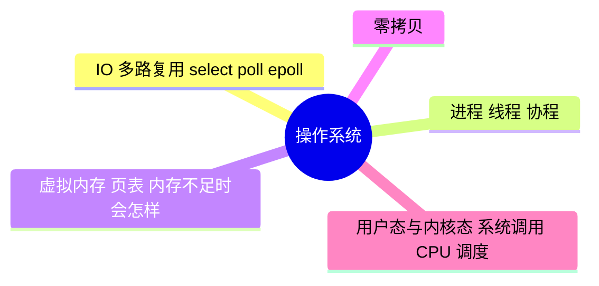

# 操作系统

> 进度：5 / 5 条已写完。本页由 `tools/gen_index.py` 生成，改条目后重新运行即可。

## 知识地图

## 条目（按频率排序）

频率按 2025–2026 年后端面经里出现的次数估计：★★★ 几乎每场都可能问，★★ 经常问，★ 偶尔问。

| 知识点 | 频率 | 状态 | 一句话答案 |
|---|---|---|---|
| [IO 多路复用：select、poll、epoll](./io-multiplexing) | ★★★ | ✅ | select 和 poll 每次都要把全部 fd 拷贝到内核并线性扫描；epoll 用红黑树管理 fd、就绪链表返回结果，只返回就绪的 fd。epoll 有水平触发（LT）和边缘触发（ET）两种模式。 |
| [进程、线程、协程](./process-thread) | ★★★ | ✅ | 进程是资源分配的单位，线程是 CPU 调度的单位，同一进程的线程共享内存；协程是用户态调度的轻量线程，切换不进内核，开销小。 |
| [虚拟内存、页表、内存不足时会怎样](./memory) | ★★☆ | ✅ | 每个进程有独立的虚拟地址空间，通过页表映射到物理内存；缺页时从磁盘调入。内存不足时先回收页缓存、再 swap，最后触发 OOM Killer 杀进程。 |
| [零拷贝](./zero-copy) | ★★☆ | ✅ | 传统读文件再发网络要 4 次拷贝和 4 次上下文切换；sendfile 让数据在内核里直接从页缓存到网卡，省掉用户态拷贝。Kafka、Nginx 都在用。 |
| [用户态与内核态、系统调用、CPU 调度](./scheduling) | ★☆☆ | ✅ | 系统调用让用户程序请求内核服务，会从用户态切换到内核态。常见调度算法：先来先服务、时间片轮转、多级反馈队列，Linux 用 CFS。 |
