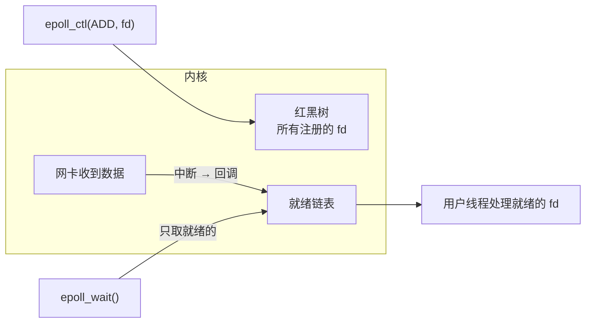

# IO 多路复用：select、poll、epoll

> 频率：★★★ · 近两年出现在：腾讯（epoll ET/LT、IO 多路复用、零拷贝、C10K）、美团（epoll 触发模式、TCP 拥塞控制、TCP 半连接全连接队列、零拷贝） · 参考：[小林coding](https://xiaolincoding.com/os/8_network_system/selete_poll_epoll.html)

## 一句话答案

IO 多路复用让**一个线程同时监听多个 socket**，哪个就绪了就处理哪个。**select**：用固定大小的位图（默认最多 1024 个 fd），每次调用都要把整个集合拷贝进内核，内核和用户都要遍历全部 fd。**poll**：用数组代替位图，去掉了数量限制，其他一样。**epoll**：用 `epoll_ctl` 把 fd 注册到内核里的**红黑树**上（只拷贝一次），就绪的 fd 由回调放进**就绪链表**，`epoll_wait` 只返回就绪的 fd，复杂度和连接总数无关。

## 展开（1–2 分钟能讲完）

| | select | poll | epoll |
|---|---|---|---|
| fd 数量 | 默认 1024 | 不限 | 不限 |
| 数据结构 | 位图 | 数组 | 红黑树 + 就绪链表 |
| 每次调用拷贝 | 全部 fd | 全部 fd | 不用，注册时拷贝一次 |
| 找就绪 fd | 遍历 O(n) | 遍历 O(n) | 直接拿就绪链表 O(就绪数) |
| 触发方式 | 水平触发 | 水平触发 | 水平触发 + 边缘触发 |
| 平台 | 跨平台 | 跨平台 | Linux（macOS/BSD 是 kqueue） |

**epoll 三个函数**：`epoll_create` 创建实例；`epoll_ctl` 增删改要监听的 fd 和事件；`epoll_wait` 阻塞等待，返回就绪的事件。

**水平触发（LT）和边缘触发（ET）**：

- LT（默认）：只要 fd 还可读（缓冲区有数据），每次 `epoll_wait` 都会返回它。编程简单，没读完下次还会通知。
- ET：只在状态**变化**时（新数据到来）通知一次。必须一次把数据读完，否则剩下的数据不会再被通知。系统调用次数少，效率更高。Nginx 用 ET。

## 图解

## 追问链

- **ET 模式为什么要配合非阻塞 IO？** ET 只通知一次，所以收到通知后要**循环 read 直到返回 `EAGAIN`**，才能确认读完。如果 fd 是阻塞的，最后一次 read 没有数据时会一直阻塞，整个事件循环就卡住了。（LT 也推荐用非阻塞 IO，防止通知了但数据被别人读走等情况下阻塞。）
- **Reactor 模型？** 「IO 多路复用 + 事件分发」。Reactor 监听事件，就绪后分发给对应的处理器。三种常见形态：
  - **单 Reactor 单线程**：监听、读写、业务处理都在一个线程，没有锁，但业务慢会阻塞所有连接。**Redis 6 之前**就是这样（业务本身是内存操作，很快）。
  - **单 Reactor 多线程**：IO 在 Reactor 线程，业务处理丢给线程池。
  - **主从 Reactor 多线程**：主 Reactor 只负责 `accept` 新连接，然后分给多个子 Reactor，每个子 Reactor 一个线程负责一部分连接的读写。**Netty**（bossGroup + workerGroup）、**Nginx**（多进程，每个 worker 一个事件循环）、**Memcached** 都是这种思路。
  - Proactor：异步 IO，内核完成读写后再通知应用（Windows IOCP、Linux io_uring）。
- **BIO、NIO、AIO？** **BIO**（同步阻塞）：一个连接一个线程，`read` 没数据就阻塞；连接多时线程太多。**NIO**（同步非阻塞 + 多路复用）：Java 的 `Selector`（Linux 上底层是 epoll）、`Channel`、`Buffer`，一个线程管理多个连接，就绪后**应用自己去读**（读的过程仍是同步的）。**AIO**（异步）：发起读操作后立刻返回，内核把数据读到缓冲区后回调通知。Java AIO 在 Linux 上是用 epoll 模拟的，没有优势，所以 Netty 用的是 NIO。
- **C10K 问题？** 单机同时处理 1 万个连接。线程模型下 1 万个线程的内存和上下文切换开销太大，epoll + 非阻塞 IO + 事件驱动解决了它。现在的 C10M 问题会进一步用内核旁路（DPDK）、io_uring 等技术。
- **为什么 epoll 比 select 快？** 不用每次拷贝全部 fd；不用遍历全部 fd 找就绪的；在**大量连接、少量活跃**的场景下优势明显。如果连接少且都很活跃，差别不大。

## 我的项目里

TODO：项目里用到的哪些组件是基于 IO 多路复用的（Netty、Redis、Nginx、Tomcat NIO）？能说清楚它们的线程模型吗？
