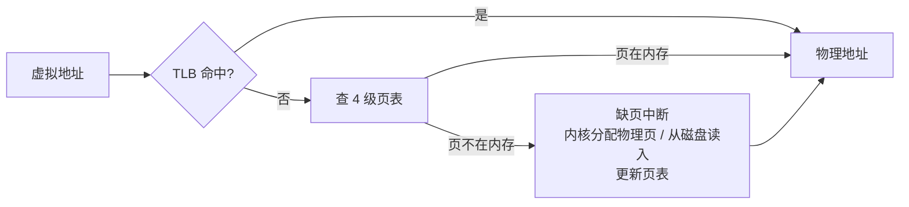

# 虚拟内存、页表、内存不足时会怎样

> 频率：★★☆ · 近两年出现在：阿里（HTTPS、浏览器请求全过程、操作系统内存）、腾讯（内存申请与 OOM、overcommit、进程与协程） · 参考：[小林coding](https://xiaolincoding.com/os/3_memory/vmem.html)

## 一句话答案

每个进程看到的是独立的**虚拟地址空间**，由 CPU 的 MMU 通过**页表**把虚拟页映射到物理页框。好处：进程之间隔离；每个进程都以为自己有连续的大内存；物理内存不够时可以把不常用的页换到磁盘。访问的页不在物理内存时触发**缺页中断**，由内核分配物理页或从磁盘读入。内存不足时，内核先**回收**（丢弃干净的页缓存、把脏页写回、把匿名页换到 swap），回收后还不够就触发 **OOM Killer**，按评分杀掉一个占内存多的进程。

## 展开（1–2 分钟能讲完）

**多级页表**：64 位系统的虚拟空间极大，如果用一级页表，每个进程都要一个巨大的表。Linux x86-64 用 **4 级页表**（48 位地址：9+9+9+9 位索引 + 12 位页内偏移，页大小 4 KB），只为实际用到的部分分配页表。代价是一次地址转换要访问 4 次内存，所以 CPU 有 **TLB**（快表），缓存最近的虚拟页 → 物理页映射，命中率很高。进程切换时 TLB 要刷新（或用 ASID 区分），这是进程切换比线程切换贵的原因之一。**大页**（2 MB、1 GB）减少页表层级和 TLB 未命中，数据库常用。

**进程的虚拟地址空间布局**（从低到高）：代码段、数据段（已初始化的全局变量）、BSS（未初始化的全局变量）、**堆**（向上增长）、文件映射区（动态库、mmap）、**栈**（向下增长）、内核空间（所有进程共享）。

**内存不足时的处理**：

1. 分配内存时空闲页低于水位线 → 唤醒 `kswapd` **后台回收**。
2. 还是不够 → 分配的进程自己**直接回收**（会阻塞，导致延迟抖动）。
3. 回收的对象：文件页（干净的直接丢弃，脏的先写回磁盘）、匿名页（换出到 swap，`swappiness` 控制倾向）。用 LRU（活跃 / 不活跃两个链表）挑选。
4. 回收后仍然分配不出来 → **OOM Killer**：按 `oom_score`（主要看占用内存多少，可以用 `oom_score_adj` 调整）选一个进程杀掉。

## 图解

## 追问链

- **用户态和内核态？** CPU 有特权级别（x86 的 Ring 0 和 Ring 3）。内核态可以执行所有指令、访问所有内存和硬件；用户态只能访问自己的虚拟地址空间，执行特权指令会触发异常。用户程序要读文件、发网络包、申请内存，都要通过**系统调用**陷入内核。切换的开销来自保存和恢复寄存器、切换栈、可能的缓存和 TLB 影响。详见[系统调用与调度](./scheduling)。
- **malloc 申请内存的过程？** malloc 是 C 库（glibc 的 ptmalloc）的函数，不是系统调用。小于 128 KB（`M_MMAP_THRESHOLD`）的请求从**堆**上分配：库自己维护空闲块链表，不够时调用 `brk` 把堆顶往上推；free 后通常不还给操作系统，而是留在库里复用（会产生碎片）。大于 128 KB 的直接用 `mmap` 在文件映射区分配匿名内存，free 时 `munmap` 立刻归还。**关键点**：这些系统调用只分配了**虚拟内存**，真正的物理内存在第一次写入时才通过缺页中断分配。
- **overcommit？** Linux 允许分配的虚拟内存超过物理内存 + swap，因为很多程序申请了不会全部使用。`vm.overcommit_memory`：0（默认，启发式检查，明显过大才拒绝）、1（总是允许，Redis 推荐，保证 `fork` 做 RDB 时不失败）、2（严格限制，不超过 swap + 物理内存 × `overcommit_ratio`）。后果是：malloc 成功了，真正使用时物理内存不够，会触发 OOM Killer，而不是 malloc 返回 NULL。
- **为什么 Java 进程被 OOM Killer 杀了却没有 OutOfMemoryError？** OutOfMemoryError 是 JVM 堆不够；OOM Killer 是整个进程占用的物理内存（堆 + 元空间 + 线程栈 + 直接内存 + JVM 自身）超过了机器或容器的限制，被内核直接 `SIGKILL`，JVM 来不及做任何事。用 `dmesg` 能看到 `Out of memory: Killed process`。所以容器里的堆要留出余量。
- **swap 要不要开？** 数据库、Redis、Java 这类对延迟敏感的服务通常关闭或设很小的 `swappiness`，因为被换出的页再访问时要读磁盘，延迟抖动很大；宁可 OOM 被拉起来，也不要长时间卡顿。

## 我的项目里

TODO：服务部署在容器里吗？容器内存限制多少、JVM 堆设了多少、给非堆留了多少？有没有遇到过进程被 OOM Killer 杀掉？
