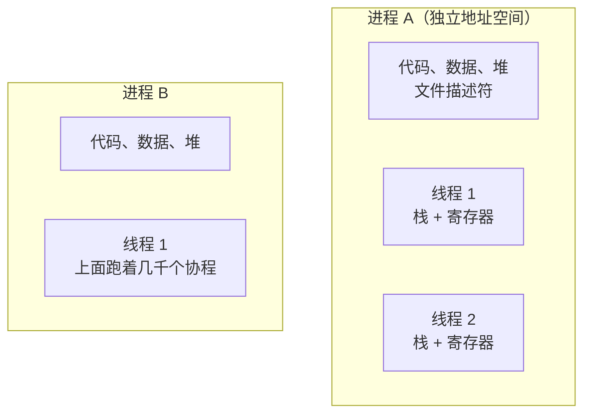

# 进程、线程、协程

> 频率：★★★ · 近两年出现在：字节（进程/线程/协程、内核态与用户态）、腾讯（内存申请与 OOM、overcommit、进程与协程） · 参考：[小林coding](https://xiaolincoding.com/os/4_process/process_base.html)

## 一句话答案

**进程**是资源分配的单位：有独立的虚拟地址空间、文件描述符表等。**线程**是 CPU 调度的单位：同一进程的线程共享地址空间和资源，只有各自的栈、寄存器和程序计数器，创建和切换比进程便宜。**协程**是用户态的轻量线程，由用户程序（运行时）调度，切换不进内核，一个协程栈只有几 KB，可以开几十万上百万个；但协程一般是**协作式**的，要在 IO 等待时主动让出。

## 展开（1–2 分钟能讲完）

| | 进程 | 线程 | 协程 |
|---|---|---|---|
| 调度者 | 内核 | 内核 | 用户态运行时 |
| 地址空间 | 独立 | 共享所在进程的 | 共享 |
| 栈 | — | 固定，通常 1–8 MB | 几 KB，按需增长 |
| 切换开销 | 最大（切页表、TLB 失效） | 中（进内核、保存寄存器） | 最小（用户态保存几个寄存器） |
| 隔离性 | 一个崩溃不影响别的进程 | 一个线程崩溃整个进程挂 | 同线程 |
| 通信 | IPC | 共享内存 + 锁 | channel 或共享内存 |

Linux 里线程和进程都是 `task_struct`，用 `clone` 创建，区别只是共享了哪些资源，所以线程也叫轻量级进程（LWP）。

**为什么切换进程比切换线程贵**：进程切换要换页表，导致 TLB 失效，切换后一段时间内存访问变慢，CPU 缓存也大多失效；同进程内的线程切换不用换页表。

## 图解

## 追问链

- **进程间通信方式？**
  - **管道**：匿名管道（父子进程，单向，`ls | grep`）、命名管道 FIFO（任意进程）。
  - **消息队列**：内核里的消息链表，按消息类型收发。
  - **共享内存**：多个进程映射同一块物理内存，**最快**（不用在内核和用户之间拷贝），但要自己做同步，通常配合**信号量**。
  - **信号量**：计数器，用于同步和互斥。
  - **信号**：异步通知，比如 `kill -9` 发 SIGKILL、Ctrl+C 发 SIGINT。
  - **Socket**：可以跨机器；同一台机器上可以用 Unix Domain Socket，比 TCP 回环快。
  - 另外还有内存映射文件（mmap）。
- **线程切换要保存什么？** 通用寄存器、程序计数器（下一条指令地址）、栈指针、状态寄存器、浮点和 SIMD 寄存器等，保存在线程的内核数据结构里。切换过程：时钟中断或系统调用陷入内核 → 保存当前线程上下文 → 调度器选下一个线程 → 恢复它的上下文 → 返回用户态。如果两个线程属于不同进程，还要切换页表。
- **Go 协程和 Java 虚拟线程？** 都是 M:N 模型（M 个协程映射到 N 个内核线程），在阻塞操作时自动让出，写同步代码就能获得异步的性能。区别：Go 从语言层面就是协程，标准库全部适配，调度器是 [GMP](../12-go/gmp)，支持基于信号的**抢占**；Java 虚拟线程（JDK 21）是后加的，跑在 ForkJoinPool 上，遇到 `synchronized` 里阻塞时会**钉住**（pinned）载体线程（JDK 24 已修复），没有时间片抢占，CPU 密集任务没有收益。详见[虚拟线程](../03-concurrency/virtual-threads)。
- **一个进程最多能创建多少线程？** 受虚拟地址空间（32 位系统只有 3 GB 用户空间，每个线程栈 8 MB 只能创建三百多个）、`ulimit -u`、`/proc/sys/kernel/threads-max`、`pid_max` 和物理内存限制。
- **僵尸进程和孤儿进程？** 子进程退出了，父进程没有调用 `wait` 回收，子进程的进程描述符一直留着，就是**僵尸进程**（占用 PID）。父进程先退出了，子进程被 init（1 号进程）收养，是**孤儿进程**，无害。

## 我的项目里

TODO：项目里有没有用到多进程（比如 Python 的 multiprocessing 绕过 GIL）、协程（Go、Python asyncio）？为什么这么选？
