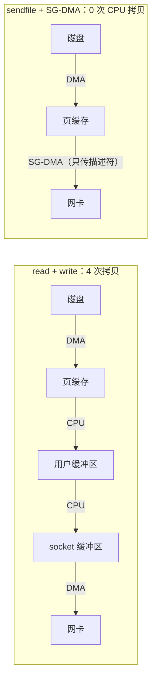

# 零拷贝

> 频率：★★☆ · 近两年出现在：腾讯（epoll ET/LT、IO 多路复用、零拷贝、C10K）、美团（epoll 触发模式、TCP 拥塞控制、TCP 半连接全连接队列、零拷贝） · 参考：[小林coding](https://xiaolincoding.com/os/8_network_system/zero_copy.html)

## 一句话答案

传统的「读文件再发到网络」要 4 次拷贝（磁盘 → 页缓存 → 用户缓冲区 → socket 缓冲区 → 网卡）和 4 次用户态/内核态切换。**零拷贝**减少 CPU 参与的拷贝：`mmap + write` 把页缓存映射到用户空间，省掉一次拷贝；`sendfile` 在内核里直接从页缓存送到 socket，只要 2 次切换；网卡支持 SG-DMA 时，`sendfile` 连页缓存到 socket 缓冲区这一次也省了，**CPU 拷贝次数为 0**。Kafka 消费、Nginx 发静态文件都用 sendfile。

## 展开（1–2 分钟能讲完）

**传统方式**（`read` + `write`）：

1. `read`：用户态 → 内核态；DMA 把数据从磁盘拷到页缓存；CPU 把数据从页缓存拷到用户缓冲区；返回用户态。
2. `write`：用户态 → 内核态；CPU 把数据从用户缓冲区拷到 socket 缓冲区；DMA 拷到网卡；返回用户态。

一共 **4 次拷贝**（2 次 DMA + 2 次 CPU）、**4 次上下文切换**。

**优化**：

| 方式 | CPU 拷贝 | 上下文切换 | 说明 |
|---|---|---|---|
| read + write | 2 | 4 | |
| mmap + write | 1 | 4 | 用户空间和页缓存共享，省掉内核 → 用户的拷贝 |
| sendfile | 1 | 2 | 一个系统调用搞定，数据不进用户空间 |
| sendfile + SG-DMA | 0 | 2 | 只把文件描述符和长度放进 socket 缓冲区，网卡直接从页缓存读 |

**限制**：sendfile 只能原样发送，数据不能在用户态修改（不能加密、压缩、改格式）。所以 HTTPS 场景下需要 TLS 加密时，传统 sendfile 用不了（Linux 有内核态 TLS，kTLS，可以结合）。

## 图解

## 追问链

- **mmap 和 sendfile 的区别？** `mmap` 把文件映射进进程的地址空间，进程可以像访问内存一样**读写**文件内容，适合需要修改或随机访问文件的场景（RocketMQ 的 CommitLog 用 mmap；数据库的文件访问）。缺点：映射大文件的缺页中断开销；文件被其他进程截断时访问映射区会收到 SIGBUS。`sendfile` 只能把文件**原样**从一个 fd 传到另一个 fd（以前要求目标是 socket），不经过用户空间，适合纯转发（Kafka 消费、Nginx 静态文件）。Java 里 `FileChannel.map()` 对应 mmap，`FileChannel.transferTo()` 对应 sendfile。
- **页缓存（Page Cache）？** 内核用空闲内存缓存磁盘文件的内容。**读**：先查页缓存，命中就不读磁盘；还会**预读**后面的页。**写**：写进页缓存就返回（标记为脏页），由内核后台线程按时间和比例刷盘（`dirty_expire_centisecs`、`dirty_ratio`），所以进程崩溃不丢数据，但断电会丢，要 `fsync`。Kafka 依赖页缓存：刚写入的消息通常直接从页缓存被消费走，不读磁盘。**不适合**页缓存的场景：传大文件（几 GB），会把页缓存里的热点数据挤出去，而且大文件很少重复读。这时用**直接 IO**（`O_DIRECT`，绕过页缓存）+ 异步 IO。MySQL InnoDB 有自己的 Buffer Pool，一般配置 `O_DIRECT` 避免双重缓存。
- **DMA 是什么？** 直接内存访问：由 DMA 控制器负责在设备和内存之间搬运数据，CPU 只需要发起和接收完成通知，搬运期间可以做别的事。零拷贝说的「零」是指 CPU 拷贝为零，DMA 拷贝还在。
- **Netty 的零拷贝？** 一部分是操作系统层面的（`FileRegion` 用 `transferTo`），另一部分是**用户态**避免拷贝：`CompositeByteBuf` 把多个缓冲区逻辑上组合成一个而不复制；`slice` 切分共享底层数组；使用**直接内存**（堆外）收发数据，避免 JVM 堆和本地内存之间多拷一次。

## 我的项目里

TODO：项目里有没有大文件下载或转发的场景？是怎么实现的？
