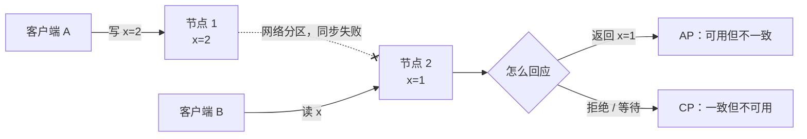

# CAP 与 BASE、一致性模型

> 频率：★★☆ · 近两年出现在：字节（强一致与最终一致、CAP、Nacos）、腾讯（负载均衡、服务发现与注册中心高可用、RPC 框架设计）、美团（令牌桶、熔断降级、CAP；Raft、注册中心脑裂与选主） · 参考：[JavaGuide](https://javaguide.cn/distributed-system/protocol/cap-and-base-theorem.html)

## 一句话答案

**CAP**：分布式系统在发生**网络分区**（P）时，只能在**一致性**（C，所有节点读到最新的数据）和**可用性**（A，每个请求都能在合理时间内得到非错误的响应）之间选一个。分区在分布式系统里无法避免，所以实际是选 **CP** 还是 **AP**。**BASE**（基本可用、软状态、最终一致）是 AP 思路的工程化：允许短时间不一致，保证最终一致。

## 展开（1–2 分钟能讲完）

**为什么不能同时满足**：两个节点之间网络断了，客户端往节点 1 写了新值。此时有人读节点 2：要么返回旧值（保证可用，牺牲一致），要么拒绝或等待（保证一致，牺牲可用）。

**常见系统的选择**：

| 系统 | 选择 | 说明 |
|---|---|---|
| ZooKeeper、etcd、Consul | CP | 基于 ZAB / Raft，Leader 挂了选举期间不可写；少数派节点不提供服务 |
| Eureka | AP | 节点之间平等复制，网络分区时各自继续提供（可能过期的）服务列表 |
| Nacos | 都支持 | 临时实例（默认）用自研的 Distro 协议走 AP；持久实例用 Raft 走 CP |
| Redis 主从 / Cluster | AP 偏向 | 异步复制，主挂了切换时可能丢写 |
| MySQL 主从异步复制 | 偏 AP | 从库可能读到旧数据 |

**一致性的强弱**（从强到弱）：线性一致性（任何读都能读到最新完成的写，像单机一样）→ 顺序一致性 → 因果一致性 → **读自己的写**（用户自己写完能马上读到）→ 单调读 → **最终一致性**（不再有新写入后，一段时间后所有副本一致）。

## 图解

## 追问链

- **强一致和最终一致？** 强一致：写成功后，任何后续读都能读到新值，实现上需要多数派确认（Raft、Paxos），写延迟高、可用性受影响。最终一致：写成功后副本可能暂时不同步，经过一段时间达到一致，延迟低、可用性高。业务上：账户余额、库存扣减要强一致；点赞数、评论数、推荐结果可以最终一致。常用的折中是「**读自己的写**」：用户刚改了资料，自己读走主库或者带版本号，其他人读从库。
- **Raft 选主过程？** 节点有三种角色：Leader、Follower、Candidate。Leader 定期给 Follower 发心跳。Follower 在**随机的选举超时**（如 150–300 ms）内没收到心跳，就变成 Candidate：**任期号 +1**，投自己一票，向其他节点发 `RequestVote`。其他节点在同一任期内**只投一票**，并且只投给日志**至少和自己一样新**的候选人（先比最后一条日志的任期，再比索引）。获得**多数派**选票就成为 Leader，立刻发心跳。随机超时避免多个节点同时发起选举而瓜分选票。日志复制：Leader 收到写请求，追加到自己的日志，发给 Follower，**多数派**确认后提交并应用到状态机。少数派分区里的节点选不出 Leader，也就不能写，这就是它的 CP。
- **注册中心选型？** 注册中心的核心需求是**服务发现的可用性**：宁可拿到一份稍微过期的服务列表（调用时失败重试换一个实例），也不能因为注册中心选主而让所有服务都发现不了。所以注册中心更适合 **AP**（Eureka、Nacos 临时实例）。配置中心、分布式锁、选主这类需要强一致的场景用 **CP**（etcd、ZooKeeper、Nacos 持久实例）。另外客户端要**缓存**服务列表，注册中心整个挂了也能用缓存继续调用。
- **脑裂？** 网络分区后，两边各自选出了 Leader，同时对外写。Raft 靠**多数派**避免：只有拿到多数票的一侧能选出 Leader；旧 Leader 发现自己联系不上多数派，写请求无法提交。所以集群节点数一般是奇数（3、5）。

## 我的项目里

TODO：项目用的注册中心 / 配置中心是什么？它是 CP 还是 AP？注册中心挂了服务之间还能调用吗？
