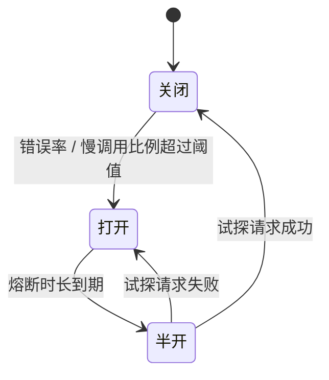

# 熔断、降级与服务治理

> 频率：★★☆ · 近两年出现在：阿里（DDD、微服务、K8s）、腾讯（负载均衡、服务发现与注册中心高可用、RPC 框架设计）、美团（令牌桶、熔断降级、CAP） · 参考：[JavaGuide](https://javaguide.cn/high-availability/fallback-and-circuit-breaker.html)

## 一句话答案

**熔断**：下游错误率或慢调用比例超过阈值时，**断开**对它的调用、直接走降级逻辑，避免请求堆积拖垮自己（雪崩）；过一段时间进入**半开**状态放少量请求试探，成功就恢复。**降级**：在故障或高峰时，主动关掉或简化非核心功能（返回默认值、缓存数据、提示稍后再试），保住核心链路。常用组件：Sentinel、Resilience4j（Hystrix 已停止维护）。

## 展开（1–2 分钟能讲完）

**雪崩是怎么发生的**：服务 C 变慢 → 调用它的 B 的线程都卡在等待 C → B 的线程池满了，B 也变慢 → 调 B 的 A 也被拖垮。一个服务的故障沿调用链蔓延到整个系统。

**熔断器的三个状态**：

- **关闭**：正常调用，统计滑动窗口内的失败率、慢调用比例。
- **打开**：超过阈值（比如 10 秒内请求数 ≥ 20 且错误率 ≥ 50%），在熔断时长内所有请求直接失败或降级，不调下游。
- **半开**：熔断时长到了，放行少量请求试探；成功就关闭，失败就重新打开。

**服务治理的整套手段**：

| 手段 | 作用 |
|---|---|
| 超时 | 每次调用都必须设，防止无限等待 |
| 重试 | 只对幂等操作、只对可重试的错误（超时、连接失败），有次数上限和退避 |
| 熔断 | 下游持续故障时快速失败 |
| 限流 | 保护自己不被上游压垮（见[限流](./rate-limiting)） |
| 隔离 | 不同下游用不同的线程池或信号量（舱壁模式），一个下游慢不影响其他 |
| 降级 | 失败时的兜底逻辑 |
| 负载均衡 | 轮询、加权、最少连接、一致性哈希；剔除故障实例 |

## 图解

## 追问链

- **超时、重试、熔断怎么配合？** 从外到内：**超时**要逐层递减（网关 3 s > 服务 A 调 B 2 s > B 调 C 1 s），否则上游已经超时放弃了，下游还在做无用功；**重试**发生在超时或失败之后，次数少（1–2 次）、带退避；重试产生的失败也计入**熔断**的统计，熔断打开后不再重试，直接降级。另外要设**总的截止时间**（deadline）并在调用链里传递，剩余时间不够就不再发起调用。
- **重试风暴？** 调用链有 3 层，每层重试 3 次，最底层的服务会收到 3³ = 27 倍的请求，正好在它已经出问题的时候，彻底被压垮。避免：只在**一层**重试（通常是最外层或者最靠近故障的一层）；**重试预算**（重试请求不超过正常请求的 10%）；指数退避 + 随机抖动；下游返回「过载」时不要重试；熔断打开后停止重试。
- **注册中心与服务发现？** 服务启动时把自己的地址注册到注册中心，定期发**心跳**续约；超过一定时间没有心跳就被剔除。调用方从注册中心拉取服务列表并**缓存**在本地，订阅变更通知，用客户端负载均衡选一个实例调用。还有**服务端发现**模式：调用方只访问负载均衡器（K8s Service、Nginx），由它转发。注册中心的选型见 [CAP](./cap-base)。
- **降级有哪些做法？** 返回缓存里的旧数据；返回默认值或兜底数据（推荐失败时展示热门榜单）；功能开关直接关掉非核心功能（评论、推荐）；写操作改为异步（先写 MQ，之后再处理）；页面静态化。降级开关放在配置中心，可以手动或自动触发。
- **Sentinel 和 Hystrix 的区别？** Hystrix 以线程池隔离为主，开销大，已停止维护；Sentinel 以信号量（并发数）隔离为主，支持 QPS 限流、热点参数限流、系统自适应保护、熔断，有控制台可以动态配置规则。

## 我的项目里

TODO：项目里调用外部服务（比如大模型 API）时，超时、重试、降级是怎么设置的？下游挂了用户会看到什么？
