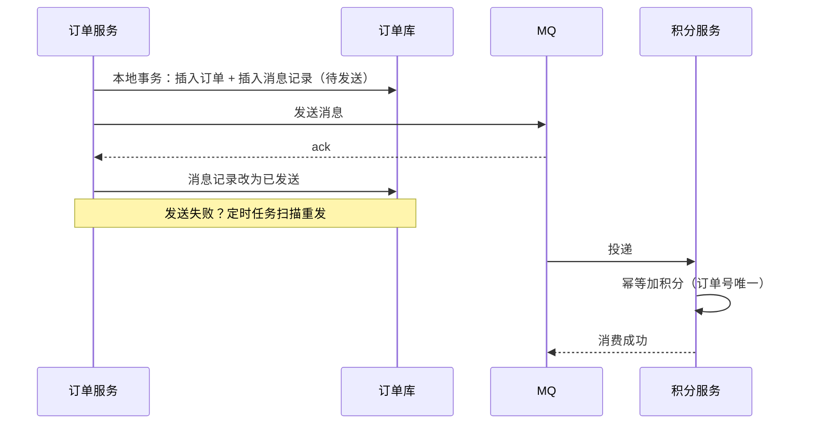

# 分布式事务：2PC、TCC、Saga、本地消息表

> 频率：★★☆ · 近两年出现在：字节（分布式事务、2PC、Saga）、阿里（分布式事务、支付幂等）、腾讯（微信扫码支付断网、支付流程）、美团（支付幂等、支付回调到库存扣减的幂等链路） · 参考：[JavaGuide](https://javaguide.cn/distributed-system/distributed-transaction.html)

## 一句话答案

跨多个数据库或服务的操作要保证一致性。**2PC**：协调者先让所有参与者准备（锁资源、写日志），都成功再统一提交，强一致但阻塞、性能差、协调者单点。**TCC**：业务自己实现 Try（预留资源）、Confirm（确认）、Cancel（释放），性能好但侵入大。**Saga**：拆成一串本地事务，失败时按相反顺序执行补偿。**本地消息表 / 事务消息**：把「发消息」和本地业务放进同一个本地事务，消息异步投递并重试，下游幂等消费，实现**最终一致**。互联网业务最常用的是后两者。

## 展开（1–2 分钟能讲完）

| 方案 | 一致性 | 性能 | 侵入性 | 适合 |
|---|---|---|---|---|
| 2PC / XA | 强一致 | 差（资源锁到第二阶段结束） | 低（数据库支持） | 内部、低并发 |
| TCC | 最终一致（很接近强一致） | 好 | 高（每个操作写三个接口） | 资金、库存等核心链路 |
| Saga | 最终一致 | 好 | 中（要写补偿） | 长流程、跨多个服务（订票：机票 + 酒店 + 租车） |
| 本地消息表 / 事务消息 | 最终一致 | 好 | 中 | 异步通知类：下单后加积分、发券 |
| 最大努力通知 | 弱 | 好 | 低 | 支付结果回调商户 |

**本地消息表**：

1. 在同一个本地事务里：写业务表 + 写一条「待发送」的消息记录。
2. 事务提交后发送 MQ；发送成功把消息记录改成「已发送」。
3. 定时任务扫描超时未发送的记录，重新发送。
4. 下游消费，**幂等**处理，失败重试。

**RocketMQ 事务消息**是同样的思路，由 MQ 帮你存「半消息」并**回查**本地事务状态，不用自己建消息表。

**TCC 的三个坑**：**空回滚**（Try 没执行就收到 Cancel，要能识别并直接返回成功）；**悬挂**（Cancel 先执行，之后迟到的 Try 才到，Try 不能再预留资源）；**幂等**（Confirm、Cancel 都可能被重试）。都靠一张事务控制表记录每个分支的状态来解决。

## 图解

## 追问链

- **Seata 的 AT 模式？** 对业务**无侵入**的两阶段提交。一阶段：拦截 SQL，执行前查出**前镜像**，执行后查出**后镜像**，把它们写进 `undo_log` 表，和业务 SQL 在**同一个本地事务**里提交，并向 TC（事务协调者）注册分支、申请**全局锁**（锁住修改的行）。二阶段：全局提交时，异步删除 undo_log 即可；全局回滚时，用前镜像生成反向 SQL 恢复数据（先比较后镜像和当前数据，不一致说明被别人改过，需要人工处理）。全局锁保证在全局事务结束前，其他全局事务不能修改这些行（写隔离）。代价是全局锁降低了并发，读隔离默认是读未提交。
- **支付回调到库存扣减的一致性链路？** 一个常见的设计：
  1. 下单时**预扣库存**（Redis 原子扣减或 DB 条件更新 `stock >= n`），订单状态为待支付，同时发一条**延迟消息**用于超时取消。
  2. 支付平台回调：验签 → 按订单号**幂等**（条件更新 `WHERE status = 'UNPAID'`）把订单改为已支付；在同一个本地事务里写消息表，异步通知库存服务把预扣转为实际扣减、通知其他下游（积分、物流）。
  3. 超时未支付：延迟消息触发取消订单，释放预扣库存（同样幂等，并且要和支付回调互斥：都是基于订单状态的条件更新，谁先改成功谁生效）。
  4. 兜底：定时**对账**（主动查支付平台的订单状态、对比订单和库存流水），修复不一致。
- **2PC 的问题？** 同步阻塞：准备阶段之后参与者一直持有锁，等协调者的指令；协调者单点：第二阶段协调者挂了，参与者不知道该提交还是回滚，一直阻塞；数据不一致：第二阶段部分参与者收到提交、部分没收到。3PC 加了超时和预提交阶段，缓解阻塞，但仍不能完全解决，实际很少用。
- **怎么选？** 能不用分布式事务就不用：先看能否通过调整服务边界把操作放到一个库里。必须跨服务时，大部分场景用「本地消息表 / 事务消息 + 幂等 + 对账」做最终一致；核心资金链路且要求强一致时用 TCC 或 Seata AT。

## 我的项目里

TODO：项目里有没有跨服务、跨库的写操作？是怎么保证一致性的？有没有对账？
