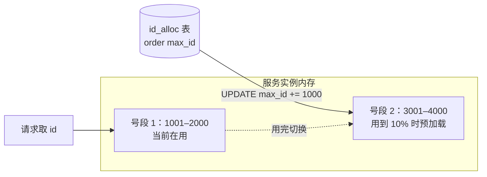

# 分布式 id：雪花算法、号段模式

> 频率：★★☆ · 参考：[JavaGuide](https://javaguide.cn/distributed-system/distributed-id.html)

## 一句话答案

分库分表后不能再用数据库自增 id，要全局唯一、最好**趋势递增**（对 B+ 树索引友好）。**雪花算法**：64 位 = 1 位符号 + 41 位毫秒时间戳 + 10 位机器 id + 12 位序列号，本地生成、性能高，依赖时钟。**号段模式**：从数据库批量取一段 id（比如一次取 1000 个）缓存在内存里分配，用完再取，用双 buffer 提前加载。美团 Leaf、百度 UidGenerator 是这两种方案的工程化实现。

## 展开（1–2 分钟能讲完）

**雪花算法**：

```text
0 | 41 位时间戳（毫秒，约 69 年） | 10 位机器 id（1024 台） | 12 位序列号（每毫秒 4096 个）
```

同一毫秒内序列号递增，用完了就等到下一毫秒。单机每秒理论上 400 多万个。时间戳是相对于自定义起始时间的偏移。**机器 id 怎么分配**：配置文件写死；启动时从 ZooKeeper / Redis / 数据库领取一个（Leaf 用 ZooKeeper 顺序节点）。

**号段模式**：

```sql
UPDATE id_alloc SET max_id = max_id + step WHERE biz_tag = 'order';
SELECT max_id, step FROM id_alloc WHERE biz_tag = 'order';
```

拿到 `(max_id - step, max_id]` 这一段，在内存里用 `AtomicLong` 分配。**双 buffer**：当前号段用到 10%（可调）时，异步加载下一个号段，切换时不用等数据库。数据库短时间挂了，内存里的号段还能撑一阵。

| 方案 | 优点 | 缺点 |
|---|---|---|
| UUID | 本地生成，最简单 | 36 个字符太长、无序，做主键导致页分裂 |
| 数据库自增 | 简单、递增 | 单点、性能瓶颈；多主可以用不同步长 |
| Redis `INCR` | 快、递增 | 依赖 Redis 持久化，可能重复 |
| 雪花算法 | 本地生成、性能最高、趋势递增 | 时钟回拨；机器 id 要管理 |
| 号段模式 | 不依赖时钟、递增、DB 短暂故障可用 | 依赖数据库；id 连续，**容易被猜出业务量** |

## 图解



## 追问链

- **时钟回拨怎么处理？** NTP 同步或人为调整可能让系统时间倒退，雪花算法就可能生成重复的 id。处理：记录上一次生成 id 的时间戳，发现当前时间更小时：回拨很小（几毫秒）就**等待**时钟追上；回拨较大就**报错**、告警并摘掉这个节点；或者使用**备用的机器 id**继续生成；百度 UidGenerator 和一些实现不读系统时间，而是自己维护一个递增的「逻辑时间」（启动时取当前时间，之后用完一毫秒的序列号就加一），彻底不依赖时钟。另外运维上用 NTP 的 slew 模式（缓慢调整）而不是直接跳变。
- **UUID 为什么不适合做主键？** 太长（36 字符，存为字符串 36 字节，二进制也要 16 字节），InnoDB 的二级索引都要存主键，索引变大；**无序**，插入位置随机，导致 B+ 树频繁**页分裂**、页空间利用率低、随机 IO 多，写入性能差。UUIDv7（时间有序）缓解了无序的问题，但长度还在。
- **id 被猜出来有什么问题？** 连续 id 会暴露业务量（竞争对手每天下两个单，相减就知道日订单量），也容易被遍历爬取数据。对外暴露的 id 可以用雪花算法或者做混淆（加密、Hashids）。
- **订单号的设计？** 除了唯一，还常常要求可读、便于分库分表定位：比如 `时间 + 业务类型 + 用户 id 后几位（基因法，决定分片）+ 序列号`，这样按订单号或按用户查询都能直接定位到分片。

## 我的项目里

TODO：项目的主键 / 订单号是怎么生成的？如果以后要分库分表需要改吗？
