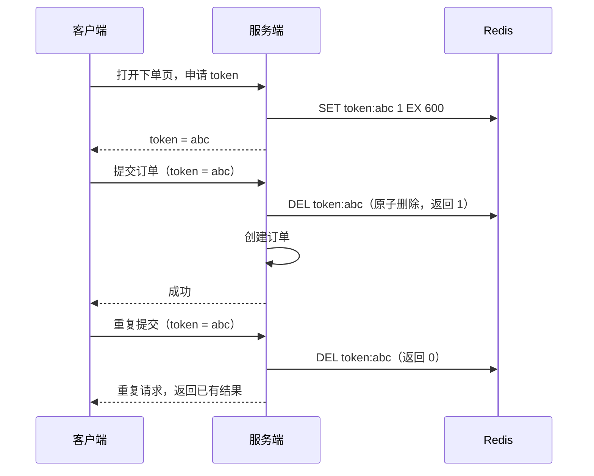

# 接口幂等

> 频率：★★★ · 近两年出现在：字节（恰好一次、幂等消费、充值幂等；429 重试导致重复扣费）、阿里（分布式事务、支付幂等）、腾讯（微信扫码支付断网、支付流程）、美团（支付幂等、支付回调到库存扣减的幂等链路） · 参考：[JavaGuide](https://javaguide.cn/high-availability/idempotency.html)

## 一句话答案

幂等：同一个操作执行一次和执行多次的效果相同。需要幂等的场景：用户重复点击、前端或网关超时重试、MQ 重复投递、支付回调重复通知。实现方式：**唯一索引**（业务唯一键）、**防重 Token**（先领 token，提交时原子地校验并删除）、**状态机条件更新**（`WHERE status = 原状态`）、**乐观锁**（版本号）、**分布式锁 + 先查后写**。查询和删除天然幂等，新增和「余额 - 10」这种增量更新要特别处理。

## 展开（1–2 分钟能讲完）

**按操作类型分析**：

| 操作 | 天然幂等吗 | 做法 |
|---|---|---|
| 查询 | 是 | — |
| 删除 | 是（删一次和删两次一样） | — |
| 更新为固定值 `SET status = 'PAID'` | 是 | 加上状态条件防止覆盖更新的状态 |
| 增量更新 `balance = balance - 10` | 否 | 流水表唯一键 + 同一事务；或者版本号 |
| 新增 | 否 | 唯一索引；防重 Token |

**几种实现的选择**：

- **唯一索引**：最可靠，数据库兜底。比如支付流水表的 `(order_id, pay_type)` 唯一，重复插入报 `DuplicateKeyException`，捕获后返回之前的结果。
- **状态机**：`UPDATE order SET status = 'SHIPPED' WHERE id = ? AND status = 'PAID'`，影响行数为 0 就说明已经处理过（或者状态不对）。
- **防重 Token**：用于表单提交、创建类接口。
- **请求 id**：客户端为每个业务请求生成唯一 id（重试时用同一个），服务端用它去重，并**缓存第一次的响应**，重复请求直接返回同样的结果（支付接口常见的 `Idempotency-Key` 头）。

## 图解

## 追问链

- **防重 Token 怎么设计？** 进入页面或提交前先调接口拿一个 token（UUID），存 Redis 并设过期时间；提交时带上，服务端**原子地**检查并删除：直接用 `DEL` 的返回值（1 表示成功删除、第一次提交），或者 Lua 脚本「GET 比较 + DEL」。**不能**先 `GET` 再 `DEL` 两步（两个并发请求都 GET 到，都会通过）。注意：删了 token 之后业务失败了怎么办？要么允许用户重新获取 token 重试，要么业务失败时恢复 token。token 方案只能防止**同一个页面的重复提交**，防不住客户端重新拿 token 再提交，所以关键业务仍然要唯一索引兜底。
- **幂等和防重的区别？** **防重**是阻止重复的请求进来（同一个请求只处理一次），重复请求可以直接报错「请勿重复提交」。**幂等**更强调**结果**：重复请求要返回和第一次相同的结果（比如重复的支付请求返回「支付成功」和同一个支付单号），调用方无需区分是不是重复。超时重试的场景必须是幂等：调用方不知道第一次是否成功，重试拿到的结果必须是正确的。
- **分布式锁能做幂等吗？** 锁只能防止**并发**的重复请求同时执行；第一个请求执行完释放锁后，第二个请求还是会再执行一次。所以锁要配合「先查是否处理过」，最终还是要靠唯一索引或状态判断。
- **429 重试导致重复扣费？** 典型问题：调用方收到 429（限流）或超时后自动重试，但第一次其实已经处理了（或者限流发生在扣费之后）。解决：所有会产生副作用的接口都带幂等 key；服务端在扣费前按幂等 key 检查；网关层的限流要在业务处理**之前**拒绝；调用方只对明确未处理的错误（429、503 在处理前返回）重试，并遵守 `Retry-After`。

## 我的项目里

TODO：项目里哪些接口做了幂等？用的什么方法？有没有出现过重复数据？
