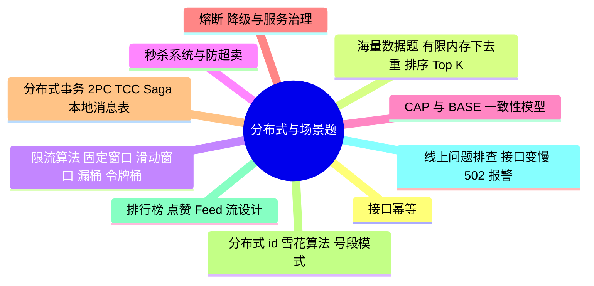

# 分布式与场景题

> 进度：10 / 10 条已写完。本页由 `tools/gen_index.py` 生成，改条目后重新运行即可。

## 知识地图

## 条目（按频率排序）

频率按 2025–2026 年后端面经里出现的次数估计：★★★ 几乎每场都可能问，★★ 经常问，★ 偶尔问。

| 知识点 | 频率 | 状态 | 一句话答案 |
|---|---|---|---|
| [接口幂等](./idempotency) | ★★★ | ✅ | 同一请求执行多次结果相同。做法：唯一请求 id + 唯一索引、Token 机制（先领令牌再提交）、乐观锁版本号、状态机。重复点击支付、429 重试导致重复扣费都靠它。 |
| [海量数据题：有限内存下去重、排序、Top K](./massive-data) | ★★★ | ✅ | 核心思路是分而治之：按哈希把大文件拆成能放进内存的小文件，分别处理再合并。整数去重或判存在用 Bitmap（40 亿个 int 约 512 MB）；近似去重用布隆过滤器或 HyperLogLog。 |
| [限流算法：固定窗口、滑动窗口、漏桶、令牌桶](./rate-limiting) | ★★★ | ✅ | 固定窗口有临界突刺；滑动窗口把窗口切成小格平滑计数；漏桶以恒定速率处理；令牌桶以恒定速率放令牌，允许一定突发，最常用。分布式限流用 Redis + Lua。 |
| [秒杀系统与防超卖](./seckill) | ★★★ | ✅ | 层层过滤：前端限流和验证码 → 网关限流 → Redis 预扣库存（Lua 原子判断并扣减）→ MQ 异步下单削峰 → 数据库用 where stock > 0 兜底。还要处理超时未支付的库存返还。 |
| [CAP 与 BASE、一致性模型](./cap-base) | ★★☆ | ✅ | 网络分区一定会发生，所以只能在一致性（C）和可用性（A）之间取舍：ZooKeeper 是 CP，Eureka、Nacos（AP 模式）是 AP。BASE 是基本可用 + 软状态 + 最终一致。 |
| [熔断、降级与服务治理](./circuit-breaker) | ★★☆ | ✅ | 熔断器有关闭、打开、半开三种状态，错误率超阈值就打开，直接失败，过一段时间半开试探；降级是返回兜底数据。常用 Sentinel、Resilience4j。 |
| [分布式事务：2PC、TCC、Saga、本地消息表](./distributed-transaction) | ★★☆ | ✅ | 2PC 强一致但阻塞、性能差；TCC 业务侵入大；Saga 用补偿操作，适合长流程；本地消息表和 MQ 事务消息实现最终一致，是业务中最常用的。 |
| [分布式 id：雪花算法、号段模式](./id-generator) | ★★☆ | ✅ | 雪花算法：1 位符号 + 41 位时间戳 + 10 位机器 id + 12 位序列号，趋势递增；问题是时钟回拨。号段模式（美团 Leaf）每次从数据库取一段 id 放内存。 |
| [排行榜、点赞、Feed 流设计](./leaderboard) | ★★☆ | ✅ | 排行榜用 Redis ZSet，千万级用户可以按分数段分桶；点赞用 Set 或 Hash 记录，计数异步落库；Feed 流分推模式（写扩散）、拉模式（读扩散）和推拉结合（大 V 用拉）。 |
| [线上问题排查：接口变慢、502、报警](./online-troubleshooting) | ★★☆ | ✅ | 按链路从外到内排查：监控看是全部慢还是部分慢 → 链路追踪定位慢在哪一段 → 看数据库慢查询、Redis、下游接口、GC、线程池是否打满。502 多是后端进程挂了或网关超时。 |
