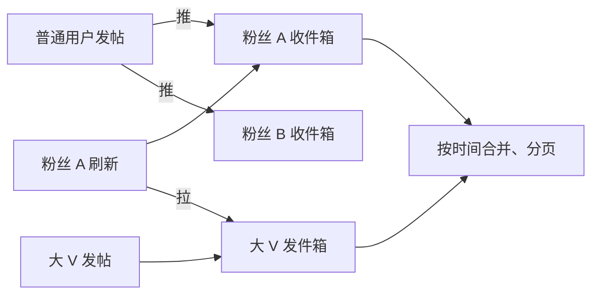

# 排行榜、点赞、Feed 流设计

> 频率：★★☆ · 近两年出现在：字节（点赞排行榜、直播评论、Feed 流推拉）、阿里（积分抽奖设计、指标聚合） · 参考：[JavaGuide](https://javaguide.cn/database/redis/redis-questions-01.html)

## 一句话答案

**排行榜**用 Redis **ZSet**：`ZINCRBY` 加分、`ZREVRANGE` 取前 N 名、`ZREVRANK` 查某人名次，都是 O(log n)。**点赞**用 Redis 记录点赞关系（Set 或 Hash）和计数，异步批量落库。**Feed 流**有推模式（发布时写入每个粉丝的收件箱）、拉模式（读时去关注的人那里拉取再合并）和推拉结合（普通用户推、大 V 拉）。

## 展开（1–2 分钟能讲完）

**排行榜**：

```text
ZINCRBY rank:2026-11-04 10 user:1001       # 加分
ZREVRANGE rank:2026-11-04 0 9 WITHSCORES   # 前 10 名
ZREVRANK rank:2026-11-04 user:1001         # 我的名次（从 0 开始）
ZUNIONSTORE rank:week 7 rank:d1 ... rank:d7   # 合并 7 天得到周榜
```

数据量很大（上亿用户）时：只保留前 N 名在 ZSet 里（定期 `ZREMRANGEBYRANK` 裁剪），其余用户的名次用分数分段统计近似给出；或者按分数段分片。

**点赞**：

- 关系：`SADD like:post:123 user:1001`（是否点过 `SISMEMBER`），或者用户维度 `like:user:1001` 存点过的帖子。
- 计数：`HINCRBY post:counter:123 likes 1`。
- 落库：点赞记录写 MQ 或者定时把 Redis 里的变化批量写进 DB（点赞表 `(user_id, post_id)` 唯一索引）；计数定期同步。
- 热门帖子的计数 key 是热 key（见下面的追问）。

**Feed 流**：

| 模式 | 写 | 读 | 适合 |
|---|---|---|---|
| 推（写扩散） | 发帖时写进所有粉丝的收件箱，粉丝多时写放大严重 | 直接读自己的收件箱，快 | 粉丝数少、读多 |
| 拉（读扩散） | 只写自己的发件箱 | 读时去所有关注的人那里拉最新的，再按时间合并 | 关注数少、粉丝极多的大 V |
| 推拉结合 | 普通用户推给粉丝；大 V 只写发件箱 | 读收件箱 + 拉关注的大 V 的发件箱，合并 | 微博、朋友圈类产品 |

收件箱用 Redis ZSet（score 是时间戳）或者 List，只保留最近几百条；分页用「上一页最后一条的时间戳 / id」作为游标，不用 offset（避免新内容插入导致重复）。

## 图解



## 追问链

- **同分时怎么排序？** ZSet 分数相同时按 member 的字典序，不符合「先达到的排前面」的要求。做法：把时间编码进分数。比如 `score = 分数 × 10^10 + (MAX_TS - 达到时间的秒数)`：分数高的在前；同分时达到时间越早，后半部分越大，排越前。注意 ZSet 的 score 是 double，只有 53 位整数精度，要算好位数不能超出。另一种是分数相同的再按时间二次排序（取出同分的一批在应用里排）。
- **直播间点赞的热 key？** 一个直播间每秒几万次点赞，都打到同一个计数 key 上，单个 Redis 分片扛不住。做法：**本地聚合**：服务在内存里先累加，每隔 1 秒或攒到一定数量再 `INCRBY` 一次，写请求降几个数量级；**key 拆分**：`like:room:1:{0..9}` 随机写到 10 个 key，读时求和（或者定时汇总到一个 key 供读）；读的热 key 用**本地缓存**；点赞数允许一点延迟和误差。前端也会合并（用户连点 10 次只发一个请求）。
- **积分抽奖怎么设计？** 扣积分和发奖品要一致：先在同一个事务里扣积分 + 写抽奖记录（幂等键防重复）；奖品库存用 Redis 预扣（`DECR` 小于 0 就回滚），中奖结果异步发放并重试；按概率抽奖可以用前缀和 + 二分（见算法库 528 题）；要防刷：限频、风控。
- **Feed 流怎么分页？** 不用页码，用**游标**：客户端传上一页最后一条的 `(时间戳, id)`，服务端查比它更早的 N 条。这样新内容插入不会导致下一页出现重复。

## 我的项目里

TODO：项目里有没有排行榜、计数、时间线这类功能？数据存在哪、怎么保证计数准确？
