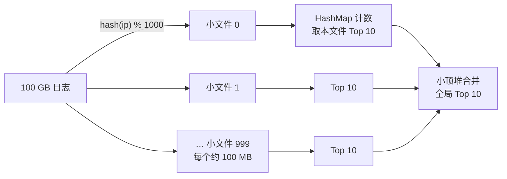

# 海量数据题：有限内存下去重、排序、Top K

> 频率：★★★ · 近两年出现在：字节（10 GB 文件找行号、日志 Top 10 IP）、阿里（积分抽奖设计、指标聚合）、腾讯（10 亿 QQ 号找唯一数、QQ 号去重） · 参考：[JavaGuide](https://javaguide.cn/cs-basics/algorithms/classical-algorithm-problems-recommendations.html)

## 一句话答案

内存装不下全部数据时，三板斧：**分治**（按哈希把大文件切成小文件，相同的数据一定落在同一个小文件里，逐个处理再汇总）、**位图 / 布隆过滤器**（用 1 个 bit 表示一个数是否出现，极大压缩空间）、**堆**（Top K 只需要维护 K 个元素）。再加上**外部排序**（分块排序后多路归并）和**计数**（数值范围小时直接计数）。

## 展开（1–2 分钟能讲完）

**常见题型和套路**：

| 题型 | 套路 |
|---|---|
| 海量数据里出现次数最多的 K 个 | 哈希分片到小文件 → 每个小文件用 HashMap 计数 → 每个文件的 Top K 用小顶堆合并（见算法库的[海量数据 Top K](https://bingqin2.github.io/algo-notes/06-heap-topk/stream-topk)） |
| 判断是否存在、去重 | 整数用**位图**；字符串用**布隆过滤器**（允许误判）或者哈希分片后逐个文件去重 |
| 找中位数 | 按数值的高位分桶计数，确定中位数在哪个桶，再在桶里找；或者用两个堆（数据流） |
| 两个大文件找共同的 URL | 两个文件用**同一个哈希函数**各自切成 1000 个小文件，第 i 对小文件分别求交集 |
| 海量数据排序 | 外部排序：分块读入内存排序写回 → k 路归并（用堆） |
| 统计不同元素的个数（基数） | 精确：位图；近似：HyperLogLog（12 KB 估计上亿，误差 0.81%） |

**位图的大小**：32 位无符号整数一共 2³² 个，每个 1 bit，需要 2³² / 8 = **512 MB**。

## 图解

## 追问链

- **2 GB 内存给 4 TB 的 int32 去重？** 4 TB 的 int32 大约是 1 万亿个数，但 int32 只有 2³² ≈ 43 亿种取值。用**位图**：2³² bit = 512 MB，2 GB 内存放得下。顺序读文件，每个数对应的位如果是 0 就置 1 并输出（第一次出现），是 1 就跳过（重复）。如果要找「只出现一次的数」，用 **2 bit 位图**（00 没出现、01 出现一次、10 多次），需要 1 GB，也放得下。如果内存更小（比如只有 100 MB），按数值的**高位**分段：先处理落在 [0, 2²⁸) 的数，再处理下一段，多读几遍文件；或者先按哈希切成小文件。
- **10 GB 文件找某一行？** 如果是只找一次：顺序扫描，按块读（不要一次加载进内存），用 `grep`、或者多线程按字节偏移分段并行扫描（注意分段边界在一行中间的处理）。如果要**多次查询**：建索引：扫描一遍，记录每行的内容哈希（或者关键字段）→ 文件偏移量，索引存在内存或磁盘上的哈希表 / B+ 树里，查询时直接 seek 过去读。如果是按行号查：记录每隔 1000 行的偏移量（稀疏索引），先定位块再顺序数。
- **日志里出现最多的 10 个 IP？** IPv4 只有 2³² 种，如果允许 2³² × 4 字节 = 16 GB 的计数数组就能直接计数；一般内存不够，就用上面的「哈希分片 + HashMap 计数 + 小顶堆」。同一个 IP 一定在同一个小文件里，所以每个小文件的计数就是全局计数。如果某个小文件还是太大（数据倾斜，大量相同 IP），对它换一个哈希函数再切分。实际工作中直接用 `sort | uniq -c | sort -rn | head`（sort 本身支持外部排序），或者 Spark / Hive 的 group by。
- **10 亿个 QQ 号找出唯一的数（只出现一次的）？** QQ 号在 32 位范围内，用 2 bit 位图（1 GB）；或者哈希分片后每个小文件用 HashMap 计数，取次数为 1 的。
- **布隆过滤器的误判率？** n 个元素、m 位、k 个哈希函数时，误判率约为 (1 − e^(−kn/m))^k，最优 k = (m/n) ln 2。每个元素 10 bit、k = 7 时误判率约 1%。只会误判「存在」，不会误判「不存在」；不能删除（计数布隆过滤器可以）。

## 我的项目里

TODO：工作或项目里有没有处理过单机内存放不下的数据？用的什么方法（分批、外部排序、Spark）？
