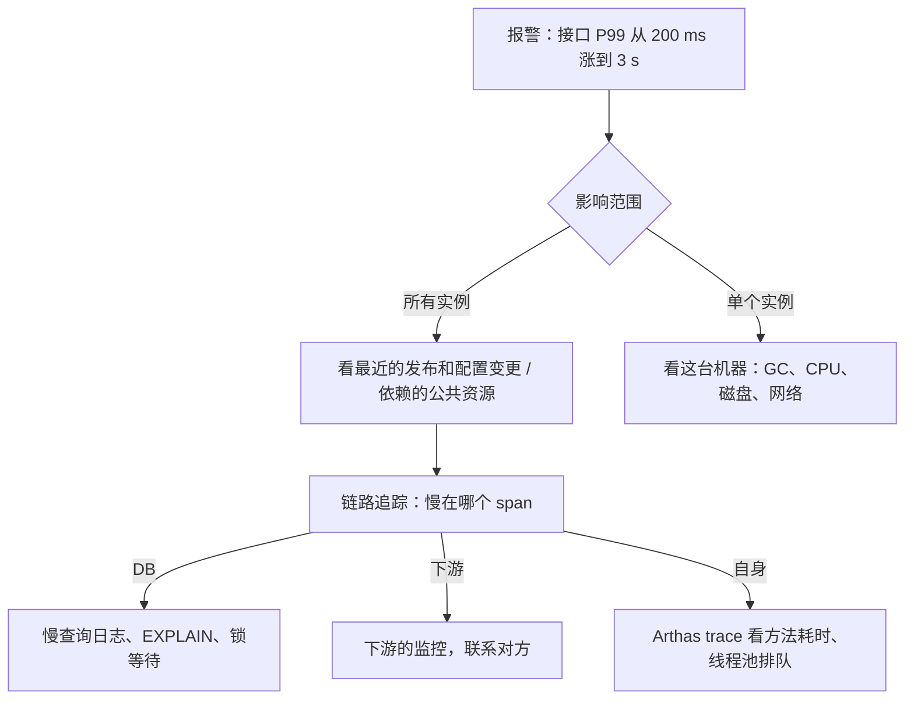

# 线上问题排查：接口变慢、502、报警

> 频率：★★☆ · 近两年出现在：美团（接口超时排查、系统容量） · 参考：[JavaGuide](https://javaguide.cn/java/jvm/jdk-monitoring-and-troubleshooting-tools.html)

## 一句话答案

先**止血**再定位：回滚最近的变更、扩容、限流降级、摘掉故障实例。定位按「**由外到内、先整体后局部**」：先看监控大盘确定影响范围（全部接口还是一个接口、全部实例还是一台、什么时候开始的、和什么变更同时发生）→ 用**链路追踪**找到慢在哪个环节（DB、缓存、下游、自身）→ 再到具体的机器和进程上用日志、`top`、`jstack`、Arthas、慢查询日志深挖。

## 展开（1–2 分钟能讲完）

**接口变慢的常见原因**：

| 环节 | 原因 | 怎么看 |
|---|---|---|
| 数据库 | 慢 SQL（索引失效、数据量增长、锁等待）、连接池耗尽 | 慢查询日志、`EXPLAIN`、连接池监控、`SHOW PROCESSLIST` |
| 缓存 | 缓存失效（击穿）、大 key、热 key、Redis 慢命令 | 命中率监控、`SLOWLOG`、`--bigkeys` |
| 下游服务 | 下游变慢、超时设置太长、重试 | 链路追踪的每个 span 耗时 |
| 自身 | Full GC、线程池满了在排队、锁竞争、CPU 打满 | GC 日志、线程池监控、`jstack`、Arthas `trace` |
| 基础设施 | 网络抖动、磁盘 IO、宿主机资源争用 | 机器监控 |

**502 / 504 排查**：

- **502**：网关（Nginx）连上游失败或者上游返回了无效响应。看 Nginx 的 error log：`connect() failed (111: Connection refused)`（上游进程挂了、端口不对、正在发布）、`upstream prematurely closed connection`（上游处理中崩溃或者主动断开，比如上游的 keepalive 超时比 Nginx 短，Nginx 复用了一个已被上游关闭的连接）。
- **504**：网关等上游**超时**（`proxy_read_timeout`）。上游太慢，按「接口变慢」排查。

**报警处理**：确认报警真实性和影响面 → 通知相关人 → 止血 → 定位 → 修复 → **复盘**（时间线、根因、为什么没提前发现、改进项）。

## 图解

## 追问链

- **一个接口从 800 ms 优化到 100 ms 的过程？** 讲一个完整的故事：
  1. **测量**：用链路追踪或 Arthas `trace` 拆解 800 ms 花在哪：比如 DB 查询 300 ms、串行调 3 个下游各 100 ms、循环里查库（N+1）150 ms、序列化 50 ms。
  2. **逐项优化**：慢 SQL 加联合索引、改成覆盖索引（300 → 20 ms）；循环查库改成批量 `IN` 查询（150 → 15 ms）；3 个没有依赖关系的下游调用用 `CompletableFuture` **并行**（300 → 100 ms）；不常变的数据加**缓存**；返回体裁掉不需要的字段。
  3. **验证**：压测对比 P50 / P99，上线后看监控。
  4. 说清楚**取舍**：缓存带来一致性问题怎么处理、并行调用的超时和降级怎么设。
- **CPU 100% 排查？** 见 JVM 模块的[线上排查](../04-jvm/troubleshooting)。
- **怎么提前发现问题？** 监控四个黄金指标：**延迟**（P99 而不是平均值）、**流量**、**错误率**、**饱和度**（CPU、内存、连接池、线程池使用率）；对依赖的下游也要监控；日志里带 traceId 方便串起整个请求；容量规划和压测。
- **系统容量怎么估？** 单机压测得到在可接受延迟下的最大 QPS，按峰值流量（日均 QPS × 峰值系数，通常 3–5 倍）计算机器数，留 30% 左右的余量；关注瓶颈在哪：DB 连接数、Redis、下游的限额。

## 我的项目里

TODO：写一个你排查过的线上问题：现象、影响、怎么定位、根因、修复、复盘的改进项。
