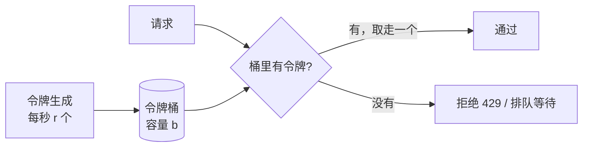

# 限流算法：固定窗口、滑动窗口、漏桶、令牌桶

> 频率：★★★ · 近两年出现在：字节（令牌桶、滑动窗口、按 RPM/TPM 限流）、腾讯（限流器（固定/滑动窗口）、热点限流器内存优化）、美团（令牌桶、熔断降级、CAP） · 参考：[JavaGuide](https://javaguide.cn/high-availability/limit-request.html)

## 一句话答案

**固定窗口**：每个时间窗口一个计数器，简单但窗口边界处可能放过 2 倍流量。**滑动窗口**：把窗口分成多个小格子或者记录每个请求的时间，统计最近一个窗口内的请求数，更平滑。**漏桶**：请求进桶，以**固定速率**流出，输出绝对平滑，但不能应对突发。**令牌桶**：以固定速率往桶里放令牌，请求拿到令牌才能通过，桶里攒的令牌允许**一定的突发**，最常用（Guava `RateLimiter`）。分布式限流用 Redis + Lua 保证原子性。

## 展开（1–2 分钟能讲完）

| 算法 | 原理 | 突发流量 | 缺点 |
|---|---|---|---|
| 固定窗口 | 每秒一个计数器，超过阈值拒绝 | 边界处可放过 2 倍 | 不平滑 |
| 滑动窗口（日志） | ZSet 记录每个请求的时间戳，统计最近 1 秒内的数量 | 精确 | 每个请求都要存，内存大 |
| 滑动窗口（计数） | 1 秒分成 10 个 100 ms 的格子，求最近 10 格之和 | 近似 | 精度取决于格子数 |
| 漏桶 | 队列 + 固定速率处理 | 不允许，全部排队 | 突发时请求延迟增大 |
| 令牌桶 | 固定速率产生令牌，桶容量是允许的突发量 | 允许，最多桶容量那么多 | 需要选两个参数 |

**令牌桶不用定时器**：记录上次的时间和令牌数，请求来时按经过的时间补令牌：`tokens = min(capacity, tokens + (now - last) * rate)`，够就扣减。手写代码见算法库的[令牌桶 / 限流器](https://bingqin2.github.io/algo-notes/13-design/rate-limiter)。

**分布式限流**：多个实例要共享计数，用 Redis：令牌桶的状态（令牌数、上次时间）存在一个 Hash 里，用 **Lua 脚本**在 Redis 端原子地完成「补令牌 + 判断 + 扣减」。Redis 本身成为瓶颈或单点时，可以把总配额按实例数分摊到本地限流，或者每次从 Redis 批量领一批令牌到本地。

**限流的维度**：全局、接口、用户、IP、租户；拒绝时返回 **429** 并带 `Retry-After`。

## 图解

## 追问链

- **手写令牌桶？** 见算法库的[限流器](https://bingqin2.github.io/algo-notes/13-design/rate-limiter)，要点：惰性补充令牌、`synchronized` 或 CAS 保证线程安全、用 `System.nanoTime()` 而不是 `currentTimeMillis()`（不受系统时间调整影响）。
- **大模型接口按 TPM / RPM 限流？** 大模型服务商一般同时限制 **RPM**（每分钟请求数）和 **TPM**（每分钟 token 数）。调用方要做的：
  - **两个维度都要限**：两个令牌桶，RPM 桶每个请求扣 1，TPM 桶扣这个请求的 token 数。
  - **token 数事先不知道**：请求前按输入 token 数 + `max_tokens` **预估**并预扣，响应回来后按实际用量（`usage` 字段）多退少补。
  - 多个业务共享一个 API key 时，按业务或租户**分配配额**，并设优先级（在线对话优先于离线批处理）。
  - 被限流（429）时按 `Retry-After` 或指数退避重试；多个 key 或多个模型**路由和降级**（主模型被限流就切到备用模型）。
  - 长请求导致 token 数波动大，可以用滑动窗口统计真实用量，动态调整。
- **热点参数限流（Sentinel）？** 对某个参数的**每个取值**单独限流，比如「每个商品 id 每秒最多 100 次查询」「每个用户每分钟最多 10 次下单」，防止某个热点值打垮系统。Sentinel 用 LRU 缓存为每个参数值维护一个令牌桶（只保留最近活跃的值，控制内存）。还可以给特定值设置例外阈值（大促商品单独放宽）。
- **限流放在哪一层？** 多层：网关 / Nginx（`limit_req` 是漏桶）做入口的总量和按 IP 限流；服务内部按接口、按用户限流；调用下游时按下游的配额限流。
- **限流和熔断的区别？** 限流保护**自己**不被上游压垮（主动拒绝超出处理能力的请求）；熔断保护自己不被**下游**的故障拖垮（停止调用出问题的下游）。

## 我的项目里

TODO：项目里有没有限流？在哪一层、用什么算法、阈值是怎么定的？调用大模型 API 时有没有遇到过 429？
