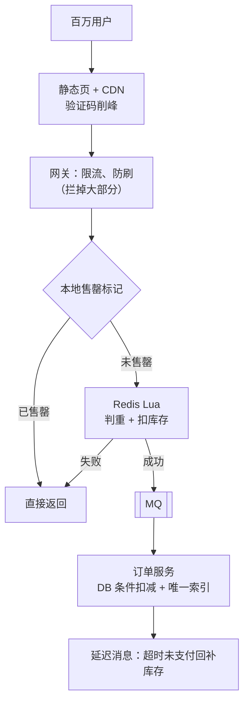

# 秒杀系统与防超卖

> 频率：★★★ · 近两年出现在：字节（秒杀、优惠券限领、抢票、红包）、阿里（百万 QPS 秒杀、超卖、防刷）、美团（秒杀库存、Redis 预扣库存、Kafka 异步下单、优惠券防超发） · 参考：[JavaGuide](https://javaguide.cn/high-performance/message-queue/message-queue.html)

## 一句话答案

秒杀的特点：瞬时流量极大、库存极少、绝大部分请求注定失败。思路是**层层过滤，让尽量少的请求到达数据库**：前端（静态化、按钮置灰、验证码削峰）→ 网关（限流、黑名单、防刷）→ 服务（本地标记售罄、**Redis Lua 原子预扣库存**）→ **MQ 异步下单**（削峰）→ 数据库（条件更新 `stock > 0` 兜底防超卖）→ 订单超时未支付回补库存。

## 展开（1–2 分钟能讲完）

**完整链路**：

1. **页面静态化 + CDN**：商品详情页放 CDN，秒杀开始前按钮不可点，开始时间以服务端为准。
2. **削峰**：答题或验证码把请求分散到几秒内；前端随机丢弃一部分请求。
3. **网关**：按用户、IP 限流；校验活动资格；拦截黑名单和机器人。
4. **库存预扣**：Redis 里存库存，用 Lua 脚本原子地「检查用户是否已买过 + 检查库存 + 扣减 + 记录用户」。扣减失败直接返回「已售罄」。服务本地用一个内存标记，售罄后直接拒绝，连 Redis 都不访问。
5. **异步下单**：扣减成功的请求发 MQ，返回「排队中」；消费者慢慢创建订单、扣数据库库存。前端轮询结果。
6. **数据库兜底**：`UPDATE stock SET num = num - 1 WHERE sku_id = ? AND num > 0`，影响行数为 0 就失败；`(user_id, activity_id)` 唯一索引防止一人多单。
7. **超时取消**：下单时发延迟消息，30 分钟未支付取消订单，回补 Redis 和 DB 库存。

## 图解

## 追问链

- **怎么防止超卖和少卖？** **超卖**：扣库存必须是原子的「检查 + 扣减」：Redis 用 Lua 脚本或 `DECR` 后判断结果小于 0 再加回去；DB 用 `WHERE num > 0` 条件更新（行锁保证）。不要「先查库存再扣」两步。**少卖**：Redis 扣成功了，但后续下单失败（MQ 发送失败、消费失败、用户没支付），库存没回来，最后有货卖不出去。解决：MQ 消息可靠投递和重试；下单失败、超时取消时**回补**库存（幂等）；定时**对账** Redis 库存、DB 库存、订单数，修正差异。
- **热点商品的 Redis 分片？** 一个商品的库存 key 在一个 Redis 分片上，单分片 QPS 有上限（约 10 万）。可以把库存**拆成多个 key** 分布到不同分片（`stock:sku1:{0..9}` 各放总库存的 1/10），请求随机或按用户哈希选一个扣减，某个分片扣完了再尝试其他分片；还可以把一部分库存分到各个服务实例的**本地内存**里扣减，Redis 只做汇总。
- **订单超时取消（延迟队列）？** RocketMQ 延迟消息 / RabbitMQ 死信队列 / Redis ZSet + 定时扫描 / 时间轮。取消和支付回调可能**并发**：两者都基于订单状态做条件更新（`WHERE status = 'UNPAID'`），谁先成功谁生效，另一个更新影响行数为 0 就放弃。回补库存要幂等。
- **十万人抢十个商品？** 关键是让 99.99% 的请求尽早失败：库存只有 10，Redis 里扣完后立刻设置本地售罄标记，后续请求在服务内存里就被拒绝；甚至可以在网关层只放行前 N 个（比如库存的几倍）请求进入，其余直接返回失败；或者先「预约 + 抽签」，把实时抢购变成离线抽取。
- **怎么防刷？** 登录态 + 实名；按用户、设备、IP 限频；验证码；隐藏秒杀接口地址（开始前才下发带签名的动态 URL）；风控识别异常账号。
- **为什么要异步下单？** 创建订单涉及多张表的写入、可能调用其他服务，耗时远高于 Redis 扣减；异步后数据库按自己的能力消费，不会被瞬时流量打垮。

## 我的项目里

TODO：项目里有没有高并发抢购、抢券、限量领取的场景？库存是怎么扣的？
