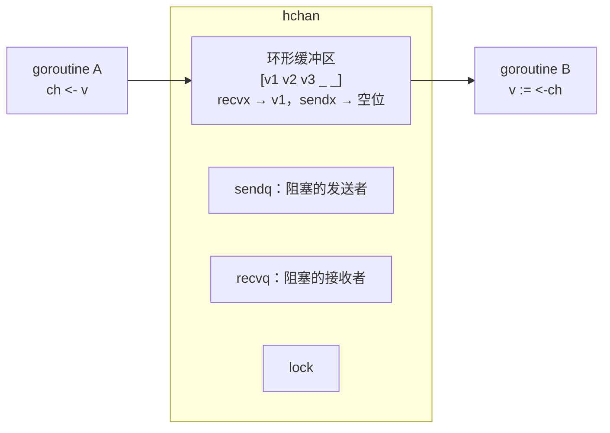

# channel 原理与无锁化思想

> 频率：★★☆ · 近两年出现在：腾讯（Go map 并发安全、Channel 的无锁思想、Go 与 Java） · 参考：[Go 语言设计与实现](https://draveness.me/golang/docs/part3-runtime/ch06-concurrency/golang-channel/)

## 一句话答案

channel 是 goroutine 之间传递数据的管道，底层是 `hchan` 结构：一个**环形缓冲区**、发送和接收两个**等待队列**、一把互斥锁。Go 的理念是「**不要通过共享内存来通信，而要通过通信来共享内存**」：数据的所有权随着消息在 goroutine 之间转移，同一时刻只有一个 goroutine 持有它，业务代码里就不需要加锁。

## 展开（1–2 分钟能讲完）

**hchan 的主要字段**：`buf`（环形缓冲区）、`qcount` / `dataqsiz`（当前元素数 / 容量）、`sendx` / `recvx`（发送和接收的下标）、`sendq` / `recvq`（阻塞的发送者和接收者队列）、`closed`、`lock`。

**发送 `ch <- v` 的三种情况**：

1. 有等待的接收者：**直接把数据拷贝给它**，唤醒它（不经过缓冲区）。
2. 缓冲区没满：放进缓冲区。
3. 都不行：把当前 goroutine 包装成 `sudog` 挂到 `sendq`，`gopark` 让出，等接收者来唤醒。

接收是对称的：有等待的发送者就直接拿（有缓冲时从队头取，再把发送者的数据放到队尾）；缓冲区有数据就取；否则挂到 `recvq`。

**「无锁化思想」怎么理解**：channel 内部是有锁的，所谓「无锁」指的是**业务代码**不用自己加锁。比如一个 goroutine 专门负责维护某个状态（actor 模式），其他 goroutine 通过 channel 发请求给它，状态只被一个 goroutine 访问，天然没有竞争。但 channel 比 mutex 慢，只是保护一个计数器的话直接用 `sync/atomic` 或 `sync.Mutex` 更合适。

## 图解

## 追问链

- **有缓冲和无缓冲的区别？** 无缓冲 `make(chan int)`：发送和接收必须**同时就绪**才能完成，是一种**同步**机制，常用于两个 goroutine 之间的「握手」和事件通知。有缓冲 `make(chan int, n)`：缓冲区没满时发送不阻塞，是**异步**的，用于解耦生产和消费速度、做信号量（容量 n 的 channel 限制并发数为 n）。
- **向关闭的 channel 读写会怎样？**

  | 操作 | nil channel | 已关闭的 channel | 正常 channel |
  |---|---|---|---|
  | 发送 | 永久阻塞 | **panic** | 阻塞或成功 |
  | 接收 | 永久阻塞 | 先读完缓冲区剩余的数据，之后立刻返回**零值**，`v, ok := <-ch` 的 ok 为 false | 阻塞或成功 |
  | 关闭 | **panic** | **panic**（重复关闭） | 成功，唤醒所有等待者 |

  原则：**由发送方关闭**，接收方不要关闭；有多个发送方时，不要直接关闭数据 channel，而是用一个额外的 done channel 或 `context` 通知它们停止。`for v := range ch` 在 channel 关闭且读完后退出。
- **select 的用法？** 同时等待多个 channel 操作，哪个就绪执行哪个；多个同时就绪时**随机**选一个（避免饥饿）；有 `default` 时都没就绪就立刻执行 default（非阻塞操作）。常见用法：超时 `case <-time.After(time.Second)`、取消 `case <-ctx.Done()`、非阻塞发送。`select {}` 永久阻塞。
- **channel 会导致 goroutine 泄漏吗？** 会，最常见的泄漏原因：发送者往一个再也没人读的 channel 发数据（比如超时后调用方不再接收），永远阻塞。解决：用有缓冲的 channel（容量够放下结果）、或者 select 里带上 `ctx.Done()`。

## 我的项目里

TODO：Go 项目里 channel 用在哪（worker pool、结果收集、取消通知）？有没有用 `context` 控制超时和取消？
