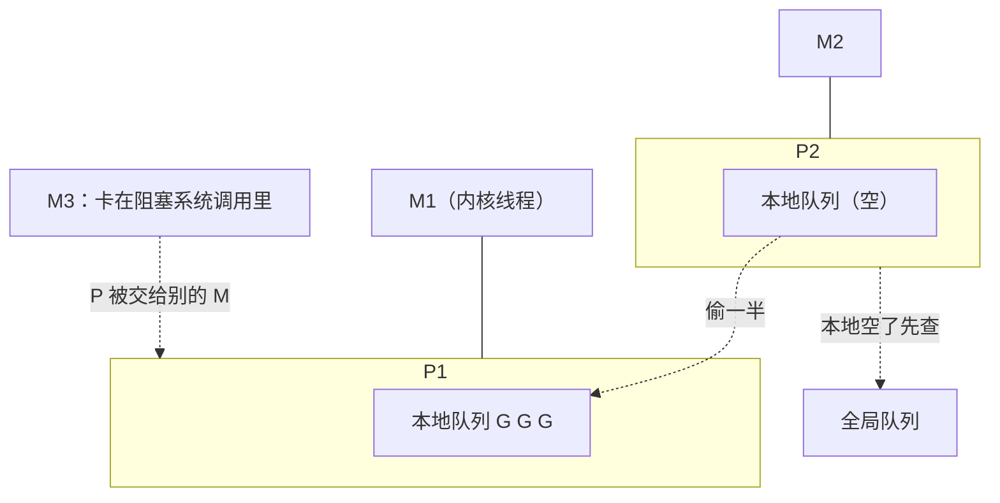

# GMP 调度模型

> 频率：★★☆ · 近两年出现在：字节（GMP、Go GC）、美团（Go 的 GMP 与 defer、Go 与 Java 差异） · 参考：[Go 语言设计与实现](https://draveness.me/golang/docs/part3-runtime/ch06-concurrency/golang-goroutine/)

## 一句话答案

**G** 是 goroutine（初始栈 2 KB，可增长）；**M** 是内核线程；**P** 是逻辑处理器，持有一个本地的 G 队列和运行 G 所需的资源，数量等于 `GOMAXPROCS`（默认 CPU 核数）。M 必须绑定一个 P 才能执行 G。调度器在用户态把大量 G 分配到少量 M 上运行（M:N 模型），配合**工作窃取**、**系统调用时把 P 交出去**、**抢占**，让 CPU 一直有活干。

## 展开（1–2 分钟能讲完）

**调度流程**：

1. `go f()` 创建 G，优先放进当前 P 的**本地队列**（无锁，最多 256 个），满了就把一半移到**全局队列**。
2. M 绑定 P 后循环：从 P 的本地队列取 G 执行；本地没有就去全局队列取；还没有就从**其他 P 偷一半**（work stealing）；也会检查网络轮询器（netpoller）有没有就绪的 G。为了公平，每调度 61 次会先查一次全局队列。
3. G 阻塞时的处理：
   - **channel、锁、网络 IO**：G 被挂起（gopark），M 继续执行别的 G。网络 IO 由 netpoller（底层 epoll）负责，就绪后把 G 放回队列。
   - **阻塞的系统调用**（比如读文件）：M 和 G 一起卡在内核里，P 会被**交给另一个 M**（空闲的或新建的）继续运行其他 G；系统调用返回后，原来的 M 尝试拿回一个 P，拿不到就把 G 放进全局队列，自己休眠。
4. **抢占**：Go 1.14 起有**基于信号的异步抢占**：sysmon 后台线程发现某个 G 运行超过 10 ms，给 M 发 `SIGURG` 信号，在信号处理中让出 CPU。之前只有在函数调用时检查的协作式抢占，死循环会卡住整个 P。

## 图解

## 追问链

- **和 Java 线程模型的区别？** Java 平台线程是 1:1 模型：每个线程对应一个内核线程，栈默认 1 MB，创建和切换都要进内核，几千个就到头了。Go 是 M:N：goroutine 由运行时在用户态调度，栈从 2 KB 开始按需增长（连续栈，不够时复制到 2 倍大的新栈），切换只保存几个寄存器，可以轻松开几十万个。Java 21 的虚拟线程也是 M:N，思路接近（见[进程、线程、协程](../10-os/process-thread)）。
- **协程泄漏怎么排查？** 现象：goroutine 数量持续增长，内存跟着涨。用 `runtime.NumGoroutine()` 打到监控里看趋势；用 `net/http/pprof` 的 `/debug/pprof/goroutine?debug=1`（或 `go tool pprof`）看所有 goroutine 的堆栈，按堆栈聚合，数量最多的那一类通常就是泄漏的，看它们阻塞在哪一行（`chan send`、`chan receive`、`select`、`IO wait`）。常见原因：channel 没人读或没人写；没有超时的网络请求；`context` 没有传递或没有被取消；`time.Ticker` 没有 `Stop`。测试里可以用 `go.uber.org/goleak` 检测。
- **GOMAXPROCS？** 决定 P 的数量，也就是同时**并行**执行 Go 代码的线程数上限（阻塞在系统调用里的 M 不算）。默认等于 CPU 核数。**容器里的坑**：Go 1.25 之前它读的是宿主机的核数，而不是容器的 CPU 配额，比如在限额 2 核的容器里跑在 64 核的机器上，会开 64 个 P，导致频繁的 CPU 节流（throttling）和延迟抖动，通常用 `uber-go/automaxprocs` 修正；Go 1.25 起运行时会自动读取 cgroup 的 CPU 限制。
- **M 的数量有上限吗？** 默认最多 10000 个（`debug.SetMaxThreads`），超过会崩溃。大量阻塞的系统调用会导致 M 不断增加。

## 我的项目里

TODO：Go 项目里同时有多少 goroutine？有没有用 pprof 看过 goroutine 或 CPU 的分布？
