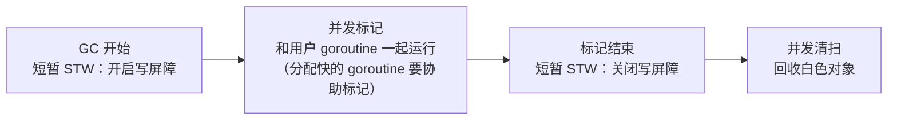

# Go 与 Java 的区别、Go 的 GC

> 频率：★★☆ · 近两年出现在：字节（GMP、Go GC）、腾讯（Go map 并发安全、Channel 的无锁思想、Go 与 Java）、美团（Go 的 GMP 与 defer、Go 与 Java 差异） · 参考：[Go 语言设计与实现](https://draveness.me/golang/docs/part3-runtime/ch07-memory/golang-garbage-collector/)

## 一句话答案

Go 编译成**单个静态二进制**，启动快、内存占用小、部署简单；语言简单（没有继承，用组合和隐式实现的接口），并发是语言内置的（goroutine + channel）；错误处理靠返回值 `error`。Java 生态更成熟（Spring、各种中间件），JIT 优化后长期运行的峰值性能好，适合复杂业务。Go 的 GC 是**并发的三色标记-清除**，没有分代、不整理，目标是**低延迟**（STW 一般在亚毫秒级），代价是吞吐量和内存。

## 展开（1–2 分钟能讲完）

| | Go | Java |
|---|---|---|
| 编译与运行 | AOT 编译为本地二进制，无虚拟机 | 字节码 + JVM（JIT），也可以 GraalVM 原生镜像 |
| 启动 / 内存 | 毫秒级启动，几十 MB | 秒级启动，堆 + 元空间通常几百 MB 起 |
| 面向对象 | 结构体 + 方法，组合，接口**隐式实现**（鸭子类型） | 类、继承、接口显式实现 |
| 并发 | goroutine + channel，语言内置 | 线程池、JUC；JDK 21 有虚拟线程 |
| 错误处理 | 多返回值 `(result, error)`，`panic/recover` 只用于真正的异常 | 异常机制 |
| 泛型 | 1.18 起支持 | 有（类型擦除） |
| GC | 并发标记-清除，低延迟，可调参数少（`GOGC`、`GOMEMLIMIT`） | 多种收集器可选，参数多 |
| 生态 | 云原生（Docker、K8s、etcd 都是 Go 写的）、网关、中间件 | 企业应用、大数据、中间件 |

**Go 的 GC**：

- **三色标记 + 混合写屏障**（1.8 起，结合了插入和删除写屏障）：标记和用户程序并发执行，只在开始和结束时有很短的 STW，而且不需要在标记结束时重新扫描栈。
- **不分代、不移动对象**：Go 有逃逸分析，很多短命对象直接分配在栈上，分代的收益没有 Java 大；不移动对象使得和 C 互操作更简单。内存分配器（类似 TCMalloc，按大小分级）减少了碎片问题。
- **触发**：堆大小达到上次 GC 后存活堆的 `(1 + GOGC/100)` 倍（默认 GOGC=100，即翻倍时触发）；1.19 起可以用 `GOMEMLIMIT` 设一个软内存上限，接近时更积极地 GC，容器里很有用；以及每 2 分钟强制一次。

## 图解

## 追问链

- **defer 的执行顺序？** 同一个函数里多个 defer 按**后进先出**执行（像栈）。几个要点：defer 的**参数在 defer 语句执行时就求值**了（`defer fmt.Println(i)` 打印的是当时的 i）；defer 在 `return` 赋值返回值**之后**、函数真正返回**之前**执行，所以对**具名返回值**的修改会生效，对匿名返回值不会；`recover` 只有在 defer 函数里直接调用才有效；循环里 defer 会等到函数结束才执行，容易导致文件句柄等资源迟迟不释放，应该把循环体抽成函数。1.14 起大部分 defer 是「开放编码」的，开销接近直接调用。
- **为什么字节用 Go 比较多？** 业务以大量微服务、高并发的 API 和中间件为主，Go 的特点很契合：goroutine 写高并发代码简单、单机能扛很高的并发；启动快、内存占用小，容器化部署和扩缩容成本低；编译快、单二进制部署简单；语言简单，新人上手快、代码风格统一。字节在 Go 上有大量自研基础设施（Kitex RPC 框架、Hertz HTTP 框架、CloudWeGo 开源）。同时字节的电商、广告等部分业务也用 Java。
- **Go 的接口和 Java 的接口有什么不同？** Go 的接口是隐式实现的：只要类型实现了接口的所有方法，就自动满足这个接口，不用写 `implements`。好处是解耦：可以在使用方定义一个小接口，让已有的类型去满足它。接口值内部是 `(类型, 数据指针)` 两个字，**持有 nil 指针的接口不等于 nil**，是常见的坑。
- **Go 没有异常，怎么处理错误？** 函数返回 `error`，调用方 `if err != nil` 显式处理；用 `fmt.Errorf("...: %w", err)` 包装并保留原错误，用 `errors.Is` / `errors.As` 判断。`panic` 只用于不可恢复的程序错误，服务框架一般在每个请求的入口 `recover`，防止一个请求的 panic 让整个进程崩溃。

## 我的项目里

TODO：你的 Go 项目为什么选 Go 而不是 Java / Python？用 Go 写的时候最不习惯的是什么？
