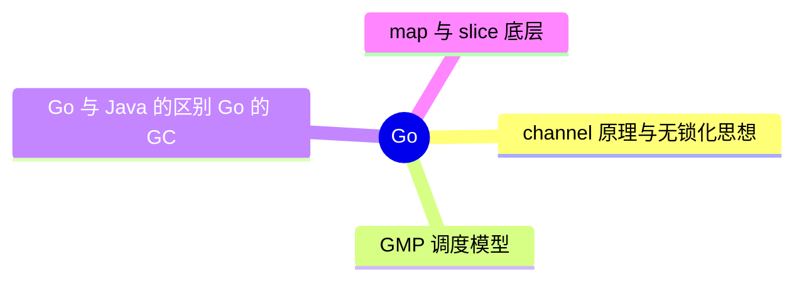

# Go

> 进度：4 / 4 条已写完。本页由 `tools/gen_index.py` 生成，改条目后重新运行即可。

## 知识地图

## 条目（按频率排序）

频率按 2025–2026 年后端面经里出现的次数估计：★★★ 几乎每场都可能问，★★ 经常问，★ 偶尔问。

| 知识点 | 频率 | 状态 | 一句话答案 |
|---|---|---|---|
| [channel 原理与无锁化思想](./channel) | ★★☆ | ✅ | channel 底层是 hchan：环形缓冲区 + 发送和接收两个等待队列 + 一把互斥锁。「不要通过共享内存来通信，而要通过通信来共享内存」。 |
| [GMP 调度模型](./gmp) | ★★☆ | ✅ | G 是协程，M 是系统线程，P 是处理器（持有本地 G 队列），M 必须绑定 P 才能运行 G。P 的本地队列空了会从全局队列取或从其他 P 偷取（work stealing）；G 阻塞在系统调用时 M 和 P 解绑。 |
| [Go 与 Java 的区别、Go 的 GC](./go-vs-java) | ★★☆ | ✅ | Go 编译成单个二进制、协程轻量、语法简单、错误显式返回；Java 生态更成熟、JIT 优化好。Go 的 GC 是并发三色标记 + 写屏障，追求低停顿，不分代。 |
| [map 与 slice 底层](./map-slice) | ★★☆ | ✅ | slice 是指向数组的指针 + 长度 + 容量，扩容可能换底层数组；map 是哈希表（Go 1.24 起改为 Swiss Table），不是并发安全的，并发读写会直接 panic，要用 sync.Map 或加锁。 |
