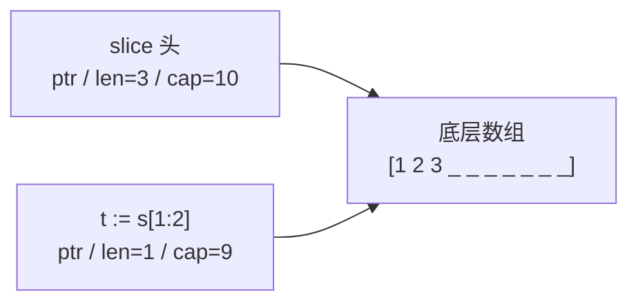

# map 与 slice 底层

> 频率：★★☆ · 近两年出现在：腾讯（HashMap 红黑树、ConcurrentHashMap、带锁 Map 的 read/dirty 设计；Go map 并发安全、Channel 的无锁思想、Go 与 Java） · 参考：[Go 语言设计与实现](https://draveness.me/golang/docs/part2-foundation/ch03-datastructure/golang-array-and-slice/)

## 一句话答案

**slice** 是一个三元组：指向底层数组的指针、长度 `len`、容量 `cap`；`append` 时容量不够就分配一个更大的新数组并复制（小于 256 时翻倍，之后逐渐过渡到约 1.25 倍）。**map** 是哈希表：Go 1.24 之前是**桶数组**，每个桶 8 个键值对 + 溢出桶，负载因子超过 6.5 时**渐进式扩容**；Go 1.24 起改成了基于 **Swiss Table** 的实现。map **不是并发安全**的，并发读写会直接 fatal（无法 recover），要用 `sync.RWMutex` 或 `sync.Map`。

## 展开（1–2 分钟能讲完）

**slice**：

```go
s := make([]int, 3, 10)   // len 3，cap 10
t := s[1:2]               // 和 s 共享底层数组，len 1，cap 9
t = append(t, 99)         // cap 够，直接写进底层数组：s[2] 也变成了 99！
```

截取出来的 slice 和原 slice **共享底层数组**，`append` 在容量够的时候会改写原 slice 后面的元素。想要独立的副本用 `copy` 或者三下标截取 `s[1:2:2]`（把 cap 限制住，append 时必然重新分配）。

**map（1.24 之前的经典实现，面试常问）**：

- `hmap` 有 `2^B` 个桶，每个桶（`bmap`）存 8 个 key、8 个 value，以及 8 个 **tophash**（哈希值的高 8 位，用来快速比较）。
- 查找：哈希值的低 B 位选桶，高 8 位在桶里逐个比较 tophash，匹配了再比较完整的 key；桶满了沿着溢出桶链继续找。
- 扩容：负载因子（元素数 / 桶数）> 6.5 时**翻倍扩容**；溢出桶太多（大量删除后）时**等量扩容**（重新整理，消除溢出桶）。扩容是**渐进的**：每次写操作顺便迁移一两个旧桶，避免一次性迁移造成停顿。
- 遍历顺序是**随机的**（故意的，防止依赖顺序）。

**Swiss Table（1.24 起）**：把元素分组，每组 8 个槽配一个控制字（每个槽 1 字节的哈希片段），可以用 SIMD 一次比较整组，开放寻址、缓存友好，查找和插入更快、内存更省。扩容按表（table）分开进行，单个表的容量有上限，避免一次大的复制。

## 图解



## 追问链

- **slice 作为参数传递的坑？** Go 只有值传递，传 slice 传的是**三元组的拷贝**，但指针指向同一个底层数组。所以：函数里**修改元素**，调用方能看到；函数里 `append`，如果没有触发扩容，底层数组被写了但**调用方的 len 没变**，看不到新元素；如果触发了扩容，函数里的 slice 指向了新数组，之后的修改调用方完全看不到。所以需要在函数里 append 的，要**返回新的 slice**（像 `append` 本身一样 `s = f(s)`），或者传 `*[]T`。另外，从一个大 slice 截取一小段长期持有，会导致整个大数组无法被 GC（内存泄漏），应该 `copy` 出来。
- **sync.Map 的读写分离设计（read / dirty）？** `sync.Map` 有两个 map：`read`（原子加载的只读 map，读它**不用加锁**）和 `dirty`（加锁访问，包含所有最新的数据）。读：先查 read，命中直接返回；没命中再加锁查 dirty，同时 `misses` 计数 +1；misses 达到 dirty 的长度时，把 dirty **提升**为新的 read，dirty 置空。写：key 已经在 read 里就直接 CAS 更新它的值（entry 是指针，不用锁）；否则加锁写进 dirty。删除是标记删除。所以它适合**读多写少**、或者**不同 goroutine 操作不相交的 key 集合**的场景（比如只增不改的缓存）；写多的场景性能不如 `map + RWMutex`，也不如分片的并发 map。Go 1.24 起 `sync.Map` 底层改成了并发哈希前缀树（HashTrieMap），但对外的行为一样。和 Java 的 `ConcurrentHashMap` 对比：后者是针对通用场景的分段锁 / CAS 设计（见[ConcurrentHashMap](../02-collection/concurrenthashmap)）。
- **为什么 map 的并发读写会直接崩溃？** 运行时在写的时候设置一个 `hashWriting` 标志，读或写时发现标志被设置了就抛出 `fatal error: concurrent map read and map write`。这是故意的「快速失败」，而且是 fatal 不能 recover，逼你修代码。用 `go test -race` 能检测出数据竞争。
- **map 的 key 有什么要求？** 必须是**可比较**的类型（能用 `==`）：slice、map、函数不能做 key；结构体所有字段可比较才能做 key。浮点数 NaN 做 key 会每次都插入新元素（NaN != NaN）。

## 我的项目里

TODO：Go 项目里有没有在多个 goroutine 之间共享 map？是怎么保护的？
