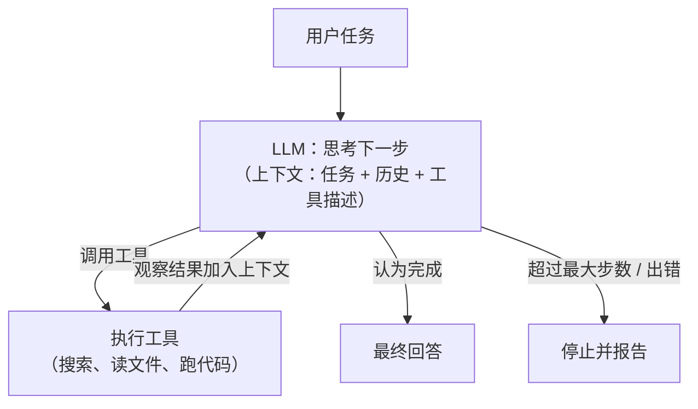

# Agent 架构：ReAct、Plan-Execute、Agent 与 Workflow

> 频率：★★★ · 近两年出现在：字节（Agent 与 Workflow、Plan-Execute-Replan、ReAct 伪代码）、阿里（Agent 执行循环、ReAct 与 Plan、重新规划、中断恢复、多 Agent 冲突）、腾讯（Agent Loop、Agent 评测、行为漂移）、美团（ReAct 与 Plan-Execute、多 Agent 拆分与超时重试降级、断点续跑） · 参考：[Anthropic：Building effective agents](https://www.anthropic.com/engineering/building-effective-agents)

## 一句话答案

**Workflow** 是由代码预先定好执行路径、在其中调用 LLM 的流程（链式、路由、并行、编排者-执行者、评估-优化）；**Agent** 是由 LLM **自己决定**下一步做什么、调用什么工具，循环直到完成任务。**ReAct**：思考（Thought）→ 行动（调用工具）→ 观察（工具结果）循环，边想边做。**Plan-Execute**：先让模型生成完整计划，再逐步执行，必要时重新规划（Replan）。原则是**能用 Workflow 解决就不用 Agent**，Agent 灵活但成本高、可控性差。

## 展开（1–2 分钟能讲完）

**怎么选**：

| | Workflow | Agent |
|---|---|---|
| 执行路径 | 代码写死，可预测 | 模型动态决定 |
| 适合 | 步骤明确的任务：文档抽取、分类后分别处理、固定的审批流程 | 步骤数和路径无法预知：编程、调研、排查问题 |
| 成本 / 延迟 | 低、可控 | 高，调用次数不确定 |
| 调试 | 容易 | 难，需要完整的轨迹记录 |

**ReAct vs Plan-Execute**：

- **ReAct**：每一步都根据最新的观察决定下一步，适应性强；但缺乏全局规划，长任务容易绕圈、遗忘目标，每一步都要带上完整上下文，token 多。
- **Plan-Execute**：规划器生成步骤列表，执行器（可以用更小的模型）逐步执行，每步完成后检查是否需要**重新规划**。结构清晰、可以并行执行无依赖的步骤、便于展示进度和人工审核；但计划一开始就错了或者环境变化大时，需要依赖 Replan。
- 实践中常常混合：先粗略规划（todo 列表），每一步内部用 ReAct。

**一个 Agent 的组成**：模型、工具（及其描述）、上下文管理（系统提示、记忆、检索）、执行循环（最大步数、超时、错误处理）、护栏（权限、审批、输出校验）、可观测性（每一步的轨迹、token、耗时）。

## 图解



## 追问链

- **手写 ReAct 伪代码？**

  ```python
  def run_agent(task, tools, max_steps=20):
      messages = [system_prompt(tools), {"role": "user", "content": task}]
      for step in range(max_steps):
          resp = llm.chat(messages, tools=tool_schemas(tools))
          messages.append(resp.message)
          if not resp.tool_calls:                  # 没有工具调用，认为完成
              return resp.text
          for call in resp.tool_calls:
              try:
                  result = tools[call.name](**call.args)   # 参数先做校验
              except Exception as e:
                  result = f"工具出错：{e}"               # 错误也返回给模型，让它调整
              messages.append({"role": "tool", "tool_call_id": call.id,
                               "content": truncate(result)})
          save_checkpoint(task_id, step, messages)     # 用于断点续跑
      return "达到最大步数，未完成"
  ```

  要点：最大步数和总超时；工具错误回传给模型而不是直接崩溃；工具结果过长要截断或摘要；每一步落盘。
- **多 Agent 怎么协作和拆分？** 常见模式：**编排者-执行者**（一个主 Agent 拆分任务，派给多个子 Agent 并行执行，再汇总），子 Agent 各自有独立的上下文，只把**精简后的结果**返回给主 Agent，避免主 Agent 的上下文被细节塞满；**流水线**（每个 Agent 负责一个阶段）；**评审**（一个生成、一个检查）。拆分的依据：任务能否**并行**、子任务是否需要**不同的工具或权限**、上下文是否会过长。多 Agent 的代价：token 成本成倍增加、协调和信息丢失的问题、冲突（两个 Agent 改同一个文件）需要通过任务划分或锁避免。不要为了「多 Agent」而多 Agent，单 Agent 能做好就用单 Agent。
- **Agent 中断后怎么恢复（断点续跑）？** 把执行状态**持久化**：任务 id、当前步骤、消息历史（或摘要）、已完成的工具调用及其结果、计划和进度。每一步执行后保存检查点。恢复时加载最近的检查点继续。关键问题是**有副作用的工具调用**：如果在「调用了支付接口但还没保存结果」时崩溃，恢复时不能简单重放，所以工具调用要带**幂等 key**，或者先记录「准备执行」再执行、执行后记录结果（类似 WAL）。LangGraph 的 checkpointer、Temporal 这类持久化工作流引擎都提供这种能力。
- **LangChain 和 LangGraph 的区别？** LangChain 提供各种组件（模型封装、提示模板、检索器、工具）和链式组合，适合线性的流程；LangGraph 用**有状态的图**（节点是步骤，边可以有条件、可以有环）编排 Agent，原生支持循环、分支、并行、**状态持久化和断点续跑**、人工介入（在某个节点暂停等待审批），更适合复杂和长时间运行的 Agent。很多团队也会不用框架，直接基于模型的工具调用 API 写循环，更透明可控。

## 我的项目里

TODO：你的 Agent 项目是 Workflow 还是 Agent？用了 ReAct 还是 Plan-Execute？最大步数、超时、出错时怎么处理的？
