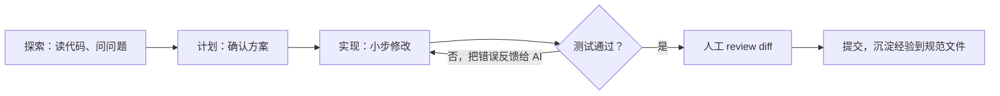

# AI 编程工具的使用经验

> 频率：★★☆ · 近两年出现在：字节（AI Coding 实践）、腾讯（AI 代码的验收与合入）、美团（AI Coding SOP、和 AI 的协作方式） · 参考：[Anthropic：Claude Code best practices](https://www.anthropic.com/engineering/claude-code-best-practices)

## 一句话答案

把 AI 当成一个**能力很强但不了解项目背景的新同事**：给它清晰的目标、上下文和约束（项目规范文件、相关代码、验收标准），让它**先探索和制定计划、再写代码**，用**测试和 review** 验证，而不是盲目接受生成的代码。我自己负责需求拆解、架构决策和最终把关，AI 负责加速实现、写测试、读陌生代码、排查问题。

## 展开（1–2 分钟能讲完）

**我常用的工作流**（面试时换成自己的真实经历）：

1. **探索**：让 AI 先读相关代码，解释现有的实现和调用关系，不急着改。
2. **计划**：让它给出修改方案（改哪些文件、为什么），我确认或调整后再动手。复杂任务拆成小步。
3. **实现 + 验证**：每一步都要有可执行的验证：先写或者让它先写**测试**，再写实现，跑测试直到通过；前端改动看截图。
4. **review**：像 review 同事的 PR 一样看 diff：逻辑是否正确、有没有多余的改动、边界条件、安全问题。
5. **沉淀**：把项目约定（构建命令、代码风格、常见坑）写进项目的说明文件（如 `CLAUDE.md`、`AGENTS.md`），下次自动带上。

**AI 适合 / 不适合的事**：

| 适合 | 要谨慎 |
|---|---|
| 样板代码、CRUD、测试用例、脚本 | 核心业务逻辑和架构决策 |
| 读陌生代码库、解释报错、写文档 | 安全相关（鉴权、加密、SQL 拼接） |
| 重构（有测试覆盖时）、迁移 | 性能敏感的代码 |
| 原型和探索 | 涉及线上数据和不可逆操作 |

## 图解

## 追问链

- **AI 生成的代码占比多少？** 如实回答，并说清楚**哪类**代码占比高（比如测试和脚本大部分由 AI 生成，核心逻辑自己写或者逐行审过），以及**效率提升体现在哪**（比如原来一天的任务半天完成，省下的时间用在设计和测试上）。不要只报一个数字，要能说明你对每一行代码负责。
- **AI 反复改错时怎么办？** 停下来，不要一直让它「再试一次」：
  - 先**自己理解问题**，判断是需求没说清楚，还是它缺少关键上下文（相关的代码、日志、文档）。
  - 提供**可复现的反馈**：完整的报错信息、失败的测试、期望和实际的输出。
  - 上下文被失败的尝试污染时，**清空会话重新开始**，带上之前学到的信息，换一个描述方式。
  - 把问题**拆小**，或者让它先加日志、写一个最小复现，而不是直接修。
  - 有时最快的办法是自己写关键的那几行。
- **怎么保证 AI 代码的质量和安全？** 和对待人写的代码一样，甚至更严格：**测试**（单测、集成测试，CI 必须通过）；**review**（所有 diff 都要人看，特别注意它有没有改测试来让测试通过、有没有吞异常、有没有引入不存在的依赖或 API）；**静态检查**（lint、类型检查、安全扫描、依赖漏洞扫描）；**权限控制**（AI 工具不能直接访问生产环境和密钥，危险命令需要确认）；对外部输入、SQL、鉴权等安全敏感的地方重点检查；不要把公司的敏感代码和数据发给未经批准的服务。
- **AI 工具会不会让你的能力退化？** 要能说清楚自己仍然理解每一处改动的原理，把 AI 当作学习的加速器：让它解释、自己验证；面试刷题和基础知识仍然自己练。

## 我的项目里

TODO：你平时用哪些 AI 编程工具？举一个具体例子：一个什么任务、怎么和 AI 协作的、遇到了什么问题、最后怎么验证的。
