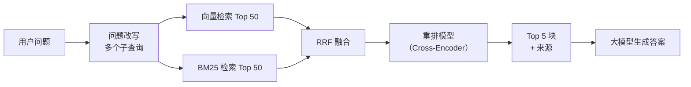

# 切块策略、混合检索与重排

> 频率：★★★ · 近两年出现在：字节（RAG 切块、多知识库融合、召回评估）、腾讯（RAG 与混合检索）、美团（RAG 召回指标、向量数据库选型、双向量召回） · 参考：[Anthropic：Contextual Retrieval](https://www.anthropic.com/engineering/contextual-retrieval)

## 一句话答案

**切块**：按语义结构切（标题、段落、代码函数），而不是按固定字符数硬切；块大小一般几百个 token，相邻块有少量重叠；每块带上来源、标题路径等元数据。**混合检索**：向量检索（语义相似，擅长同义改写）+ 关键词检索 BM25（精确匹配专有名词、编号、代码），两路结果用 **RRF** 融合。**重排**：用 Cross-Encoder 重排模型对候选（比如前 50 条）逐个精细打分，取前几条给大模型。

## 展开（1–2 分钟能讲完）

**切块策略**：

| 策略 | 说明 | 适合 |
|---|---|---|
| 固定长度 + 重叠 | 每 500 token 一块，重叠 50 | 基线，结构差的纯文本 |
| 递归分割 | 按「章节 → 段落 → 句子」的分隔符逐级切，直到小于上限 | 通用文档 |
| 按文档结构 | Markdown 标题、HTML 标签、PDF 的版面结构；表格整体保留 | 技术文档、手册 |
| 按代码结构 | 按函数、类切（用语法树） | 代码库 |
| 语义切分 | 相邻句子的向量相似度突然下降处切开 | 话题跳跃的长文 |
| 父子块 | 用小块检索（精确），返回它所在的大块（上下文完整） | 需要上下文的问答 |

**上下文增强**：单独一块可能缺少关键信息（「该公司第二季度营收增长 3%」——哪个公司？）。做法是在每块前面加上文档标题、章节路径，或者用 LLM 为每块生成一句**上下文说明**再一起做嵌入和 BM25 索引（Anthropic 的 Contextual Retrieval 报告称能明显减少检索失败，配合重排效果更好）。

**混合检索的原因**：向量检索擅长「意思相近」，但对「错误码 E1043」「函数名 `parse_v2`」「型号 RTX 4090」这类精确匹配经常失灵；BM25 正好相反。两者互补。

## 图解

## 追问链

- **chunk 太大太小分别有什么问题？** **太小**：语义不完整，丢失上下文（代词指代不明、表格被切断）；为了覆盖答案要召回更多块；块太多索引变大。**太大**：一块里混了多个主题，向量被「平均」了，和具体问题的相似度下降，检索不准；塞进提示词的无关内容多，浪费 token，还会干扰模型（长上下文中间的信息容易被忽略）。经验值是 200–800 token，要用评测集对比几种大小再定；父子块可以兼顾两者。
- **多知识库结果怎么融合（RRF）？** 不同来源（向量 / BM25、不同知识库）的分数不可比（余弦相似度和 BM25 分数的量纲完全不同）。**RRF**（倒数排名融合）只用**排名**：`score(d) = Σ 1 / (k + rank_i(d))`，k 一般取 60，对每一路结果里文档 d 的排名求和。简单、不需要调参、对分数尺度不敏感。融合后再统一用重排模型打分，重排的分数在同一尺度上，可以直接比较。也可以按知识库的权威性加权。另一种做法是先用**路由**（意图分类或 LLM 判断）决定查哪几个库，减少无关结果。
- **问题改写和多路召回？** 用户的问题往往口语化、不完整（多轮对话里的「那它的价格呢」）。改写手段：**指代消解**（结合对话历史改写成独立的问题）；**查询扩展**（生成同义的多个问法，分别检索再合并）；**问题分解**（复杂问题拆成多个子问题分别检索）；**HyDE**（让 LLM 先写一个假想的答案，用这个答案去检索，因为答案和文档的表述更接近）。多路召回：向量、BM25、元数据过滤、知识图谱等多个通道各自召回，再融合重排。代价是延迟和成本，要权衡。
- **向量模型怎么选？** 看中文和领域的效果（用自己的评测集，MTEB 排行榜只作参考）、向量维度（影响存储和速度）、最大输入长度、是否支持多语言、是否需要私有部署（BGE、GTE 等开源模型）。换嵌入模型要重建整个索引。

## 我的项目里

TODO：你的 RAG 项目是怎么切块的？块多大？有没有用混合检索和重排？效果是怎么评估的（见 [RAG](./rag)）？
