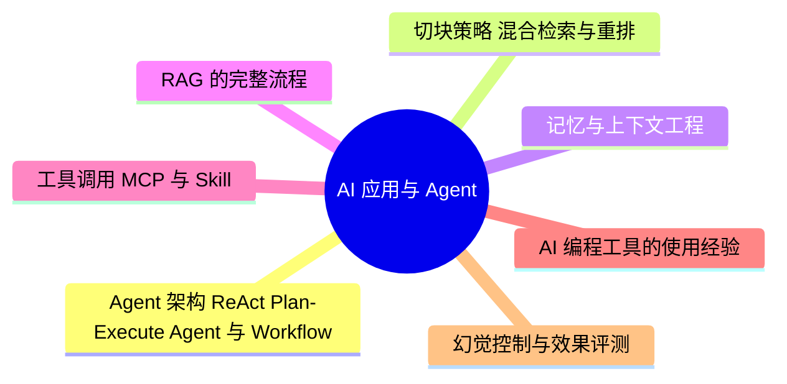

# AI 应用与 Agent

> 进度：7 / 7 条已写完。本页由 `tools/gen_index.py` 生成，改条目后重新运行即可。

## 知识地图

## 条目（按频率排序）

频率按 2025–2026 年后端面经里出现的次数估计：★★★ 几乎每场都可能问，★★ 经常问，★ 偶尔问。

| 知识点 | 频率 | 状态 | 一句话答案 |
|---|---|---|---|
| [Agent 架构：ReAct、Plan-Execute、Agent 与 Workflow](./agent-architecture) | ★★★ | ✅ | ReAct 是「思考 → 调用工具 → 观察结果」的循环；Plan-Execute 先整体规划再逐步执行，可以重新规划。流程固定、要求可控时用 Workflow，步骤不确定时才用 Agent。 |
| [切块策略、混合检索与重排](./chunking-retrieval) | ★★★ | ✅ | 切块要按语义边界（标题、段落），块之间留重叠，大小按嵌入模型和问题粒度调；混合检索结合向量的语义匹配和 BM25 的关键词精确匹配；重排用交叉编码器给候选重新打分。 |
| [记忆与上下文工程](./memory-context) | ★★★ | ✅ | 短期记忆是当前对话窗口，长期记忆存到外部（向量库、数据库）再按需检索。上下文快满时做压缩：摘要旧对话、裁剪长工具输出、只保留关键信息。 |
| [RAG 的完整流程](./rag) | ★★★ | ✅ | 离线：文档解析 → 切块（chunk）→ 向量化 → 存入向量库；在线：问题改写 → 检索（向量 + 关键词混合）→ 重排（rerank）→ 拼进提示词 → 生成，并要求带引用。 |
| [工具调用、MCP 与 Skill](./tool-calling) | ★★★ | ✅ | Function Calling 是模型输出结构化的调用请求，由程序执行再把结果返回模型；MCP 是统一工具和数据接入的开放协议（客户端-服务器）；Skill 是按需加载的说明和脚本，平时只放简短描述，节省上下文。 |
| [AI 编程工具的使用经验](./ai-coding) | ★★☆ | ✅ | 说清楚三件事：怎么给 AI 足够的上下文（需求、约束、现有代码）、怎么拆小任务、怎么验收（读代码、跑测试、code review），以及什么时候必须人工介入。 |
| [幻觉控制与效果评测](./hallucination-eval) | ★★☆ | ✅ | 减少幻觉：RAG 提供依据、要求引用来源、约束输出格式、低温度、加校验步骤。评测：准备标注测试集，看准确率、召回、任务完成率，用 LLM 当评委时要抽样人工复核，每次改动做回归测试。 |
